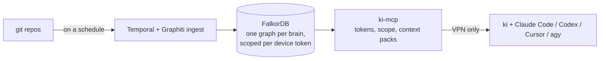

# kio

kio (*künstliche Intelligenz Orchestrator*, German for AI orchestrator) starts the coding-agent CLIs you already pay for (Claude Code, Codex, Cursor and agy) in the right repository, as the right GitHub identity, with the same instructions whatever the vendor. The command is `ki`. With an optional knowledge base, each session also gets a context pack scoped to its repo. `ki` can hand a task to any of these agents headless, each job in its own git worktree, and when one vendor runs out of quota it continues on the next.


**Status:** pre-1.0. Built for macOS and Linux. Without a knowledge base, `ki` still starts sessions and runs delegated jobs with identity and instructions only.

## Install

Paste this into your agent. It interviews you, then installs and checks `ki`:

```text
Read https://github.com/kislow/kio/blob/main/INSTALL.md and set up kio for me
```

With Homebrew (macOS and Linux), which builds `ki` from the release's source and needs no other setup:

```bash
brew install kislow/tap/kio
```

From a release archive (macOS or Linux, arm64 or amd64) with the `ki` and `ki-mcp` binaries:

```bash
gh release download --repo kislow/kio --pattern "kio_*_$(uname -s | tr A-Z a-z)_$(uname -m | sed 's/x86_64/amd64/;s/aarch64/arm64/').tar.gz"
mkdir -p ~/.local/bin && tar xzf kio_*.tar.gz -C ~/.local/bin ki ki-mcp
```

Or from source, with Go installed (the binary goes to `$(go env GOPATH)/bin`):

```bash
go install github.com/kislow/kio/cmd/ki@latest
```

The skills and the agent instructions are inside the binary. Link the skills for Claude Code and the other agents:

```bash
ki setup skills
```

Contributors clone the repository and run `make laptop` instead. It builds `ki` into `~/.local/bin`, links the skills, turns off Claude Code's commit and PR attribution, and runs `ki doctor`. Details: [laptop setup](docs/laptop-setup.md).

## Quickstart

This runs without a knowledge base.

1. Create your configuration directory from the minimal example. It is a private directory, typically its own git repository.

   ```bash
   mkdir -p ~/code/my-config
   cd ~/code/my-config
   for f in projects.yaml config.yaml models.env aliases.yaml mcp-config.json; do
     curl -fsSLO "https://raw.githubusercontent.com/kislow/kio/main/examples/config-minimal/$f"
   done
   ```

   In `~/code/my-config/projects.yaml`, replace `your-github-user` (twice) with your GitHub user, `you@example.com` with your commit email, and keep the repo URL pointing at a repo you own.

2. Validate it, link it, and record which identities this machine carries:

   ```bash
   ki validate ~/code/my-config/projects.yaml
   ki setup config ~/code/my-config
   ki setup machine me
   ```

3. Check a repo that is listed in `projects.yaml`. Its `origin` must match the repo URL, and its git email must match the identity's:

   ```bash
   cd ~/code/notes
   ki status
   ki doctor
   ```

   `ki status` shows the repo, its project, its identity and brains, and `git email: ... OK`. `ki doctor` lists what is still missing on the machine, such as `gh`, an agent CLI or the global git ignore entries. It says `all good` once everything is in place.

4. Start a session in that repo with `ki`. A bare `ki` starts the first available agent of the machine's planner role, or Claude Code. This needs an agent CLI that is installed and logged in.

5. Try a delegated job in a scratch repo that you own, with a GitHub `origin`:

   ```bash
   mkdir -p ~/code/scratch && cd ~/code/scratch
   git init -b main && git remote add origin https://github.com/alice/scratch.git
   git commit --allow-empty -m "docs: start scratch"
   ki delegate --task "Create HELLO.md with one line of text"
   ```

   `ki` must know the repo: add it to `projects.yaml` with the same identity, or pass `--force` for an unmapped repo. The worker runs in a worktree next to the repo (`~/code/scratch-worktrees/`), and its last line is the status: `PR: <url>`, `DONE: <summary>`, `BLOCKED: <question>` or `FAILED: <reason>`. Add `--json` for one JSON result instead. Without `--agent`, the machine's execution role picks the agent when `machine.yaml` defines one; otherwise `KI_AGENT`, else Claude Code.

## Commands

| Command | What it does |
| --- | --- |
| `ki`, `ki <agent>` | Start an agent session in the current repo, with its identity, brains and instructions. `ki claude`, `ki codex`, `ki cursor-agent` (or `ki agent`, Cursor's binary name) and `ki agy` name the agent; any other first word is refused, so agent arguments go after `--`. Outside a repo, `ki` works in a folder of one identity's repos. `--identity`, `--brain`, `--model` and `--mode ask\|auto\|edits\|skip` adjust a session |
| `ki delegate` | Run one task headless on any agent, in its own worktree; the status line says `PR`, `DONE`, `BLOCKED` or `FAILED`. `--issue N` claims a GitHub issue first. `--when-available` queues a job while every provider is out, and `ki delegate resume <job>` continues a quota-stopped job elsewhere ([docs](docs/ki-delegate.md)) |
| `ki mecca` | A tmux hub with one window per session. `ki mecca new <job-id>` reopens a `BLOCKED` job with its session resumed ([docs](docs/ki-mecca.md)) |
| `ki ask "<question>"` | One read-only answer from the knowledge base, the vault and GitHub, with a source for every fact ([docs](docs/ki-ask.md)) |
| `ki skill run <skill>` | One skill, headless, allowed only the tools it declares ([docs](docs/ki-skill.md)) |
| `ki approve <pr>` | Approve a pull request as the repo's identity, optionally after a read-only review ([docs](docs/ki-approve.md)) |
| `ki recap` | One identity's GitHub activity since the previous working day; what `/ki-recap` drafts from |
| `ki kb ...` | Read-only views of the knowledge base as JSON for UIs: brains, search, recent documents, context ([docs](docs/ki-kb.md)) |
| `ki mcp ls` | Every MCP server each agent on the machine can reach, with its status. Never prints a token ([docs](docs/ki-mcp-ls.md)) |
| `ki status`, `ki doctor` | What `ki` resolves here, and a health check of the machine |
| `ki validate [file]` | Validate a `projects.yaml` |
| `ki setup config <dir>`, `ki setup machine <identity>...` | Link your configuration directory; record this machine's identities |
| `ki setup claude`, `ki setup codex`, `ki cursor` | Turn off Claude Code's attribution; add the knowledge base to Codex; write Cursor's MCP config and rule for this repo |
| `ki vault push`, `ki vault mcp` | Optional notes vault: commit and push it, or serve it to an agent over stdio ([docs](docs/vault.md)) |
| `ki diagram build\|check\|render` | Optional tldraw drawings for the vault, rendered to PDF or SVG ([docs](docs/diagrams.md)) |
| `ki queue run\|install\|uninstall\|status` | Start queued delegated jobs once a provider is back |
| `ki update`, `ki version` | Pull a linked configuration and, in a checkout, the checkout too; relink the skills (a checkout also reinstalls `ki` and runs `ki doctor`); without a checkout it says how to upgrade the binary; `ki version` prints the version |

The skills, for every supported agent: `/ki-issue`, `/ki-resolve`, `/ki-burndown`, `/ki-review`, `/ki-debug`, `/ki-decision`, `/ki-recap`, `/ki-diagram`, `/ki-rebase` and `/ki-address` ([skills](docs/skills.md)). The full list, with flags, is in [laptop setup](docs/laptop-setup.md#daily-use).

## What ki is not

ki does not run an agent loop or call model APIs itself. It works one level above the agents:

| | Level | What it does | Billing |
| --- | --- | --- | --- |
| ki | Above the agents | Starts each vendor's own CLI with identity, context and instructions; delegates headless jobs; tracks quota per vendor and fails over | Each vendor's subscription |
| OpenCode and similar | Agent | One agent loop that can drive many models | Per token, through your API keys |
| OpenRouter and similar | Model API | One API for many model providers, with routing and fallback | Per token |

They compose: a pay-per-token agent can be one more provider ki starts when every subscription is spent.

## How the parts fit together

There are three layers, each owned by someone different:

- **This repository:** the `ki` and `ki-mcp` code, generic agent instructions, skills and coding standards. Nothing in it is specific to one person.
- **Your configuration directory:** projects, identities, brains and your own agent instructions. Keep it in its own git repository and share it across your machines.
- **The machine file** (`~/.config/ki/machine.yaml`): which identities and vendors this machine carries, in what order, with what budgets. Each machine has its own.

Credentials are created on each machine and never copied between machines.

## Optional knowledge base

A knowledge base gives sessions and `ki ask` a shared, scoped view of your repos' conventions, decisions and current state. It is optional, and nothing above needs it.

- Run one on a single machine with Docker Compose, without a cluster: [local stack](docs/local-stack.md).
- Run it on a Kubernetes cluster for a team: [self-hosting](docs/self-hosting.md).
- Name it in your configuration's `config.yaml` (`knowledge_base.url`) or export `KI_MCP_URL`.



A notes vault kept in git and tldraw drawings built from specs are optional too: see [vault and diagrams](docs/vault.md).

## Requirements and platforms

- **Platforms:** macOS and Linux, on arm64 and amd64. Release archives are built for these four.
- **Go:** 1.27.3 or later, the version in `go.mod`, to build from source.
- **Tools:** `git`, the GitHub CLI `gh` (one login per GitHub identity), and `tmux` for `ki mecca`. Node 22 or later is needed only for `ki diagram`.
- **Agent CLIs:** Claude Code, Codex, Cursor (`cursor-agent`) and agy. Install at least one; each is optional.

## Status and stability

kio is pre-1.0, so commands, flags and configuration can change between releases. The four packages under `pkg/` (`projects`, `scope`, `config` and `sessions`) are the public Go surface: pin a release tag and read the changelog before you move it ([Go packages](docs/go-packages.md)). Everything else, including the CLI's text output and the `internal/` packages, may change.

## Security

- Device tokens decide which brains a machine can read. Sensitive brains are never in a default scope.
- On a cluster, the knowledge base answers only over a VPN and sits behind a default-deny network policy.
- Document text never enters workflow inputs or results; workflows pass project names and counts.
- Secrets come from a secrets manager, never from a repository or a configuration directory.
- Every control fails closed: a wrong scope refuses instead of leaking.

Details: [security and brain separation](docs/security.md). Report a vulnerability privately, as described in [SECURITY.md](SECURITY.md).

## History

kio began as a private repository. Its public history starts at the first public release.

## More

- [Documentation](docs/README.md): architecture, setup, every command, operations
- [Contributing](CONTRIBUTING.md) and the [code of conduct](CODE_OF_CONDUCT.md)
- [Security policy](SECURITY.md)
- [Licence](LICENSE): Apache-2.0
