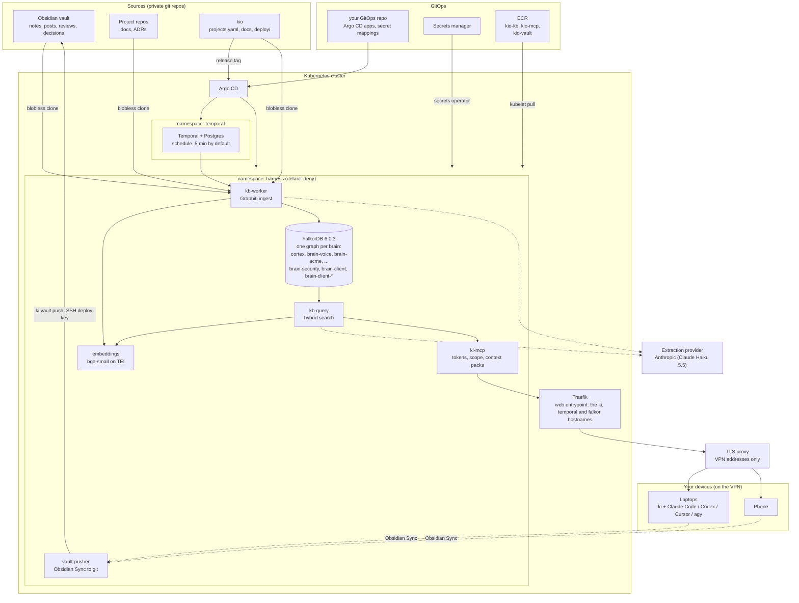
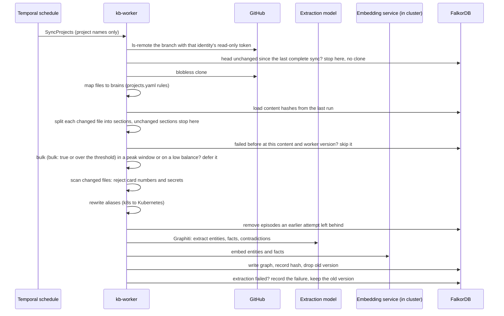
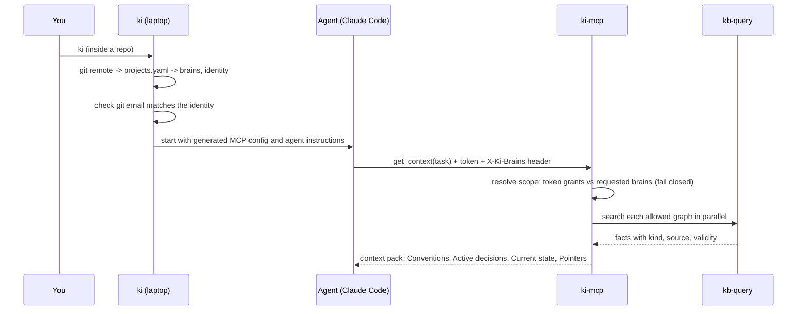
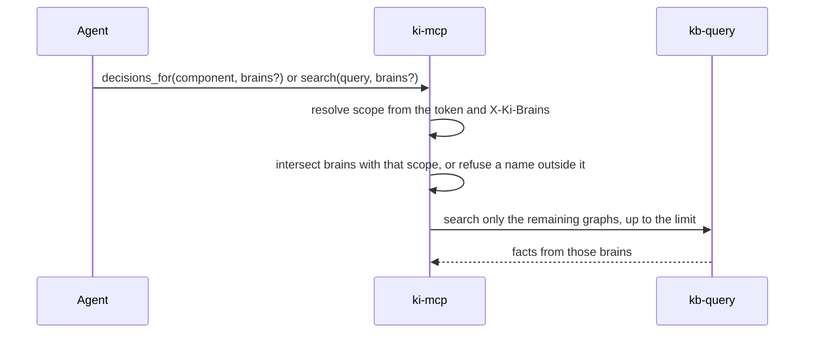
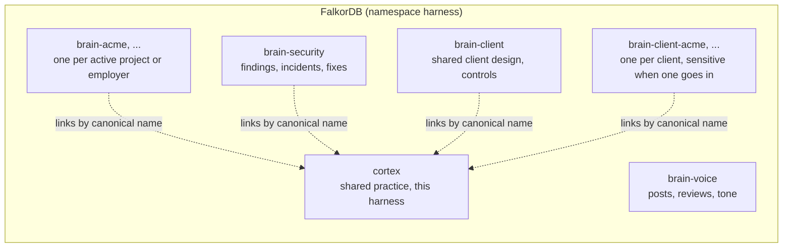

# Architecture

kio gives every agent session the right context in one call: conventions, active decisions and current state for the repo it is working in, scoped to what that session may see, trimmed to a token budget. Agents stop re-deriving past decisions, spend fewer tokens, and behave alike whichever model runs them.

Three rules shape everything:

1. **Git is the source of truth.** The graph is an index that can be wiped and rebuilt from git at any time.
2. **Scope is decided by the harness, never by the model.** A session's brains come from the central `projects.yaml` and are enforced by tokens on the server.
3. **No traces in project repos.** Which projects exist, how they are split and which identity owns them lives only in this repo and in the vault.

## The whole system

## From document to context: ingest

A Temporal schedule runs `SyncProjects` every `KI_SYNC_EVERY_MINUTES` (5 by default; 0 is manual, a run only when the schedule is triggered). It reads `projects.yaml` and syncs each project with ingest rules, in three stages: the vault first, then repo docs, then projects marked `bulk: true`; projects within a stage run side by side. When `KI_LLM_BALANCE_URL` is set, the run reads the provider balance at the start; bulk syncs recheck between batches at the configured interval.

A document is not one episode but one per section. Markdown is split at headings (any level, outside code fences) into sections keyed `path#heading-path`, for example `docs/guide.md#Guide > Setup`; text before the first heading, front matter included, is the section `path#`, a heading with no text of its own, such as a title right above a subheading, is not a section (the sections under it carry it in their heading path), and a repeated heading path gets a `~2` suffix. Each section has its own hash over normalized text, with whitespace and line wrapping collapsed, so a reflow or formatting fix is not a change. A changed section is added and replaced, a section that no longer exists is removed, and the rest keep their facts. Each section episode's source description ends with the document title and heading path, so its facts keep their context during extraction; kb-query strips it when it reads a fact's source. The run counts `added`, `replaced`, `removed` and `unchanged` per section; the path lists (`failed_paths`, `deferred_paths`, `rejected_paths`) still name documents. Migration is lazy: a document recorded as one whole-document episode keeps it while its content is unchanged, and when it changes its sections are extracted and the old episode removed only once every section is recorded. See [the decision](../decisions/2026-10-29-section-episodes.md).

Within a sync, each brain's documents form one lane and the lanes run side by side, because graphs share no entities. A lane hands Graphiti `KI_INGEST_BATCH` documents (16 by default) per `add_episode_bulk` call, which extracts them in parallel and resolves the batch against everything already in that graph. Rate-limited bulk calls retry with bounded backoff; other service outages fail the activity without a Temporal retry, and document-specific extraction failures split the batch in halves until the bad document is alone. A lane stops before a batch the attempt's timeout would cut off (`deferred_reason: time`), and a project whose runs keep failing is deferred with a growing delay (`backoff`, see [Operations](operations.md#failed-runs-and-backoff)). Each successful document is recorded as soon as it is added, so a later timeout resumes with only the remaining documents. Before each bulk attempt or fallback the worker removes unrecorded episodes an earlier attempt saved and could not clean up because FalkorDB went down with it; `ki_kb.admin remove-duplicates` repairs copies from before 0.25.7. What to tune for a bulk load is in [Operations](operations.md#bulk-ingest-speed-and-cost).

A document whose extraction still fails after Graphiti's own retries does not stop the sync. It is counted as `failed` (with its path for non-sensitive projects), recorded in FalkorDB at `ki:failed:<project>` with its content hash, graph, worker version and error type, and skipped on later runs until its content, its graph or the worker version changes. A failed replace keeps the old episode and its ingest state, so the brain answers from the previous version rather than having a gap. Outages are different: an unreachable, rate-limited or unauthorised model, embedder or FalkorDB fails the whole sync without a Temporal retry, the next scheduled run resumes, and no document is marked failed.

A git command that fails or outruns its limit (60 seconds, 300 for the clone) does not fail the run: the project is reported with `skipped_reason: git`, counted in `ki_sync_skipped_total{project,reason}` (the run itself succeeds, so this counter is how a repo that keeps failing shows up), and the other projects still sync; the next tick tries it again. A clone whose first read exits 128 is cloned once more before the project is skipped; a timeout is not retried.

A sync is complete when nothing was deferred (by the quiet period, a peak window or a low balance) and no document has a failure outstanding; its marker in FalkorDB (`ki:synced:<project>`) covers the commit, branch, ingest rules, allowed graphs and worker version, so a change to any of them or a release re-diffs the project once. A project with an outstanding failure is therefore cloned and diffed on every tick instead of skipped, but the failed document is not extracted again. `forget-graph` and `forget-stranded` drop every marker and every recorded failure; `forget-failures` drops only the failures.

Document text never enters Temporal workflow history: workflows carry project names and counts; the activity reads files and the projects file itself.

## From question to answer: an agent session

The pack has the same headings in the same order every time, and superseded facts are dropped. Repeated fact text is returned once, in `get_context` and `decisions_for` alike. That fixed shape is what keeps quality similar across models.

## MCP tools

`ki-mcp` exposes seven tools. The session's brains come from the device token and the `X-Ki-Brains` header. `scope.Resolve` is unchanged: it still adds `cortex` when the token grants it, and a brain the token does not grant is still an error. `get_context` always searches that resolved scope. `decisions_for`, `search`, `recent` and `activity` take an optional `brains` argument (`graph` takes one required `brain` instead, checked against the resolved scope the same way) that narrows the search to the intersection of that list with the resolved scope. A name that is not in the resolved set is an error, and no graph is queried, so the argument cannot add a brain the header did not already resolve (including one the token grants but this session did not name). The result limit is applied to that narrowed set: each remaining brain is fetched up to the limit, rather than searching every resolved brain and dropping rows afterwards.

| Tool | Arguments | What it returns |
| --- | --- | --- |
| `get_context` | `task` (required), `budget` (optional, default 3000) | Context pack for the whole resolved scope |
| `search` | `query` (required), `limit` (optional, default 15, max 50), `brains` (optional) | Ranked facts. `brains` narrows the resolved scope; the limit then ranks within those brains |
| `decisions_for` | `component` (required), `brains` (optional), `limit` (optional, default 30) | Active decisions, then superseded history. Up to `limit` facts from each brain that remains after narrowing |
| `brains` | none | Each brain in scope with its document count and last ingest time, for [`ki kb`](ki-kb.md) |
| `recent` | `since` (optional, RFC 3339), `limit` (optional, default 20, max 100), `brains` (optional) | The newest documents by commit time across the narrowed brains, for [`ki kb`](ki-kb.md) |
| `activity` | `since` (required, RFC 3339), `brains` (optional) | Per brain, the documents ingested on each UTC day since `since`, by ingest time; days without documents are left out. At most one row per day, so no limit. Scoped like `recent`, for [`ki kb`](ki-kb.md) |
| `graph` | `brain` (required), exactly one of `query` and `node` (a uuid), `limit` (1 to 60, default 30) | A subgraph of that one brain: `nodes` (entities) and `edges` (facts, with both endpoint ids, kind and source), around a query or an entity. Superseded facts are left out. Scoped like `recent`, for [`ki kb`](ki-kb.md) |

`search`, `brains` and `recent` also return structured content next to their text, so a UI reads fields instead of parsing lines.

## Brains

A **brain** is one FalkorDB graph: a scope of knowledge. Brains are cheap, so each active project can have one, and every brain lives in the same FalkorDB. They are kept apart by scope, not by servers: a device token grants a fixed set of brains, ki-mcp refuses any brain the token does not grant, and kb-query and the worker refuse any graph outside `KI_ALLOWED_GRAPHS`. A brain listed in `sensitive_brains` is never part of a default scope and needs the device's separate sensitive token. This suits regulated client work: each client gets its own `client-<client>` brain and the list names it, so their material never mixes. See [Projects and brains](projects-and-brains.md#sensitive-brains-and-sub-projects).

Knowledge flows one way: brains may reference shared concepts in cortex, but cortex never contains anything from a brain.

## FalkorDB

One FalkorDB 6.0.3 (image `falkordb/falkordb`, which also carries FalkorDB Browser) runs as `falkordb-0` in namespace `harness`, with a volume mounted at `/var/lib/falkordb/data` and `--appendonly yes` plus RDB snapshots. The data path matters: 6.x only takes ownership of the directory the image names, and `/data` in the image is a link to it. Upgrading from 4.x has a procedure ([Operations](operations.md#upgrade-falkordb-4x-to-6x)).

The worker and kb-query reach it through `FlatFalkorDriver` (`kb/src/ki_kb/falkor.py`), which fixes what Graphiti sends:

- Nested attribute values become JSON strings, since FalkorDB stores only primitives.
- Search text keeps no token without a letter or digit, which RediSearch rejects.
- The group filter is dropped from the full-text search string: FalkorDB 6 matched it against nothing for any brain with a dash in its name. Graphiti's Cypher still filters by group after the search, and a graph is one brain anyway.
- `x.name IN $names` becomes `toString(x.name) IN $names`. On 4.x an entity called "IT" in that list crashed the server (FalkorDB/FalkorDB#3348); 6.x fixes the crash, and the rewrite stays so name lookups never depend on the shared index.

Connections come from one blocking pool shared by every graph lane (`KI_FALKORDB_MAX_CONNECTIONS`, 300: three lanes times Graphiti's nested query fan-out) with a five-minute read timeout. A full pool waits up to five minutes for a free connection instead of failing the batch at once; past that, the run ends as an outage. FalkorDB queues up to `MAX_QUEUED_QUERIES` 1000 queries, because a bulk merge arrives in bursts.

## Components

| Component | Language | Where | Job |
| --- | --- | --- | --- |
| `ki-mcp` | Go | `cmd/ki-mcp`, `internal/` | MCP tools `get_context`, `search`, `decisions_for`, `brains`, `recent`, `activity`, `graph` (`search`, `decisions_for`, `recent` and `activity` take optional `brains` to narrow the resolved scope); token auth, scope, context packs, sensitive-access audit log |
| `kb-worker` | Python | `kb/` | Temporal worker: clone, diff, scan, Graphiti ingest |
| `kb-query` | Python | `kb/` | Graphiti hybrid search (`/search`), per-brain document counts and last ingest (`/stats`), newest documents (`/recent`), documents ingested per day (`/activity`) and a one-brain subgraph (`/graph`) over the allowed graphs; called only by `ki-mcp` |
| `falkordb` | FalkorDB 6.0.3 | `deploy/kb/falkordb.yaml` | One graph per brain, plus the ingest state (`ki:ingest:*`, `ki:synced:*`, `ki:failed:*`); the admin commands `forget-*`, `remove-duplicates` and `rebuild-indexes` run from `kb-worker` (`python -m ki_kb.admin`) |
| Configuration | YAML, env, JSON | `deploy/config/` (the harness's own), `examples/config/` (a template), or a private repo linked by `ki setup config` | `projects.yaml`, `models.env`, `aliases.yaml`, `mcp-config.json`, `config.yaml`; the cluster takes it as config maps, laptops through `KI_CONFIG`, the `~/.config/ki/config` link or the checkout's `deploy/config` |
| `ki` | Go | `cmd/ki`, `internal/cli`, `internal/ki`, `pkg/projects` | Laptop CLI, one static binary: scope, identity guard, the machine file (`~/.config/ki/machine.yaml`), the configuration directory (`ki setup config`), permission mode (`--mode`), model (`--model`), MCP config, agent setup, `ki doctor`, `ki update` |
| `ki mecca` | Go | `internal/cli/mecca.go`, `internal/ki/mecca.go` | tmux hub: one `ki-mecca` session with a window per agent session, each running `ki` in its checkout; status read from tmux alone ([ki-mecca](ki-mecca.md)) |
| `ki recap` | Go | `internal/cli/recap.go`, `internal/standup` | One identity's GitHub activity, board cards and changed vault notes since the previous working day, as JSON for `/ki-recap` |
| `vault-pusher` | Node + Go | `vault/`, `deploy/vault/` | `ob sync --continuous` into a volume, then `ki vault push` after 5 quiet minutes, so notes from any device reach git without the main Mac |
| `ki vault mcp` | Go | `internal/cli/vaultmcp.go`, `internal/vault` | Local stdio MCP server per session: `vault_write`, `vault_read`, `vault_list`, `vault_search` over `$KI_VAULT`, following the vault's own `AGENTS.md` and templates, pushing through the `ki vault push` path. `--read-only` serves the three read tools only, for `ki ask`, without needing git, and `--path` limits it to vault folders |
| `ki diagram` | Node, started by Go | `diagram/`, `internal/cli/diagram.go` | Builds tldraw drawings in the vault from spec files with tldraw's own schema, merges around hand edits, renders PDFs in headless Chromium ([diagrams](diagrams.md)) |
| Skills | Markdown (Agent Skills format) | `skills/` | `/ki-issue`, `/ki-resolve`, `/ki-burndown`, `/ki-review`, `/ki-debug`, `/ki-decision`, `/ki-recap`, `/ki-diagram`, `/ki-rebase`, `/ki-address` |
| `ki delegate` | Go | `internal/cli/delegate.go`, `internal/cli/delegate_publish.go`, `internal/cli/issue.go`, `internal/ki/delegate.go`, `internal/ki/policy.go`, `internal/ki/agy.go` | One task headless on Claude Code, Codex, Cursor or agy in its own worktree, one status line back; the vendor picked by `machine.yaml`'s role policy, edits-mode commands from its `delegate.allow`. `--issue` claims the GitHub issue first so two machines do not start it ([ki delegate](ki-delegate.md)) |
| `ki skill run` | Go | `internal/cli/skill.go`, `internal/cli/skill_checkout.go`, `internal/ki/skill.go` | One skill headless on the agent its `ki-role` picks, through the delegate run path in a scratch folder or a throwaway worktree: Claude Code held to the skill's `ki-tools` by `dontAsk` and an allow-list, Codex and Cursor to read-only skills; `git push` only from the caller's `--allow` ([ki skill run](ki-skill.md)) |
| `ki ask` | Go | `internal/cli/ask.go`, `internal/ki/ask.go` | One read-only question on the agent the `search` role picks, through the delegate run path in a scratch folder: Claude Code, Codex and Cursor each held to reading by their own permission flags, the knowledge base and the read-only vault server as sources, the answer with its sources back ([ki ask](ki-ask.md)) |
| `ki mcp ls` | Go | `internal/cli/mcp.go`, `internal/ki/mcp.go` | Lists the MCP servers Claude Code (`claude mcp list`), Cursor and Codex (their config files) and ki itself provide, one agent failing without failing the list, with every target reduced to a host or command name ([ki mcp ls](ki-mcp-ls.md)) |
| `ki kb` | Go | `internal/cli/kb.go`, `internal/ki/kb.go` | Read-only `brains`, `search`, `recent`, `activity`, `graph` and `context` for UIs: an MCP client of `ki-mcp` with the session's token and brain rules, one stable JSON object per command, titles, snippets and GitHub links added from `projects.yaml` ([ki kb](ki-kb.md)) |
| Standards | Markdown | `standards/` | Your Go, Python and Bash rules and templates, loaded in full by code-writing skills |
| Metrics | Python and Go | `kb/src/ki_kb/metrics.py`, `internal/server/metrics.go`, `deploy/kb/monitoring.yaml` | Prometheus: tokens and calls per provider, documents per outcome, seconds per document, latency per tool and stage ([operations](operations.md#cost-and-latency)) |
| Manifests | YAML | `deploy/` | Kustomize for the `harness` namespace, Helm values for Temporal, `check.py` deployment test; synced by Argo CD from your GitOps repo through your configuration repo's overlay |
