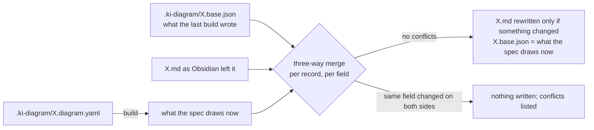

# Diagrams

`ki diagram` builds tldraw drawings for the Obsidian vault from spec files, keeps the edits made by hand in Obsidian when a drawing is rebuilt, and renders each drawing to PDF or SVG. Agents draw through the [`/ki-diagram`](skills.md#ki-diagram) skill; the spec format and drawing conventions are in [`skills/ki-diagram/spec.md`](../skills/ki-diagram/spec.md).

`ki diagram` uses tldraw 5.x, which is free for development. Production use (CI, a shared publishing machine) needs a licence from tldraw; see [third-party licences](third-party-licences.md).

## Setup

| Needs | For | Check |
| --- | --- | --- |
| node 22 or newer | Everything | `ki doctor`, section Diagrams |
| `make diagram` in the harness checkout | Installs the pinned packages (tldraw 5.4.0, the version the Obsidian tldraw plugin 1.32.0 bundles, plus Playwright, esbuild, yaml) and Playwright's headless Chromium, about 100 MB in its cache | `ki diagram requirements` |

Building and checking need node and the packages; only `render` (PDF or SVG) and `build --pdf` need the browser. `KI_DIAGRAM_CHROME=/path/to/chrome` uses another Chrome or Chromium instead. Rendering never touches the network: tldraw, its CSS and its fonts are served from `diagram/node_modules` to the headless browser, and every other request is refused. After a release changes `diagram/package-lock.json`, `ki diagram` says the packages are out of date; run `make diagram` again.

## Files

```text
diagrams/projects/kio/
  ki CLI.md                          the drawing: Obsidian opens it, edit it freely
  ki CLI.pdf                         one PDF page per tldraw page, each sized to its content
  .ki-diagram/ki CLI.diagram.yaml    the spec, the only file agents edit
  .ki-diagram/ki CLI.base.json       what the last build wrote: the base for keeping hand edits
```

Obsidian Sync skips dot folders, so the spec and the snapshot reach other machines and the cluster through the vault's git (`ki vault push`), like the vault's other dotfiles. The drawing and the PDF sync everywhere.

## Commands

| Command | Does |
| --- | --- |
| `ki diagram build <spec> [--dry-run] [--pdf]` | Writes a new drawing, or merges spec changes into an existing one; `--pdf` renders it afterwards |
| `ki diagram build <spec> --prefer drawing\|spec` | Resolves conflicts for one side |
| `ki diagram build <spec> --adopt` / `--base <file.md>` | Starts tracking a drawing that has no snapshot (see below) |
| `ki diagram check <spec>...` | Reports, without writing, what a build would do; fails on invalid specs, conflicts and missing snapshots |
| `ki diagram render <drawing.md> [-o file.pdf]` | Renders any Obsidian tldraw drawing to PDF |
| `ki diagram render <drawing.md> --svg -o <dir> [--theme light\|dark] [--json]` | Renders each tldraw page to its own SVG (see below) |
| `ki diagram requirements` | Lists what this machine has and lacks |

`--drawing <file.md>` overrides where the drawing is: by default `.ki-diagram/<name>.diagram.yaml` draws `<name>.md` in the folder above, and a spec kept anywhere else draws next to itself.

## Rendering to SVG

`ki diagram render <drawing.md> --svg -o <dir>` writes one standalone SVG per tldraw page to `<dir>/01.svg`, `02.svg`, ... in page order, so tools that cannot run tldraw can show a drawing. It creates `<dir>` if needed and replaces older `NN.svg` files there, so a page deleted from the drawing does not linger; other files in `<dir>` are left alone. The SVGs come from the same tldraw export as the PDF and include the background, and tldraw inlines the fonts they use, so they render without network or tldraw's CSS.

- `--theme dark` exports with tldraw's dark mode; the default is `light`.
- `--json` prints one line instead of the paths: `{"pages":[{"index":1,"name":"<page name>","file":"<absolute path>","width":<n>,"height":<n>}]}`, with the size in pixels rounded up.
- `--json` and `--theme` need `--svg`, and `--svg` needs `-o`, else the command exits 2 with its usage. Without `--svg`, `render` writes the PDF as before.

## How hand edits survive



For every record (page, shape, binding) and every field of it, a change in the drawing since the last build is a hand edit and is kept; a change in the spec since the last build is applied; the same field changed differently on both sides is a conflict, and nothing is written until the spec or the drawing is made to agree, or `--prefer` picks a side. So a box moved by hand still takes a new label from the spec, a shape deleted by hand stays deleted, and a shape added by hand stays. A rebuild never removes a shape that a hand-drawn arrow is still bound to; that is reported as a conflict too.

Some differences are tldraw's, not the user's, and never count: z-order keys (tldraw gives new shapes random keys and restacks arrows when it opens a file, so a shape's `index` stays as the drawing has it once it exists), the text-direction marker tldraw adds to an edited label, and the session records the plugin writes into the file (camera, pointer, user, instance). The drawing's frontmatter, its plugin uuid and anything around the data block are kept as they are.

Before writing, the build reads the drawing again; if Obsidian saved it in the meantime, nothing is written. A drawing saved by a newer tldraw than the pinned one is refused rather than downgraded. Close a drawing in Obsidian before a build that changes it: an open copy saved afterwards would put the old shapes back, and the next build would then see them as hand edits.

## Adopting a drawing without a snapshot

A drawing made before `ki diagram` (or whose snapshot was lost) has no base. If it matches what the spec draws, the first build just records the snapshot. If it differs, the build refuses and lists the differing records, because it cannot tell hand edits from spec changes. Then either:

- `--adopt` keeps the drawing exactly as it is and records every difference as a hand edit, or
- `--base <file.md>` names the drawing ki-diagram (or an older build script) last wrote, so the real hand edits are found.

The first three drawings (`kio Architecture`, `ki CLI`, `Vault Pusher`) were drawn by one-off scripts. Their specs are in `diagram/testdata/specs/`, and a test proves each rebuilds what its script last wrote, field for field and in the same stacking order. To move one into the vault's layout, copy its spec to `.ki-diagram/<Title>.diagram.yaml` next to the drawing and run `ki diagram build` with `--adopt`.

## Development

`diagram/` is a small node package: `lib/spec.mjs` checks specs, `lib/build.mjs` draws, `lib/merge.mjs` and `lib/plan.mjs` merge and decide, `lib/render.mjs` makes PDFs and SVGs from one shared browser export. Every record passes through tldraw's own store before it is written, so an invalid shape fails in the build rather than in Obsidian. `make test-diagram` runs its tests (part of `make test`); CI runs them with the browser installed so the PDF test cannot skip. Keep `tldraw` in `diagram/package.json` at the version the Obsidian plugin bundles.
