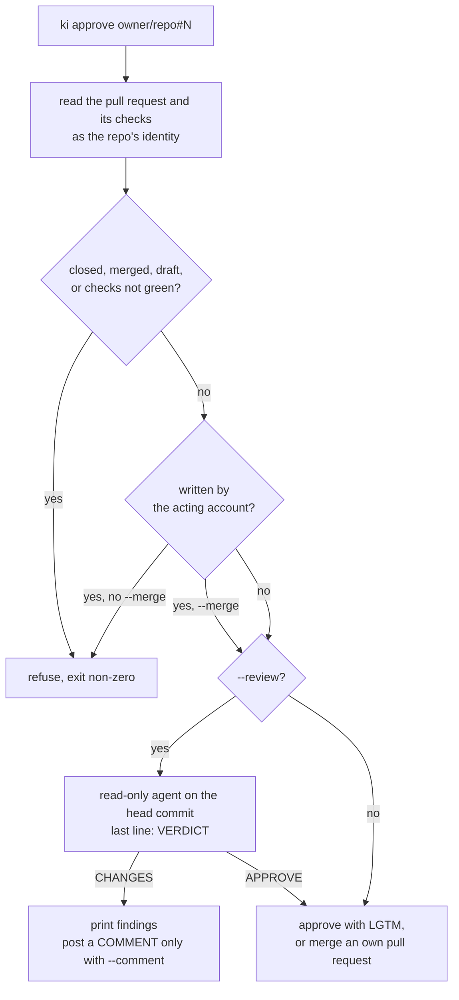

# ki approve

Approve a pull request as the identity that owns its repo, either right away or after a read-only agent has reviewed it and found nothing to change. Approving and merging are separate steps, and nothing ki writes to GitHub says where or how it was written.



## Command

```bash
ki approve <pr> [--review [--comment]] [--merge] [--dry-run] [--json] [--force]
           [--role execution | --agent claude|codex] [--model M] [--brain B]... [--timeout 30m] [--quiet]
```

`<pr>` is a pull request URL or `owner/repo#N`. The repo must be in `projects.yaml`: its identity gives the gh account, and ki uses that account's token for every gh call and no other. An unmapped repo is refused unless you pass `--force`, which acts as gh's active account.

| Flag | Effect |
| --- | --- |
| `--review` | Run one headless review agent before approving, as described below |
| `--comment` | With `--review`, post the findings as one `COMMENT` review when the verdict is `CHANGES`. Without it nothing is posted |
| `--merge` | Squash-merge and delete the branch after approving, once GitHub reports the pull request mergeable |
| `--dry-run` | Read from GitHub, apply every refusal, print what would happen and call no write API. It does not start the review agent |
| `--json` | Print one result object: `pr`, `url`, `author`, `identity`, `mode`, `merge`, `dry_run`, `checks`, `verdict`, `action`, `refusal`, `note`, `findings`, `review_job`, `job` |
| `--role`, `--agent`, `--model`, `--brain` | Choose the review agent, as for [ki delegate](ki-delegate.md). Only with `--review` |

## What it refuses

Every refusal prints the reason, exits non-zero and writes nothing to GitHub:

- A closed, merged or draft pull request.
- Checks that are not all successful, skipped or neutral. Pending counts as not ready, and so does a head with more checks than ki reads (100 runs and 100 statuses).
- `--admin`, `--bypass...` and similar flags. ki never bypasses branch protection and never runs `gh pr merge --admin`. A merge is `gh pr merge --squash --delete-branch --match-head-commit <sha>`, so GitHub refuses whatever the branch rules refuse and a push after the check is not merged.

## Your own pull request

GitHub does not let an account approve its own pull request, so ki does not try.

- Without `--merge`: refused with `own PR; approval needs another account`.
- With `--merge`: squash-merged when GitHub reports it mergeable, which means the repo does not require a review (or it is already satisfied) and the checks are green. If GitHub reports it blocked by branch rules, ki refuses with the same reason.

## Someone else's pull request

ki submits one `APPROVE` review on the head commit it checked, with the body `LGTM`. With `--merge` it then reads the pull request again, waits while GitHub's mergeable state is still `unknown`, and merges only if the state is clean. A pull request that is still blocked after the approval (a second required review, say) stays approved and is reported as not merged. It is never forced.

## Review first

`--review` runs one agent before any approval:

1. ki fetches the pull request's head commit and checks it out, detached, in a fresh worktree next to the checkout (`<repo>-worktrees/<job>`). The checkout is the one you are in, or the project's, found as [ki mecca](ki-mecca.md#finding-the-checkout) finds it.
2. The agent starts through the same machinery as `ki delegate`: the `execution` role from `machine.yaml` picks it unless you name one, and the job is recorded in the ledger. Its brief holds the pull request, its diff and the review steps of the [`/ki-review`](skills.md) skill (reading, rules, running checks and reviewing; not drafting or posting).
3. The agent can only read. Claude Code runs with its edit tools denied and only read-only `git` commands and the knowledge base tools allowed; Codex runs in its read-only sandbox. Other agents are refused, and in a role they are skipped. ki checks afterwards that the worktree is still the head commit with no changed or new file, and discards a verdict from a review that touched it.
4. The last line of its answer must be `VERDICT: APPROVE` or `VERDICT: CHANGES: <one-line reason>`. A missing or misplaced verdict is a failed review, and a failed review never approves.

`CHANGES` prints the findings and stops with a non-zero exit. With `--comment` it also posts them as one `COMMENT` review. `APPROVE` goes on to the rules above. ki also checks that the head did not move during the review.

### Security surfaces

A review that touches IAM, OIDC, SSO, bucket policies, network ingress or secrets approves with the body:

```text
LGTM, second reviewer recommended: <reason>
```

and never merges, `--merge` or not. An own pull request that touches one is refused, not merged. The agent reports it with a `SECURITY: <what and where>` line. ki backs that up by scanning the diff for files named like those surfaces and for added lines that grant access or open the network (`assume_role_policy`, `aws_iam_`, `aws_security_group`, `0.0.0.0/0`, a `Secret`, `NetworkPolicy` or `Ingress`), so a missed line does not become a plain approval.

## Nothing ki writes names ki

Review and comment bodies read as your own words. ki drops any line of an agent's findings, and any reason, that mentions ki, a job id, a worktree, this machine's host name or an agent, and posts the rest. This applies to every text it sends, and it applies to the ki repository's own reviews too: a finding about `ki delegate` is dropped from a posted comment, though it is still printed to you.

## Ledger

Each run adds one record to the same `jobs/ledger.jsonl` as delegated jobs, with kind `approve`, the pull request and a status: `APPROVED`, `MERGED`, `COMMENTED`, `CHANGES`, `REFUSED`, `DRY_RUN` or `FAILED`. A review adds a second record of kind `review` with the agent, model, tokens and cost, which also counts toward the role's round-robin turns and daily caps. [`ki delegate ls`](ki-delegate.md) shows both, with the pull request in the issue column and `-` where no agent ran.
