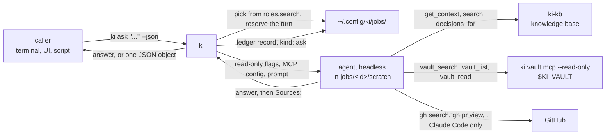

# ki ask

One question, answered read-only by whichever agent the machine's policy picks, with a source for every fact. It is what a UI or a script calls instead of running `claude -p` itself: the model, the knowledge base token and brains, and provider health stay where ki keeps them, and every agent ki can hold read-only can answer.



## Command

```sh
ki ask "What is the vault pusher and how is it deployed?"
ki ask "Which PR changed the stall limit?" --agent claude --source gh --json
ki ask --continue j-20261107-063902-d85f "and for prod?"
```

| Flag | Effect |
| --- | --- |
| `--role search\|writing\|judgement\|execution` | Pick the agent from that role in `machine.yaml`, as [ki delegate](ki-delegate.md#roles-letting-the-machine-pick-the-vendor) does: the strategy, the skips (not installed, a recent launch failure, a hang, over quota or over the daily cap) and the demotion. Default `search` when the machine defines it, else the default agent (`KI_AGENT`, else `claude`). Never the `execution` role by default |
| `--agent claude\|codex\|cursor-agent` | The agent, named outright. Exclusive with `--role` |
| `--model M` | With `--agent` only; else the provider's model, else `models.search.<agent>` (`models.<role>` with a role) |
| `--identity NAME` | Whose brains and gh login. Default: the identity of the repo you are in, else the one identity the machine carries; with several and no repo, ki asks for this flag |
| `--brain B` | The brains to search, instead of the default scope (cortex is always added). A [sensitive brain](projects-and-brains.md) switches to the sensitive token, as for a session |
| `--source kb,vault,gh` | Where the answer may come from; default all three. A source named here that the agent cannot reach is refused; a default one is left out with a note on stderr |
| `--continue <job-id>` | Ask a follow-up in the conversation of an earlier ask on this machine (see [Follow-ups](#follow-ups)). Refused together with `--role`, `--agent`, `--model`, `--brain`, `--identity` or `--source` |
| `--timeout 10m` | Kill the agent after this and record `FAILED` |
| `--json` | Print the result object (below) instead of the markdown answer |
| `--quiet` | No progress lines on stderr |

The default scope is a session's: inside a repo of the identity, the repo's brains from `projects.yaml`; otherwise every brain of the identity's projects that is not sensitive. A brain the machine's token does not grant makes the knowledge base refuse the whole query, as it does for a session, so name the brains with `--brain` when the identity's projects list more than this machine may read.

Without a knowledge base (no `knowledge_base.url` and no `KI_MCP_URL`) the default sources refuse with a message naming the setting. `--source vault`, `--source gh` or both work: ki reads no device token, writes no `ki-kb` server and exports no `KI_TOKEN`, `KI_BRAINS` or `KI_MCP_URL`.

No repo is needed, and none is touched: no worktree, no branch, no commit. The agent runs in `~/.config/ki/jobs/<id>/scratch`, an empty folder ki removes when the run ends.

## Follow-ups

`ki ask --continue <job-id> "<follow-up>"` continues the conversation of an earlier ask, so a front end can ask, then follow up ("and for prod?", "show me the file") without restating anything. The follow-up runs with the scope of the job it continues: the same agent, model, identity, brains and sources, all read from that job's `result.json`, which is why none of the flags that set them can be given. One line says which one was refused:

```text
--continue keeps the conversation's scope: drop --agent
```

It is a new job with its own folder, and its result records `continues: <job-id>`. A follow-up can be continued in turn; the chain is the jobs linked by `continues`.

The agent's session carries the conversation when it can:

| Agent | Resumed with |
| --- | --- |
| Claude Code | `--resume <session>` |
| Cursor | `--resume <session>` |
| Codex | `exec resume <session>`, with the same read-only flags as any ask, except that `--sandbox read-only` becomes `-c sandbox_mode="read-only"` because `exec resume` rejects `--sandbox` |

An agent files its sessions under the folder it ran in, so a follow-up runs in the scratch folder of the job it continues (recreated empty, removed again when the run ends), not in a new one. Two follow-ups of the same job cannot run at once: the second is refused with `a follow-up of <id> is still running` until the first ends.

When the session cannot be resumed, ki starts a fresh run whose prompt begins with the questions and answers of the chain, oldest first, and prints `ki: resumed by transcript` on stderr. That happens when the earlier job recorded no session, or when the run that tried to reopen it failed (the agent no longer has the session, or the job is older than the agent keeps sessions); the failed attempt stays in the ledger as its own job. The transcript is capped at 20,000 characters: the oldest turns are dropped first, and a single turn that is still too long is cut. A job at the start of the chain that has been pruned from the jobs folder only shortens the transcript.

The read-only guarantees do not change: the follow-up gets the same flags as any ask, in the scratch folder, and the prompt still asks for a source behind every fact and a final `Sources:` list.

The job to continue must be an ask that ended `DONE` and recorded its scope, so an ask from before `--continue` existed is refused with a request to ask again. The jobs folder is per machine, so a job id from another machine is unknown here and refused, as is an id that is not an ask.

## What each agent may do

The agent cannot write, and that is enforced by the agent's own permission mechanism, not by the prompt:

| Agent | Flags ki passes | Sources |
| --- | --- | --- |
| Claude Code | `--strict-mcp-config` (only ki's servers), `--permission-mode dontAsk` (anything not allowed is denied without a prompt), `--disallowedTools` for Edit, Write, NotebookEdit, WebFetch, WebSearch and `vault_write`, and one `--allowedTools` per source tool: the three knowledge base tools, the three vault read tools, and `Bash(gh search:*)`, `Bash(gh pr view:*)`, `Bash(gh issue view:*)`, `Bash(gh run view:*)`, `Bash(gh project item-list:*)` | kb, vault, gh |
| Cursor | `--mode ask` (no edit, no shell command), `--sandbox enabled` (no network), `--approve-mcps`, and a `.cursor/cli.json` in the scratch workspace that allows only the source tools as `Mcp(ki-kb:search)` and so on | kb, vault |
| Codex | `exec --sandbox read-only --skip-git-repo-check`, with ki's servers defined by `-c mcp_servers...` so the vault server is always the read-only one, even when `ki setup codex` registered the writing one | kb, vault |
| agy | not used: ki knows no read-only mode for it, so a role's agy provider is skipped with a note | |

GitHub is read through `gh` on Claude Code only, with the identity's gh login in `GH_TOKEN`. Codex's read-only sandbox and Cursor's sandbox have no network, which is what keeps `gh` from writing there, so they answer from the knowledge base and the vault.

The vault is served by `ki vault mcp --read-only`: the same server sessions get, without `vault_write`. It needs `KI_VAULT` set to a folder, which need not be a git clone. When the identity has `vault_read` in `projects.yaml`, ki adds one `--path` per folder and the server reads only those ([vault](vault.md#limit-what-an-identity-reads)).

Checked by hand on 2026-11-07: asked to create a file in the scratch folder, one in `/tmp` and to run `gh api rate_limit`, Cursor in ask mode refused all three; Claude Code in `dontAsk` refused a `touch` and a file write.

## The token

The knowledge base token never appears in an agent's arguments, the ledger, the JSON result or the job log:

- Claude Code reads it from an MCP config in the job folder, next to the scratch folder rather than in it, mode 0600, removed after the run.
- Cursor's `.cursor/mcp.json` in the scratch folder names it as `${env:KI_TOKEN}`; the value is only in the agent's environment.
- Codex reads it from `KI_TOKEN` through `bearer_token_env_var`.

An agent can still see its own environment, so ki also replaces the token with `[redacted]` in the answer, the job's `result.json` and `output.log` if an agent printed it. The prompt tells the agent never to print a secret, token, password or key, nor a full cloud account id.

## The answer

The prompt asks for a short markdown answer with a source behind every fact (the knowledge base document, the note path or the URL), a plain statement when nothing in the sources answers it, and a final `Sources:` list. Without `--json` the answer is printed as the agent wrote it. With `--json`:

```json
{
  "id": "j-20261107-063902-d85f",
  "agent": "claude",
  "model": "claude-haiku-5-5",
  "role": "search",
  "answer": "**Vault pusher** is a component in the `harness` namespace ...",
  "sources": ["kio/decisions/2026-10-23-vault-pusher-in-cluster.md", "kio/docs/operations.md"],
  "tokens": {"input": 8, "output": 1667, "cache_read": 171566},
  "cost_usd": 0.0118,
  "duration_s": 14.3,
  "status": "DONE"
}
```

A follow-up adds two fields, and a first question has neither:

```json
{"id": "j-20261107-071500-2c1e", "continues": "j-20261107-063902-d85f", "resumed": "session", "status": "DONE"}
```

`resumed` is `"session"` when the agent reopened the earlier session and `"transcript"` when a fresh run was given the earlier turns.

`answer` is the text before the `Sources:` list and `sources` its entries (`[]` when none was cited). `status` is `DONE` for any answer and `FAILED` for none, a timeout or an agent error, with `detail` saying why; `LAUNCH_FAILED` moves on to the role's next provider, as for a delegated job. Anything but `DONE` also exits non-zero.

## The record

Every question is a job in the ledger with `kind: ask`, the question as its title (credentials redacted, capped), the role, agent, model, tokens, cost, duration and status; the answer stays in the job's `result.json`, together with what a follow-up needs: the question, the identity, brains and sources it ran with, its scratch folder, and for a follow-up `continues` and `resumed` (which the ledger line carries too). It counts for the role's turns, daily caps and provider health like any job. `ki delegate ls` leaves asks out; `ki delegate ls --all` shows them, with `-` in the repo column.

## `ki status --json`

To offer exactly what the machine is set up for, `ki status --json` carries the policy:

```json
{
  "roles": {
    "search": {
      "strategy": "ordered",
      "providers": [
        {"agent": "claude", "model": "haiku", "available": true, "health": "ok", "ask": true},
        {"agent": "agy", "model": "gemini-3.8-flash-low", "available": false, "health": "skipped", "reason": "not on PATH", "ask": false}
      ]
    }
  },
  "models": {"search": {"claude": "haiku"}},
  "effort": {"search": "low"}
}
```

`planner` (not shown above) is what a bare `ki` would start here: `{"agent": "codex", "model": "gpt-5", "source": "roles.planner", "skipped": [{"provider": "claude:opus", "reason": "over quota until ..."}]}`, with `source` one of `roles.planner`, `KI_AGENT` or `default`, and `error` instead of `agent` when no provider is eligible ([the planner role](laptop-setup.md#the-planner-role-which-agent-a-bare-ki-starts)).

`model` is the provider's own, else `models.<role>.<agent>`, `""` when the agent chooses. `health` is what the next pick does with the provider (`ok`, `skipped` or `demoted`, with the `reason`), read from the ledger as [ki delegate health](ki-delegate.md#provider-health) reads it. `ask` says whether `ki ask` can run it. A machine file that does not parse leaves `roles`, `models` and `effort` empty and sets `policy_error`; status still prints.
