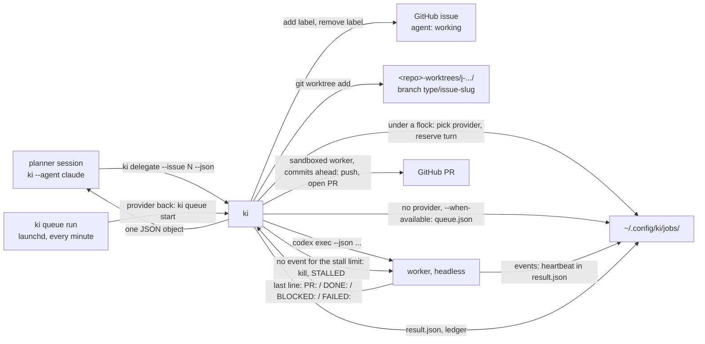

# ki delegate

One task, run headless on one agent, in its own git worktree, answered with one status line. A planner session (Claude Code, Codex, Cursor or agy) runs it through its shell and reads the JSON back, so any agent can hand work to any other: the same token, brains, instructions and permission flags a `ki` session gets, with nothing interactive left in the loop.



## Commands

| Command | What it does |
| --- | --- |
| `ki delegate --task "<brief>"` | Run the brief in a fresh worktree of the current repo and print `<job> <agent> <STATUS>: <detail>`. The agent comes from the machine's `execution` role when one is defined, else `KI_AGENT`, else `claude` |
| `ki delegate --issue N` | The same, claiming GitHub issue `N` in the current repo first (or `owner/repo#N`). Without `--task` the issue's title and body are the brief |
| `ki delegate --task ... --json` | The same, printing the full result object (below); what planners and skills read |
| `ki delegate ls [--all] [--json]` | Queued jobs first (status `QUEUED`, the role in the agent column, the reason and the expected start in the detail), then running jobs (status `RUNNING`, elapsed time in the age column, the worker's pid), then every job this machine ran, newest first: id, title, agent, model, status, repo, branch, issue, age, detail, and for a running job the age of its last event (`LAST`, red on a terminal once it passes the stall limit). The model is the one that ran ([below](#the-result)), `-` when nothing names one. The title comes from the job's record; an older job without one gets it from its `brief.md`, read-only ([below](#the-result)). [`ki approve`](ki-approve.md) runs appear here too, with the pull request in the issue column. Questions from [`ki ask`](ki-ask.md) and runs of [`ki skill run`](ki-skill.md) are left out; `--all` lists them too |
| `ki delegate resume <job> [--role R \| --agent A] [--when-available]` | Continue a `QUOTA` (or `STALLED`, `FAILED`) job in its own worktree and branch on another provider, with the original brief and a handoff note ([below](#usage-limits-quota-and-resume)) |
| `ki delegate cancel <job>` | Drop a `QUEUED` job that has not started |
| `ki queue run` | Start the queued jobs whose role has a provider back, oldest first ([below](#the-queue-waiting-for-a-provider)) |
| `ki queue install \| uninstall \| status [--json]` | Run `ki queue run` every minute from a launchd agent (macOS), remove it, or show it and the queued jobs |
| `ki delegate watch <job>` | Print a job's log as progress lines and follow it until the job ends, then its final status line. Lines already in the log show `--:--` instead of a time |
| `ki delegate health [--json]` | Each provider's recent outcomes, median duration and whether the next pick skips or demotes it ([below](#provider-health)) |
| `ki delegate log [--date YYYY-MM-DD] [--vault]` | Render the day's ledger jobs; optionally write `agents/<date> Agent Log.md` to the vault |
| `ki delegate help` | Usage |

The log uses UTC dates and includes time, machine, agent, model, repo, issue, outcome, PR, duration and token counts. It reads only the append-only ledger and job metadata. A job whose project is marked `vault: false`, whose project uses a sensitive brain, or whose repo cannot be matched to a configured project is reduced to its job id and outcome; the brief and result detail are never copied into the note.

`--vault` rewrites the dated note under `agents/` and runs the same checked commit, pull-with-rebase and push path as `ki vault push`. Repeating it for a day produces the same note. It requires `KI_VAULT` and the vault's `AGENTS.md`; the note contains generated metadata only, never a job brief or issue comment text.

Flags:

| Flag | Effect |
| --- | --- |
| `--project <name\|path>` | The checkout to run in, when you are not standing in it: a project name from `projects.yaml` found through `~/.config/ki/mecca.yaml` (`roots`, `checkouts`, as [ki mecca new](ki-mecca.md#finding-the-checkout) finds it), or a path. Without it the job uses the repo you are in; outside any repo it refuses and names this flag |
| `--role judgement\|execution\|search\|writing` | Pick the worker from that role in `machine.yaml` (below). Exclusive with `--agent`; `--model` is refused with a role, the model belongs on the provider |
| `--agent claude\|codex\|cursor-agent\|agy` | The worker, named outright. Each runs in its own non-interactive mode: `claude --print --output-format stream-json --verbose`, `codex exec --json --output-last-message <file>`, `cursor-agent --print --trust --output-format stream-json`, `agy --output-format json --print <brief>` (the Antigravity CLI: Gemini, Claude and GPT-OSS models behind one login). Any other agent is refused: ki would not know how to read its answer |
| `--model M` | The worker's model, else `models.<class>.<agent>` from `machine.yaml` (and `effort.<class>` for Claude Code and agy), else the agent's default. The class is the role's, `execution` without one: a worker applies a described change. `KI_MODEL`, the session default, is not consulted |
| `--mode auto\|edits\|skip` | [Permission mode](laptop-setup.md#permission-modes). Default `auto` (Claude Code, Codex and Cursor, which runs with `--sandbox enabled`). The sandbox does not keep a worker out of the repository's shared .git directory: on 2026-10-26 a Cursor job wrote user.email and core.bare into the main checkout's .git/config and registered worktrees there (#287, #288). Until those land, prefer Claude for jobs that commit; agy has no `auto`, so it gets `edits` when `machine.yaml` defines `delegate.allow`, else `skip`. `--mode edits` without `delegate.allow` is refused. `ask` is refused: nobody is there to answer a prompt. `KI_MODE` is not consulted for the same reason |
| `--issue N` or `--issue owner/repo#N` | Claim that issue before the worker starts, and record it on the job. A bare number is an issue in the checkout's `origin`. See [Claiming an issue](#claiming-an-issue) |
| `--title "<text>"` | The job's short title, shown in `ki delegate ls` and written to `result.json` and the ledger. Without it the title is the issue's title (`--issue` without `--task`), else the first sentence of the brief ([below](#the-result)) |
| `--steal` | Take an issue that already has the `agent: working` label. Refused without `--issue` |
| `--when-available` | When every provider of the role is skipped, queue the job instead of refusing it ([below](#the-queue-waiting-for-a-provider)). `delegate.queue: true` in `machine.yaml` makes it the default. An `--agent` job is never queued: naming the agent skips the pick |
| `--here` | Run in the current checkout instead of a worktree. For read-only tasks, or when the planner already made the branch |
| `--draft` | The brief tells the worker to open its pull request with `gh pr create --draft`. Without it the brief says ready for review: the choice is always stated, so prose elsewhere in a brief does not decide it |
| `--timeout 30m` | Kill the worker after this and record `FAILED: timed out`. Default 30 minutes |
| `--stall 15m` | End a streaming worker that prints no event for this long and record `STALLED`. Default `delegate.stall` from `machine.yaml`, else 15 minutes. Raise it for a worker that is legitimately quiet for long, such as a long build. agy prints once at the end, so it is never stalled |
| `--brain B`, `--force`, `-- args` | As for `ki`: extra brains, the unmapped-repo and identity overrides, and arguments passed to the agent unchanged. A flag `ki delegate` does not know is refused with a usage error before any worktree or launch, so a typo is never handed to the agent; agent arguments go after `--` only |

## Claiming an issue

The job ledger is per machine, so two laptops can otherwise start the same issue. `ki delegate --issue` uses one generic label on the issue as the lock, which every machine can read. It works with `--role` and `--project`, on every repo.

The claim is the `agent: working` label and nothing else. ki never posts, edits or reads a comment on the issue, so no machine name, agent, model, job or branch reaches GitHub. Who holds a claim lives in the local ledger, which `ki delegate ls` and `ki delegate log` read.

Before the worktree is created, ki reads the issue. It refuses, naming the issue, when it already carries the label, unless `--steal` takes it over. A missing issue and a closed issue are refused too, and nothing is started. The label is created on the repository the first time it is needed.

A job that starts makes one read and two writes: add the label, and on finish remove it, whatever the outcome. Nothing polls. GitHub has no compare-and-swap on labels, so two machines that read the issue in the same instant can both add the label and both start; the second shell to start sees it and refuses.

A crash, or a finish call that does not land, leaves the label. The next `ki delegate --issue` refuses until someone passes `--steal` or removes the label. An orderly failure (`FAILED`, a launch that never started, a worktree that could not be created) clears it. The worker's pull request says `Closes #N`, which GitHub cross-references. Comments already on an issue are left alone.

`--task` still replaces the brief. Without it the worker receives the issue's title and body, then the usual status contract (and the edits-mode rules, when that mode applies).

## Roles: letting the machine pick the vendor

`machine.yaml` can list, per class of work, which agents may run it headless. The four classes are the same as for `models` and `effort`: `judgement` (issues, reviews, decisions), `execution` (applying a described change), `search` (read-only lookup) and `writing` (summaries, changelogs, commit and PR text, status posts). A fifth name, `planner`, has the same shape but is read by a bare `ki` to choose the session's agent ([laptop setup](laptop-setup.md#the-planner-role-which-agent-a-bare-ki-starts)); `ki delegate --role planner` is refused.

```yaml
roles:
  execution:
    strategy: ordered            # or round-robin
    providers:
      - codex:gpt-5-mini
      - {agent: claude, model: sonnet, weight: 2, daily_jobs: 20}
      - agy:gemini-3.8-flash-low
  writing:
    providers: [claude:haiku]
```

A provider is `agent:model` (the model is optional: then `models.<class>.<agent>`, else the agent's default) or the long form with a round-robin `weight` (default 1) and a `daily_jobs` cap (default none). The strategy decides the order to try:

| Strategy | Order |
| --- | --- |
| `ordered` (default) | Always the first provider; the rest only as failover. For "cheapest first", sort the list by price |
| `round-robin` | Turns, weighted: with weights 2 and 1 the first provider gets two jobs of every three. The turn is counted from the role's jobs in the ledger, plus the picks whose job is not recorded yet |

Failover is part of every pick, whatever the strategy. A provider is skipped, and the reason printed on stderr, when:

- its agent is not on PATH;
- its latest job is a `LAUNCH_FAILED` younger than 10 minutes (the breaker; any later run of that agent, whatever its outcome, resets it);
- its latest job that ran is a `STALLED` or timed-out one that ended less than 30 minutes ago (the cool-down; any later job that ran, whatever its outcome, ends it; see [Provider health](#provider-health));
- the ledger has an over-quota reset time for that provider that has not passed (see below);
- it has already run `daily_jobs` jobs today, counting picks still waiting to be recorded (launch failures do not count; the day is the machine's).

A provider is not skipped but moved to the end of the order when two of its jobs hung within the last day and none has ended `PR` or `DONE` since; ki prints `ki: role execution: agent demoted, 2 jobs hung in the last 24h; last in the order until a job ends PR or DONE`. It is still tried when nothing before it is available.

Parallel launches take turns. Reading the ledger, choosing the provider and reserving the turn happen under one exclusive lock (`jobs/pick.lock`), and the reservation goes to `jobs/reservations.jsonl` before the lock is released. The next `ki delegate` therefore sees the turn as taken, even when the first job has not started yet: four launches in the same second with weights 1 and 1 split two and two. The lock is held for the pick only, never while an agent runs. The kernel drops it when the process exits, so a crash cannot leave it held; a pick that cannot get it within 10 seconds fails with an error naming the lock file. A reservation is counted until its job reaches the ledger, then the ledger counts it. `ki delegate ls` and `ki delegate log` read the ledger as before.

Over-quota detection reads what the agent printed when the run failed, not the happy path: a worker that finished with its own status line is never read as a quota hit. A reset is taken from any of these:

- a duration: `resets in 2h30m`, `resets in 2 hours 30 minutes`;
- a time of day: `resets at 7pm`, `resets 7:30 PM`, `resets at 19:00`, optionally with a date (`resets Nov 9 at 10am`, `resets 2026-11-07 08:00`) and a zone (`(Europe/Berlin)`, `UTC`, `+02:00`, `PST`). Without a zone the machine's local zone is used, and a time already past today means tomorrow.

When the output clearly says the provider is over a usage or rate limit (`quota`, `usage limit`, `hit your limit`, `limit reached`, `rate limit`, `RESOURCE_EXHAUSTED`, a 429) but gives no reset ki can read, the provider cools down for 60 minutes, so the next pick skips it. A CLI that dies on the limit before printing a result is read from the end of its job log. ki does not call any vendor to ask.

Nothing in the pick touches the network: it reads the ledger, the reservations and the filesystem. If the first candidate exits without running the task, that attempt is recorded and the next candidate runs in the same worktree. A worker that ran, whatever it returned, is never re-run on another provider by itself; `ki delegate resume` does it when asked. With no candidate left, `ki delegate` exits with `role execution: no provider available` and nothing is recorded, unless the job may wait: then it is queued.

## The queue: waiting for a provider

When the limits run out mid-morning, every provider of a role can be skipped at once. `--when-available` (or `delegate.queue: true`) turns that refusal into a wait:

```text
$ ki delegate --issue 41 --when-available
ki: role execution: claude:sonnet skipped, over quota until 2026-11-07T13:00:00+04:00
ki: role execution: agent skipped, daily cap of 20 reached
j-20261107-091502-3c1e execution QUEUED: claude:sonnet over quota until ...; agent daily cap of 20 reached; expected start 2026-11-07 13:00
```

The job gets its id at once and its folder holds `queue.json`: the `ki delegate` arguments to run (without `--when-available`), the checkout, the role, when it was queued, why it waits and `start_after`, the earliest time a skipped provider is expected back. That time comes from the skips: the quota reset, the end of the 10-minute breaker or the 30-minute cool-down, the next midnight for a daily cap; a provider missing from PATH has none. Nothing is claimed and no worktree exists while it waits, so `--issue` claims the issue when the job starts. `--json` prints the same as a result with `"status": "QUEUED"` and `start_after`; the exit code is 0.

`ki queue run` is one pass: for each waiting job, oldest first, it runs the role's pick the way `ki delegate` would (the ledger, the reservations, PATH, the clock), without reserving. A job whose role has a provider back is marked starting and handed to a detached `ki queue start <job>` in its checkout, which runs it under the queued id, its output in the job folder's `queue.log`. Every other waiting job gets a fresh reason and `start_after`, so a provider whose health returns early (a reinstalled agent, a cool-down that ended) is seen at the next pass. At most `delegate.queue_parallel` queued jobs run at once (default 2); the rest wait with the reason `a provider is available; waiting for one of the 2 queued jobs running`.

```yaml
delegate:
  queue: true          # queue without --when-available
  queue_parallel: 2    # queued jobs running at once
```

The pick and the start are separate, so the started job picks again; if the provider went away in between it goes back to waiting with its original queue time. A job that cannot start for another reason (an unknown flag, a refused claim) is recorded `FAILED` with `queued job could not start: ...` and leaves the queue. A `ki queue start` that dies is noticed at the next pass: its job goes back to waiting, or leaves the queue when its job folder already has a result. All of this runs under `jobs/queue.lock`, so two passes, a cancel and a starting job never interleave. `ki delegate cancel <job>` drops a job that has not started; a started one is refused, it is `RUNNING` in `ls`.

Something has to run the queue with no session open. `ki queue install` writes `~/Library/LaunchAgents/local.ki.queue.plist`: `ki queue run` at load and every 60 seconds, the PATH and `KI_HOME`, `KI_CONFIG_DIR`, `KI_AGENT` of the installing shell (launchd starts agents with a bare environment, and the workers must be found), `AbandonProcessGroup` so started jobs outlive the pass, and its output in `jobs/queue.log`. Run it again after a PATH change. `ki queue status` says whether it is loaded and lists the queued jobs; `ki queue uninstall` removes it. On Linux run `ki queue run` every minute from cron or a systemd timer.

## Usage limits: QUOTA and resume

A worker that runs out of quota after it started the task ends `QUOTA`, not `FAILED`: the agent's error (or the end of its log, for a CLI that died) reads as a usage limit, and the job was not ended by ki. Its detail is the limit message and `(over quota until <time>)`, `quota_until` is recorded as before so the next pick skips the provider, and `result.json` keeps how far it got: `tail` (the last progress lines), `commits` (`<sha> <subject>` since the branch left origin's default branch, oldest first) and `diff_stat` (against the same base, uncommitted changes included). The worktree stays. A CLI that dies on the limit before any progress line never started the task: it stays `LAUNCH_FAILED` and the next provider runs it in the same worktree.

`ki delegate resume <job>` continues it:

```bash
ki delegate resume j-20261107-091502-3c1e --json               # the job's role picks, which skips the provider over quota
ki delegate resume j-20261107-091502-3c1e --agent codex --json  # or name the agent
ki delegate resume j-20261107-091502-3c1e --when-available      # queue the resume until a provider is back
```

The new job runs in the same worktree and branch, records `resumed_from` and the original job's issue, and its brief is the original task (`task.md` in the job folder; for an older job, `brief.md` without the contract) followed by a handoff note: who stopped and why, the commits so far, the diff stat, files not yet added, the diff itself (the first 300 lines) and the last progress lines, with the instruction to finish rather than start over. The draft or ready choice of the original brief is kept. `STALLED` and `FAILED` jobs with a worktree can be resumed the same way; `--task`, `--issue`, `--here`, `--project`, `--title` and `--steal` are refused, since all of them come from the job it continues. A resume does not claim the issue again: the label was removed when the first job ended.

`ki doctor` prints each role's strategy and providers; `ki setup machine` keeps the block when it rewrites the file.

## Edits mode: a worker without skipped permissions

`--mode edits` lets a worker edit files without asking and run only the shell commands the machine allows. It exists for agy, which has no `auto` mode a headless run can rely on, so it no longer needs `--dangerously-skip-permissions`. The allow-list lives in `machine.yaml`:

```yaml
delegate:
  allow: [git, gh, go, uv, make]   # commands a worker in edits mode may run
```

An entry is a binary (`git`) or a binary and one subcommand (`git status`): letters, digits, `.`, `_` and `-`, one space at most. `*`, empty entries, duplicates and anything else are refused with the file and key named, so a typo cannot widen what a worker may run. `ki setup machine` keeps the block when it rewrites the file.

| Agent | What `edits` passes |
| --- | --- |
| agy | `--mode accept-edits`; the allow-list goes into agy's own settings (below) |
| Claude Code | `--permission-mode acceptEdits` and one `--allowedTools=Bash(<entry>:*)` per entry |
| Codex, Cursor | none: ki refuses, as for any mode an agent lacks |

agy reads command rules only from `~/.gemini/antigravity-cli/settings.json` (`permissions.allow`, rules like `command(git)` or `command(git status)`), so before it starts agy in edits mode ki adds `command(<entry>)` for every entry that is missing and prints `ki: added N command rules to agy settings: git, go` when it added any. It only adds: existing rules keep their order, the `deny` and `ask` lists and every other key (`colorScheme`, `trustedWorkspaces`, ...) stay, and the file is replaced atomically with mode 0600. A settings file that is not valid JSON stops the job and is left as it is. ki never writes `command(*)`. `KI_AGY_SETTINGS` points ki at another file (the tests use it).

A Cursor worker in `auto` mode runs inside Cursor's sandbox, which refuses every host not allowed (ki, not the worker, [pushes and opens its PR](#sandboxed-workers-ki-publishes); the policy file stays for any `gh` read the worker makes), so `gh` would fail with `api.github.com is blocked in this sandbox` and nobody is there to approve the prompt. Before it starts, ki writes `.cursor/sandbox.json` into the worktree with `networkPolicy.allow: ["api.github.com"]` (`gh` needs no other host), adds the path to the repo's `info/exclude` so it never reaches a commit, and leaves a `.cursor/sandbox.json` the repo already has untouched. The sandbox stays on and `--force` is never added.

What agy does with it, checked by hand: with `--mode accept-edits` and those rules, edits through its file tool go through and `git add` or `git status` run, while a command that is not on the list (`whoami`) is refused. Headless agy cannot ask, so a refusal ends the run with an empty `response` and `"denied_actions":[{"action":"command",...}]`; ki records that as `FAILED` with a detail naming the allow-list: add the command under `delegate.allow`, or run that job with `--mode skip`. agy's `--mode auto` is not offered: on accounts without it agy prints `--mode auto is not available for this account; continuing in the default mode` and keeps prompting.

In edits mode the brief tells the worker which commands it may run, to edit files with its file tools rather than the shell, and that any other command is refused and ends the job without a result. Interactive `ki --mode edits` works the same way for agy and Claude Code, including the settings merge; there a command off the list prompts instead of failing. A `--mode` or permission flag after `--` still wins over ki's.

## Sandboxed workers: ki publishes

A Cursor worker in `auto` mode runs in Cursor's macOS sandbox: commands run without asking, writes stay in the workspace, and the sandbox refuses `git push` over the network and a browser such as Playwright's Chromium. A worker that is asked to push and open a PR can only pretend it did (on 2026-11-07 a Cursor job committed a correct fix, reported a push that never landed and ended `STALLED`). So for an agent ki runs sandboxed, the worker commits and ki publishes. `--mode skip` and the other agents are not sandboxed and keep the normal contract.

The brief of a sandboxed worker ends with these rules instead of the PR line, and its status lines have no `PR:`:

- Commit only; ki publishes. Do not run `git push` or `gh pr create`. A push or PR the worker reports is never trusted.
- Commit everything: uncommitted changes are not published.
- If the task asks for a browser check (Playwright, Chromium), skip it and say so in the final line.
- End with `DONE: <summary>`, `BLOCKED: <question>` or `FAILED: <reason>`.

After the worker exits, and only when it ended `DONE` (or claimed a `PR:`; the claim is checked, not believed), ki publishes from the worktree:

| What ki finds | Status |
| --- | --- |
| Uncommitted or untracked changes (anything `git status --porcelain` lists) | `BLOCKED: uncommitted changes in <worktree>`; nothing is pushed |
| No commits since the branch left the default branch | unchanged (`DONE`); a claimed `PR:` becomes `FAILED: the worker reported a pull request but made no commits` |
| An origin `gh` cannot address (not a GitHub remote, such as an SSH alias) | `FAILED: not pushed, origin is not a GitHub repository`; the origin is parsed before the push, so nothing reaches the remote |
| Commits that origin's copy of the branch lacks | `git push origin HEAD:refs/heads/<branch>`, never forced, with the job's own GitHub token (a credential helper reads it from `GH_TOKEN`; without an identity, as gh's active account). A rejected push is `FAILED` with git's first line |
| After a push, no open PR for the branch | `gh pr create` with the first commit's subject as the title and the worker's final message (without its `DONE:` marker, led by `Closes <owner/repo#N>` for an `--issue` job) as the body; `--draft` is honoured; `PR: <url>` |
| After a push, an open PR for the branch (a `--here` job on a PR branch) | left as it is; `PR: <that url>` |
| The default branch itself (a `--here` job on it), or a detached HEAD | `BLOCKED` or `FAILED` with the reason; ki publishes a branch, never the default branch |

ki publishes the branch the worktree is on, so a worker that renamed its job branch (briefs often ask for a `<type>/<summary>` name) is published under the new name. For every job that commits, `branch` in `result.json`, the ledger and `ki delegate ls` is the pull request's head branch when the job ended `PR:` (else the worktree's current branch), and `scratch_branch` keeps the name ki created when the two differ.

A worker that ended `BLOCKED` or `FAILED`, or that ki ended (`STALLED`, `QUOTA`, the timeout), is never published; its worktree and commits stay.

A brief that mentions a browser check (browser, Playwright, Chromium, Puppeteer, Cypress) makes ki add `"note": "checks skipped: browser (sandbox)"` to the result, and the text output prints it on a second line, so the planner knows to run that check itself.

A sandboxed worker's final message without a status line ends from its exit code: `DONE` with the message's first line as the summary on exit 0, `FAILED` on a non-zero exit. Publishing then decides whether that `DONE` becomes a `PR`. A worker that has printed its final result and keeps running (a child that never exits) is ended a minute after the result, as if it had exited 0, instead of waiting for the stall limit; this applies to Claude Code and Cursor, whose streams end in a result event.

## The contract

The brief the worker receives is the task, a paragraph telling it that it is the worker and does the task itself, runs tests and builds in the foreground, and passes pull request bodies with `gh pr create --body-file` (in edits mode followed by that mode's rules, above) and a fixed ending. ki also sets `KI_JOB=<job id>` in a delegate worker's environment, and `ki delegate` (task, issue and resume forms) and `ki queue run` refuse inside it with `ki delegate: refused inside job <id>: you are the worker, do the task yourself`, so a worker never starts a nested job; `ls`, `watch`, `log`, `health`, `ki ask` and `ki skill run` stay allowed. The ending: it cannot ask questions, and its final message must be exactly one line:

| Line | Status | Meaning |
| --- | --- | --- |
| `PR: <url>` | `PR` | It opened a pull request |
| `DONE: <summary>` | `DONE` | Complete without a pull request |
| `BLOCKED: <question>` | `BLOCKED` | It needs a person; the question is the detail |
| `FAILED: <reason>` | `FAILED` | Something broke that it could not fix |

A final message without such a line is `FAILED: no status line in the final message`: ki never guesses what a worker meant. (A [sandboxed worker](#sandboxed-workers-ki-publishes) is the exception: its exit code decides, and its brief has no `PR:` line because ki opens the PR.) More statuses come from ki itself: `FAILED` with the agent's own error, a non-zero exit after a run, or the timeout (the result then has `"timed_out": true`); `QUOTA` when the agent stopped on a usage limit after it started ([above](#usage-limits-quota-and-resume)); `QUEUED` for a job waiting for a provider, never in the ledger; `STALLED` when a streaming worker printed no event for the stall limit and ki ended it, with its worktree and commits left in place; and `LAUNCH_FAILED` when the agent exited without producing any result, such as an expired login or a flag it does not know. A quota or usage-limit error, with its reset time or the 60-minute default, is recorded in the job ledger, and role picks skip that provider until the reset. `LAUNCH_FAILED` is the only status that also makes `ki delegate` exit non-zero, since the task never ran; a routing policy later reads it as "this provider is down".

### Hooks and the leak guard

Every worker that commits gets a `commit-msg` and a `pre-push` hook, written into its job folder (`jobs/<job>/hooks/`, outside the worktree) and reached through `GIT_CONFIG_COUNT`/`GIT_CONFIG_KEY_n=core.hooksPath` in the worker's environment, appended to any `GIT_CONFIG_*` already there; no git config file is written. `commit-msg` removes the `Co-authored-by:` lines that name an agent (Claude, Cursor, Codex, Gemini, agy, Copilot, or an `anthropic.com`, `cursor.com` or `openai.com` address) and the `Generated with` / `Made with` lines; a human co-author stays. `pre-push` rejects a push whose branch name or commit messages match the leak guard: `ki/j-`, a job id, `-worktrees/`, the machine's hostname (short and full, when at least four characters) or an attribution line. The hooks call `ki delegate guard`, so the patterns live in one place (`ki.LeakMatch`). The repository's own hook of the same name runs afterwards, and its other hooks are passed through, so a repo with its own `core.hooksPath` or `.git/hooks` keeps them. Before ki reports `PR` or `DONE` with pushed commits, it runs the same check on the branch name, every commit message since the base and, for a sandboxed worker, the pull request title and body it writes: a match ends the job `FAILED: leak guard: <match>`, with nothing pushed for a sandboxed worker, and with the pull request URL in the detail for a worker that pushed itself. It applies to every project, personal ones included.

## Progress while a job runs

Claude Code, Cursor and Codex print one JSON event per line while they work, and ki reads them as they arrive (agy prints its single JSON object at the end, so it has no stream). Every event is appended to `output.log` at once, and ki prints one progress line to stderr per tool call or assistant message; thinking, tool results and bookkeeping events print nothing:

```text
ki: 00:07 claude  message: Reading a.txt now.
ki: 00:08 claude  read /work/repo/a.txt
ki: 00:21 claude  bash ls -la /work/repo
ki: 02:14 claude  edit docs/ki-delegate.md
```

The time is the job's elapsed time, then the agent, then what it did: the lower-cased tool name and its file, command or pattern, or `message:` and the first line of what it said. `--quiet` turns the lines off; stdout, which carries the final status or the `--json` result, is never touched.

A worker that prints no event for five minutes gets `ki: 07:30 claude  no event for 05:00; still running, ended as STALLED at 15:00`, repeated every five minutes of silence, also under `--quiet`. At the stall limit (`--stall`, else `delegate.stall` in `machine.yaml`, else 15 minutes) ki kills the worker and records `STALLED` with the detail `stalled: no event for 15:00`. `--timeout` is the other bound: a worker still going after it is `FAILED` with `"timed_out": true`. Neither removes the worktree, so the commits and edits stay for inspection or a retry, and the job's `result.json` keeps the last ten progress lines in `tail`. The ledger holds the status but not the tail. Any line a streaming agent writes to stdout counts as an event, not only the ones that print a progress line.

```yaml
delegate:
  stall: 20m          # default 15m
  notify_stall: true  # macOS notification when a job stalls; default off
```

`notify_stall` runs `osascript -e 'display notification ...'` once per stalled job, on macOS only. The delegate block no longer needs `allow` when it sets only these.

### Heartbeat

While a streaming worker runs, ki rewrites the job's `result.json` on its events, at most once a second, with `last_event_at` (the worker's start before its first event) and `stall_s`, the limit that job runs under. The file is replaced atomically, so a reader never sees half of it. `ki delegate ls` shows the age of the last event in its `LAST` column (`-` for an agent that does not stream) and in red once it reaches `stall_s`; `ki delegate ls --json` carries both fields for any reader, such as a dashboard. A finished job keeps `last_event_at`, so the record shows how long it was silent before it ended.

`result.json` is written when the worker starts, with `"status": "RUNNING"`, its `pid` and ki's own `ki_pid`, and replaced by the final result when it ends. The ledger is still appended only at the end, so `ls` finds running jobs by scanning the job folders. A job whose `result.json` says `RUNNING` but whose worker and ki process are both gone (ki was killed before it could record the end; a worker that has exited while ki still writes the result stays `RUNNING`) is listed as `LOST`. `ki delegate watch <job>` works on a running or a finished job.

## Provider health

A provider that hangs is stuck, not down, and the pick treats it that way. Both rules read only the ledger and look at one provider, the agent and its requested model (a provider that names no model covers whatever model the agent ran):

| Rule | When | Effect |
| --- | --- | --- |
| Cool-down | the latest job that ran ended `STALLED` or timed out less than 30 minutes ago | The provider is skipped, with `ki: role execution: agent skipped, stalled 3m ago, cooling down for 30m`. A later job that ran, however it ended, or 30 minutes passing, ends it. A `LAUNCH_FAILED` in between neither starts nor ends it |
| Demotion | two jobs hung within the last 24 hours, and none ended `PR` or `DONE` after the most recent of them | The provider moves to the end of the order for both strategies and the reason is printed. A job on it ending `PR` or `DONE` clears it; a `FAILED` or `BLOCKED` one changes nothing. It is still tried when everything before it is skipped |

The existing breaker for `LAUNCH_FAILED` is unchanged and per agent.

`ki delegate health [--json]` shows what the pick sees: one row per provider the machine's roles list, plus any agent the ledger saw in the last seven days that no role covers.

```text
PROVIDER       JOBS  PR  DONE  BLOCKED  FAILED  STALLED  QUOTA  LAUNCH_FAILED  MEDIAN   NEXT PICK
agent          6     1   2     0        1       2        0      0              12:40    skipped: stalled 3m ago, cooling down for 30m
claude:sonnet  9     7   1     0        0       0        1      0              08:15    ok
```

The counts cover the provider's latest 20 jobs; the median is of those that ran (not `LAUNCH_FAILED`). `NEXT PICK` is `ok`, `skipped: <reason>` or `demoted: <reason>`, and the same strings are `skip` and `demoted` in `--json`. `ki doctor` prints one line, `delegate health`, naming the providers that are skipped or demoted, or how many there are when none is.

## The result

```json
{
  "id": "j-20261025-161805-4fdf",
  "title": "Retry the flaky upload in app",
  "provider": "codex",
  "role": "execution",
  "model": "gpt-5-mini",
  "model_requested": "gpt-5-mini",
  "repo": "/home/alice/code/app",
  "issue": "acme/app#41",
  "branch": "fix/42-retry-the-flaky-upload",
  "worktree": "/home/alice/code/app-worktrees/j-20261025-161805-4fdf",
  "status": "PR",
  "detail": "https://github.com/acme/app/pull/88",
  "session": "01a173db-1dd5-7192-b509-0165d9a45730",
  "last": "PR: https://github.com/acme/app/pull/88",
  "started": "2026-10-25T16:18:05Z",
  "duration_s": 412.3,
  "tokens": {"input": 18213, "output": 2210, "cache_read": 12400},
  "cost_usd": 0.0,
  "exit": 0,
  "last_event_at": "2026-10-25T16:24:51Z",
  "stall_s": 900
}
```

`note` appears when ki skipped a check for a sandboxed worker (`checks skipped: browser (sandbox)`, [above](#sandboxed-workers-ki-publishes)).

`title` is a short human label, at most 90 characters, written from the first `RUNNING` write onward. It is the first of these that gives something: `--title`; the issue's title when `--issue` is given without `--task`; the first sentence of the brief. For a brief, ki takes the first non-empty line, drops a leading `Repo:` or `Repository:` clause up to its first `. ` (a `. ` inside parentheses does not end it), drops leading markdown (`#`, `-`, `*`, `>`), keeps up to the next `. ` or the end of the line, collapses whitespace and cuts on a word boundary with `...`. `Repo: acme/kio (this worktree). Add SVG output to the renderer. Read x first.` gives `Add SVG output to the renderer`. Credential-shaped text is redacted, and nothing past the first sentence is used. It is absent when nothing usable is left. [`ki approve --review`](ki-approve.md) jobs are titled `Review <owner/repo#N>`.

`last_event_at` and `stall_s` are there for the agents that stream; `timed_out` appears (as `true`) on a job killed at `--timeout`, and `tail` on one that stalled, timed out or ended `QUOTA`; `commits` and `diff_stat` on a `QUOTA` job (the ledger leaves these three out). `resumed_from` names the job a resume continues, `queued` is when a job that waited in the queue was queued, and `start_after` is a `QUEUED` job's expected start. `model_requested` is the model ki passed to the agent, `""` when it passed none. `model` is the model that ran: the one the agent reports in its own output when it does (Claude Code's result event, the model under `modelUsage` that the init event named, else the one that wrote the most; Cursor's init event, such as `Auto Balance` when it chose for itself), else `model_requested`, else `auto` for a Cursor job, since Cursor then picks its own. It is empty only when nothing was passed and the agent reported nothing (Codex and agy do not report one). Daily caps count jobs by `model_requested`, the model the provider names; ledger lines written before the split hold only `model`, which is read as the requested one.

`session` is the vendor's own id (Claude Code's `session_id`, Codex's thread id, Cursor's chat id, agy's conversation id), kept so a blocked job can be resumed later. `tokens` is what the agents report in common; `cost_usd` is Claude Code only. Two more statuses from ki: `FAILED` carries agy's non-`SUCCESS` status word as its detail. `last` is the worker's whole final message.

## Where things go

| Path | Contents |
| --- | --- |
| `<repo>-worktrees/<job>/` | The worker's checkout, next to the repo, on branch `<type>/<issue>-<slug>` (from the issue title's Conventional Commits prefix, `chore` without one, the rest of the title as the slug) or `chore/<slug of the task>-<random>` without `--issue` (the whole job id stays out of a branch name), suffixed with the job id's last part when that branch already exists locally or on `origin`, from `origin`'s default branch (`HEAD` without a remote). ki runs `git fetch origin <default>` first, with an 8 second timeout, so the job starts from the remote's current head; when the fetch fails or times out it prints one `ki: could not fetch ...; starting from the last fetch` line on stderr and uses the last fetch. Parallel jobs retry a ref lock held by a sibling's fetch. The worktree is left in place so you can read, resume or `git worktree remove` it |
| `~/.config/ki/jobs/<job>/` | `brief.md` (the task as sent), `task.md` (the task without the contract, what a resume starts from), `queue.json` (while the job is queued), `queue.log` (a queued job's own output), `output.log` (the agent's raw stdout and stderr, event by event as they arrive), `last.txt` (Codex's final message), `result.json` (`RUNNING` with the worker's pid until the job ends) |
| `~/.config/ki/jobs/queue.lock`, `queue.log` | The queue's flock, and the launchd agent's output |
| `~/.config/ki/jobs/ledger.jsonl` | One line per job, the result without `last`, including `issue` when the job claimed one and both `model` and `model_requested`; what `ki delegate ls` prints |

Job ids are `j-<UTC date>-<time>-<8 hex>`, so the folder sorts by time. The worker's commit identity comes from ki, not from the worker: before the agent starts, ki reads `user.name` and `user.email` in the repo root (so `includeIf` applies), ends the job `FAILED` without running the agent when the email is unset or is not the session's identity, and gives every worker `GIT_AUTHOR_*` and `GIT_COMMITTER_*` with that identity. A worker is told not to write git config; if it changed `user.name` or `user.email` in the repo's shared `.git/config` anyway, ki puts the old values back (unsetting those that were unset) and adds `restored git identity in .git/config` to the job's detail.

## From a planner

The planner says what, not who. A skill that fans work out runs one `ki delegate` per piece, in parallel if it likes, and reads each result's `status` and `detail`; the machine's `execution` role picks the vendor:

```bash
ki delegate --issue 41 --json
ki delegate --issue acme/app#41 --project app --role execution --json
```

`--task` is for a brief that is not an issue. Passing both claims the issue and sends `--task` to the worker instead of the issue body.

`--agent` is for the case where the planner wants a specific tool. `/ki-burndown` works this way: one job per approved issue, from any agent ([skills](skills.md#ki-burndown)). A `BLOCKED` job is reopened with `ki mecca new <job-id>`: a tmux window in the job's worktree, running the job's agent with its session resumed, where you answer the question ([ki-mecca](ki-mecca.md)).
