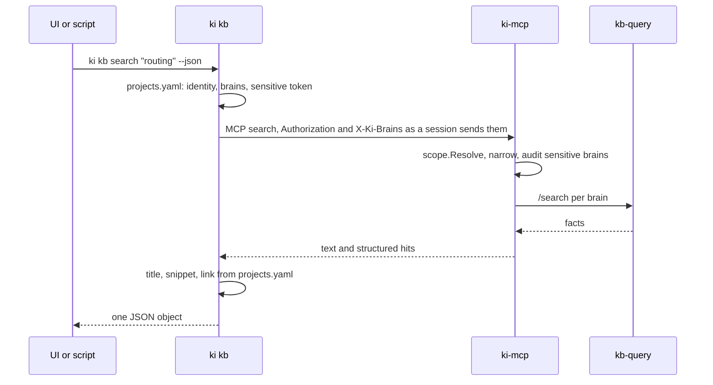

# ki kb

Read-only views of the knowledge base for UIs and scripts: which brains this machine can reach, ranked search with sources and links, the newest documents, and the context pack agents get. A UI calls `ki kb ... --json` instead of re-implementing the token file, the brain rules and the MCP handshake.



`ki kb` is an MCP client of the same `ki-mcp` server sessions use, so scope is enforced where it always is: the device token grants brains, the header names the ones wanted, and a brain the token does not grant makes the call fail. Nothing is written anywhere, and the token goes only into the `Authorization` header: every error ki prints has it scrubbed.

## Commands

```sh
ki kb brains [--brain B]... [--identity NAME] [--json]
ki kb search "<query>" [--brain B]... [--all] [--limit N] [--identity NAME] [--json]
ki kb recent [--brain B]... [--all] [--since 7d] [--limit N] [--identity NAME] [--json]
ki kb activity [--brain B]... [--all] [--since 30d] [--identity NAME] [--json]
ki kb graph --brain B (--query Q | --node ID) [--limit 30] [--identity NAME] [--json]
ki kb context "<query>" [--brain B]... [--all] [--budget N] [--identity NAME] [--json]
```

| Flag | Effect |
| --- | --- |
| `--brain B` | The brains to read instead of the default (cortex is always added). A [sensitive brain](projects-and-brains.md) switches to the sensitive token, as for a session. With `--all` it adds to the set |
| `--all` | Every brain the token reads by default, except `voice` unless named. Sensitive brains stay out unless named |
| `--identity NAME` | Whose brains to read when no repo decides it: the repo's identity, else the one identity the machine carries; with several and no repo, ki asks for this flag |
| `--limit N` | `search`: 1 to 50, default 15. `recent`: 1 to 100, default 20. `graph`: 1 to 60 edges, default 30 |
| `--query Q`, `--node ID` | `graph` only, exactly one: the facts that match the text, or the facts of one entity (a node `id` from an earlier `--json` result, a uuid) |
| `--since` | `recent`: only documents committed after this: `36h`, `7d`, `2w`, a date (`2026-11-01`) or an RFC 3339 time. Default: no cut-off. `activity`: only documents ingested after this, default `30d` |
| `--budget N` | `context`: token budget of the pack, as for `get_context` |
| `--json` | One JSON object on stdout instead of text |

The default scope is a session's: inside a repo, the repo's brains from `projects.yaml`; elsewhere cortex plus every non-sensitive brain of the identity's projects. `brains` ignores the repo: with no `--brain` it lists everything the token reads by default, voice included, because it shows counts and never content.

## JSON

Fields are only ever added. Arrays are `[]`, never `null`; timestamps are RFC 3339 in UTC; `link` is left out when the source has none.

`ki kb brains --json`:

```json
{"brains": [
  {"name": "app", "documents": 42, "last_ingest": "2026-11-06T10:00:00Z", "projects": ["app"]}
]}
```

`documents` counts files, however many sections each was split into. `last_ingest` is `null` for an empty brain. `projects` lists the projects whose `brains` name it.

`ki kb search --json`:

```json
{"query": "routing", "brains": ["cortex", "app"], "hits": [
  {"title": "2026 10 24 routing with chi", "source": "app/decisions/2026-10-24-routing-with-chi.md",
   "brain": "app", "kind": "decision", "snippet": "Routing uses chi ...", "score": 1,
   "superseded": false, "link": "https://github.com/work/app/blob/main/decisions/2026-10-24-routing-with-chi.md"}
]}
```

`title` is the file name without extension, dashes read as spaces. `snippet` is the fact on one line, cut to 240 characters. `score` ranks within the answer (1 is best). `link` is the file on GitHub, built from the project named in the source and its branch; a source from outside `projects.yaml` has none.

`ki kb recent --json`:

```json
{"since": "2026-10-31T09:00:00Z", "brains": ["cortex", "app"], "documents": [
  {"title": "routing", "source": "app/decisions/routing.md", "brain": "app", "kind": "decision",
   "committed_at": "2026-11-05T08:00:00Z", "link": "https://github.com/work/app/blob/main/decisions/routing.md"}
]}
```

Newest first by commit time, undated documents last. `since` is `null` without `--since`.

`ki kb activity --json`:

```json
{"since": "2026-10-09T09:00:00Z", "brains": ["cortex", "app"], "activity": {
  "app": [{"day": "2026-11-07", "documents": 3}, {"day": "2026-11-08", "documents": 12}],
  "cortex": []
}}
```

`activity` counts documents per UTC day by when they were ingested, not when they were committed: a catch-up sync of week-old commits counts on the sync day. A document with several sections counts once per day. Only days with documents appear, oldest first; the client fills the gaps. Text output is one line per brain with the total and a sparkline, one block per day from `--since` to today, scaled to the brain's busiest day.

`ki kb graph --json`:

```json
{"brain": "app",
 "nodes": [{"id": "6f1d2c1e-8a4b-4c55-9e0a-3b7f0a9d1c42", "name": "Acme", "summary": "...", "labels": ["Service"]},
           {"id": "0b9a5d3e-27c4-4e8c-8f10-5d6c2a7e9b11", "name": "chi", "summary": "", "labels": []}],
 "edges": [{"id": "c7e41a5b-93d2-4f6a-b1c8-2e0d4a6f8b30", "from": "6f1d2c1e-8a4b-4c55-9e0a-3b7f0a9d1c42",
            "to": "0b9a5d3e-27c4-4e8c-8f10-5d6c2a7e9b11", "name": "USES", "fact": "Acme routes with chi",
            "kind": "decision", "source": "app/decisions/2026-10-24-routing-with-chi.md",
            "valid_at": "2026-11-05T08:00:00Z", "invalid_at": null}]}
```

`graph` reads one brain, because ids belong to one graph; `--brain` is required and names exactly that brain. Nodes are entities and edges are facts: `from` and `to` are node ids, and every edge has both endpoints in `nodes`. With `--query` the edges are what `search` ranks first for the text; with `--node` they are the entity's facts in either direction, newest `valid_at` first, and the entity itself is in `nodes` even with no edges. A node id from another brain is refused, as is a brain outside the token's scope. Superseded facts (Graphiti's `expired_at`) are left out; `invalid_at` is data, set when the fact stopped being true. `summary` is cut to 400 characters, `labels` are the entity's types without Graphiti's own `Entity` labels, `kind` and `source` come from the fact's first episode as in `search` (`source` is left out for a fact without one). Text output is one line per edge, `from -[name]-> to: fact (source)`, with the kind in place of a missing source.

`ki kb context --json`: `{"query": "...", "brains": [...], "context": "<the pack, as markdown>"}`.

## What the server adds

`ki-mcp` serves this with four new tools beside `get_context`, `search` and `decisions_for`: `brains` (document count and last ingest per brain in scope), `recent` (newest documents, with `since`, `limit` and `brains`), `activity` (documents ingested per brain per day since `since`, with `brains`; scoped and audited like `recent`) and `graph` (`brain`, `query` or `node`, `limit`: nodes and edges of one brain, scoped and audited like `recent`, `node` checked as a uuid before it leaves the server, a brain outside the scope refused rather than widened). `search` keeps its text and now also returns structured hits. All of them resolve scope exactly like the others, audit sensitive brains, and fail the whole call when a brain's backend fails. `kb-query` answers them with `/stats`, `/recent`, `/activity` and `/graph`, reading episode names, commit times and ingest times from each brain's graph; `/graph` takes exactly one of `query` and `node`, filters every read on the brain's `group_id` and answers 404 for a node that is not in that graph.
