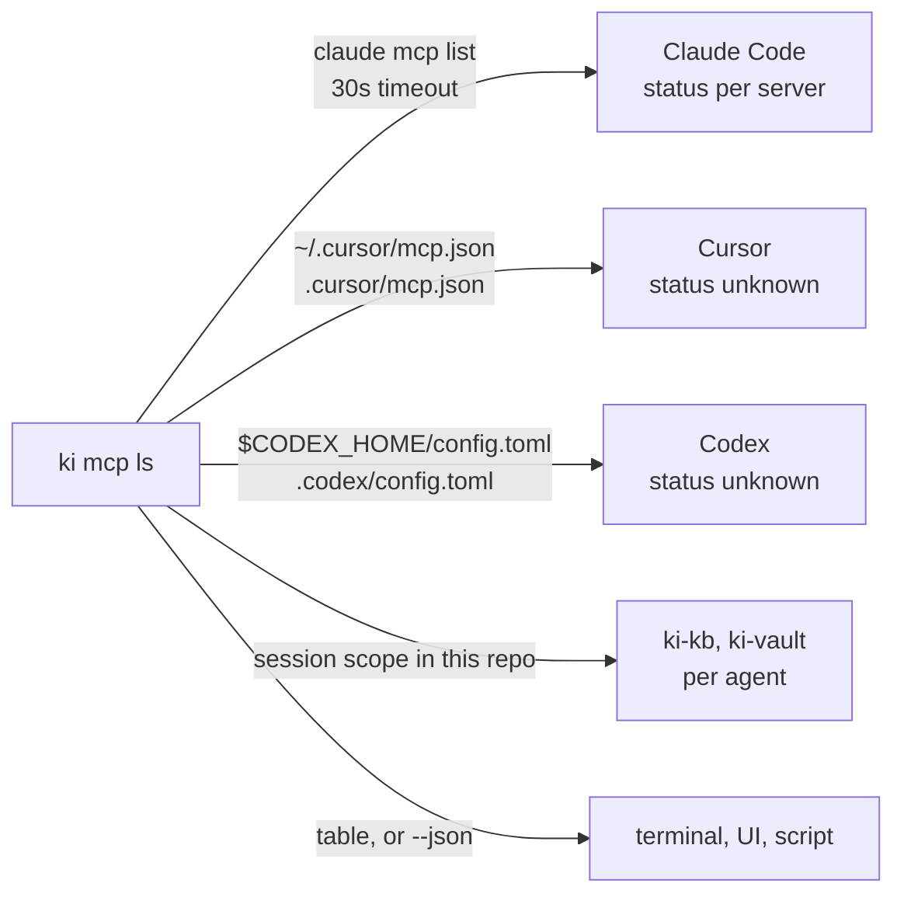

# ki mcp ls

One list of every MCP server each agent on this machine can reach. Claude Code shows its own with `claude mcp list`, Cursor and Codex keep theirs in their own config files, and ki adds `ki-kb` and `ki-vault` per session, so the same service can look connected in one place and missing in another. `ki mcp ls` reads all three and prints one table, or one JSON object for a UI.



## Command

```sh
ki mcp ls
ki mcp ls --agent codex --json
```

| Flag | Effect |
| --- | --- |
| `--agent claude\|cursor\|codex` | List one agent only (default: all three) |
| `--json` | Print the object below instead of a table |

## Where each agent's servers come from

| Agent | Read from | Status |
| --- | --- | --- |
| `claude` | `claude mcp list` run in the current directory, with a 30 second timeout (it probes every server) | `connected`, `needs-auth`, `failed` as the list reports them |
| `cursor` | `~/.cursor/mcp.json` (`local`) and the repo's `.cursor/mcp.json` (`project`) | `unknown`: Cursor has no cheap probe |
| `codex` | `$CODEX_HOME/config.toml`, default `~/.codex/config.toml` (`local`), and the repo's `.codex/config.toml` (`project`) | `unknown`, for the same reason |

ki's own servers are listed once per agent. `ki-kb` carries the brains a session started in the current repo would pass it; `ki-vault` is listed when `KI_VAULT` is set, as a session starts it then. When an agent's own list already shows one of them, that entry keeps its status and transport and gains source `ki` and the brains.

Servers `claude mcp list` prints are named by prefix: `claude.ai ` is a connector, `plugin:` a plugin, `ki-kb` and `ki-vault` ki's, a name in the repo's `.mcp.json` is `project`, and anything else `local`.

## The JSON

```json
{
  "servers": [
    {
      "agent": "claude",
      "name": "claude.ai Gmail",
      "source": "claude.ai",
      "transport": "http",
      "target": "gmail.mcp.claude.com",
      "status": "connected"
    },
    {
      "agent": "claude",
      "name": "ki-kb",
      "source": "ki",
      "transport": "http",
      "target": "kb.example",
      "status": "unknown",
      "brains": ["app", "voice"]
    }
  ],
  "errors": [
    { "agent": "cursor", "error": "/Users/me/.cursor/mcp.json: not valid MCP JSON: ..." }
  ]
}
```

| Field | Values |
| --- | --- |
| `agent` | `claude`, `cursor`, `codex` |
| `name` | The server's name in that agent |
| `source` | `ki`, `claude.ai`, `plugin`, `local`, `project` |
| `transport` | `http`, `sse`, `stdio` |
| `target` | A URL's host (with port), or a command's name. Never a path, query, argument, header or environment value |
| `status` | `connected`, `needs-auth`, `failed`, `unknown` |
| `brains` | `ki-kb` only: the brains it would get in the current repo; absent otherwise |

`servers` and `errors` are always arrays, sorted by agent (claude, cursor, codex) and then name. An agent that cannot be read (not installed, a file that does not parse, a timeout) adds an entry to `errors`, with `agent` `ki` when the session's scope could not be resolved, and the other agents still list. The exit code is 0 either way; the table prints the same problems as warnings on stderr.

## No secrets

Config files hold tokens in headers, `env` blocks, command arguments and URLs (`user:pass@`, `?key=`). `ki mcp ls` never reads headers or environment values, and reduces every URL to its host and every command to its name, so none of them can reach a table or the JSON. Tests plant a token in each of those places and assert none appears.
