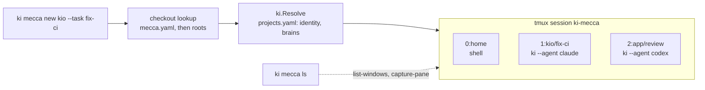

# ki-mecca

One place on a laptop where every agent session lives: a tmux session named `ki-mecca` with one window per session. Each window runs `ki` in a checkout, so identity, brains, token and MCP config come from the same code path as a session started by hand.



## Commands

| Command | What it does |
| --- | --- |
| `ki mecca` | Create the `ki-mecca` session if it is missing (a `home` shell window in `$HOME`), then attach. Inside tmux it switches your client instead of nesting |
| `ki mecca attach <window>` | The same, with that window selected |
| `ki mecca new <project-or-path>` | Open a window in the checkout, running `ki`. Prints the window name and id; the window opens in the background unless you pass `--attach` |
| `ki mecca new <job-id>` | Reopen a [delegated job](ki-delegate.md) (`j-...`, from `ki delegate ls`): a window in the job's worktree, running `ki` with the job's agent and its resume flag, so a `BLOCKED` job is answered where it stopped. Refused for a job that ran with `--here` or whose worktree is gone |
| `ki mecca ls` | List windows: project, agent, identity, mode, age and status. `--json` for scripts |
| `ki mecca kill <window>` | Close one window. It is killed like a closed terminal: the agent gets SIGHUP |

`<window>` is a name (`kio/fix-ci`), an index (`1`) or a tmux id (`@4`). An ambiguous name is refused; use the id.

Flags for `new`:

| Flag | Effect |
| --- | --- |
| `--agent claude\|codex\|cursor-agent\|agy` | The agent `ki` starts (default `KI_AGENT`, else `claude`; a job id sets it to the job's agent) |
| `--task "..."` | Names the window `<project>/<task-slug>` and is shown by `ls`. It is not sent to the agent; pass a first prompt after `--` if you want one |
| `--mode ask\|auto\|edits\|skip` | [Permission mode](laptop-setup.md#permission-modes), passed to the window's `ki` as `--mode`, so it shows in the window's command line. Checked before the window opens, including whether the agent has that mode (agy has no `auto`); without it, the window's `ki` uses `KI_MODE` or `ask` |
| `--name N` | Window name instead of `<project>/<task-slug>`. No spaces, dots or colons |
| `--brain B`, `--model M`, `--force` | Passed to `ki` unchanged |
| `--attach` | Attach to the new window straight away |
| `--json` | Print the new window as JSON |
| `-- args` | Passed to the agent, as with `ki -- args` |

`-2`, `-3`, ... is appended when a window name is already taken.

## Finding the checkout

`projects.yaml` names projects but has no local paths: it is shared with the cluster, and every machine lays out its folders differently. ki-mecca resolves the argument in this order:

1. **A path** (contains `/`, or starts with `~` or `.`): used as is; inside a git repo, its top level.
2. **`checkouts:`** in `~/.config/ki/mecca.yaml`: an explicit name to path map.
3. **`roots:`** in the same file: each root is searched one and two levels deep for a git checkout named after the project, or after the repo in its `projects.yaml` entry. For a project listed in `projects.yaml`, a folder counts only if its `origin` is that project's repo, so a fork or a same-named folder of another owner is never picked. Two matches are refused; map the name explicitly.

Without the file, the only root is `~/code`, the [one folder per identity](laptop-setup.md#2-one-folder-per-github-identity) layout.

```yaml
# ~/.config/ki/mecca.yaml (per machine, never committed)
roots: [~/code, ~/repos, ~/other]
checkouts:
  kio: ~/code/kio-worktrees/ki-mecca   # pin a worktree
```

With `~/repos` as a root, `ki mecca new work-service` finds `~/repos/infra/service`: the folder is named after the repo, not the `work-` project name, and the match is confirmed by its `origin` (`acme/service`).

A repo that is not in `projects.yaml` is refused before a window opens, as `ki` refuses it; `--force` opens a session there without an identity, acting as gh's active account.

## Status

`ls` reads tmux, never the agent:

| Status | Meaning |
| --- | --- |
| `working` | The window produced output in the last 15 seconds. Agents redraw a spinner while they work |
| `needs-user`, `waiting`, `done` | The window is quiet and the last status line on screen is `NEEDS USER: ...`, `WAITING: ...` or `DONE: ...`; the text after the colon is shown |
| `idle` | Quiet with no status line: usually waiting at the prompt |
| `exited` | `ki` or the agent exited with an error. The window stays open with the error on screen until you kill it; a clean exit closes the window |

Agents print them when their instructions ask for it; until then most windows show `working` or `idle`.

## Guarantees

- **No keystrokes.** ki-mecca never sends input to a pane (`send-keys`, `paste-buffer`); a test fails if any code path does. The only way to talk to an agent is to attach.
- **Your other tmux sessions are untouched.** Everything targets the `ki-mecca` session. The hook that keeps failed windows open (`after-new-window`, `remain-on-exit failed`) is set on that session only, never globally.
- **No secrets on the command line.** tmux windows inherit the tmux server's environment, which can be days older than your shell's, so `new` passes `PATH` and the `KI_*` settings (`KI_HOME`, `KI_CONFIG_DIR`, `KI_VAULT`, `KI_MCP_URL`, `KI_MODEL`, `KI_MODE`) with `tmux -e`. `KI_TOKEN`, `KI_BRAINS` and `GH_TOKEN` are never passed: the window's `ki` sets them for its own repo.
- **tmux is required, not installed.** Without tmux on `PATH`, every `ki mecca` command stops with `install it with brew install tmux`, and `ki doctor` notes it without counting it as a problem. tmux 3.2 or later (for `remain-on-exit failed`).

## Testing and a second hub

`KI_MECCA_SOCKET=<name>` runs every command on `tmux -L <name>`, a separate tmux server. Use it to try changes without touching your real sessions, and remove the server afterwards:

```bash
KI_MECCA_SOCKET=ki-mecca-test ki mecca new . --agent sh --force -- -c 'echo hi; sleep 60'
KI_MECCA_SOCKET=ki-mecca-test ki mecca ls
tmux -L ki-mecca-test kill-server
```
