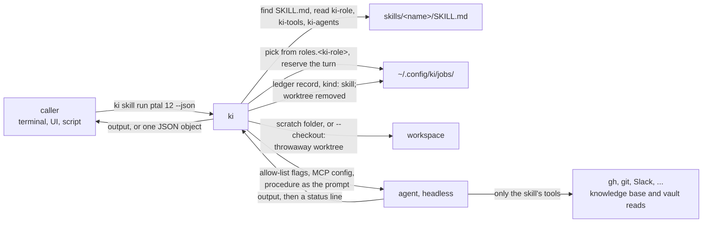

# ki skill run

One skill, run once, headless, on whichever agent the machine's policy picks, allowed only the tools the skill declares. It is what a UI or a script calls instead of running `claude -p` itself with a fixed model: the model policy, provider health and the ledger stay where ki keeps them. [`ki ask`](ki-ask.md) is read-only and [`ki delegate`](ki-delegate.md) always cuts a branch and opens a pull request; a skill run does neither unless the skill's own tool list says so.



## Command

```sh
ki skill run ki-review 412 --checkout 412 --repo ~/code/app
ki skill run slack-ptal 412 413 --json
ki skill run ki-rebase --checkout feat/x --allow "git push --force-with-lease" --json -- main
```

| Flag | Effect |
| --- | --- |
| `<skill> [args...]` | The skill: a folder name looked up in the harness's `skills/`, then `~/.claude/skills`, then `~/.agents/skills`, or a path to a `SKILL.md` or its folder. The arguments replace `$ARGUMENTS` in the procedure; a procedure without `$ARGUMENTS` gets them on an `Arguments:` line above it |
| `--role writing\|execution\|judgement\|search` | Pick the agent from that role in `machine.yaml`, as [ki delegate](ki-delegate.md#roles-letting-the-machine-pick-the-vendor) does: the strategy, the skips and the demotion. Default: the skill's `ki-role` when the machine defines it (a note on stderr when it does not), else `execution`, else the default agent |
| `--agent claude\|codex\|cursor-agent` | The agent, named outright. Exclusive with `--role` |
| `--model M` | With `--agent` only; else the provider's model, else `models.<role>.<agent>` |
| `--repo PATH` | The repo the run belongs to: its identity and brains, and what `--checkout` cuts from. Default: the repo you are in, if any |
| `--checkout PR\|BRANCH` | Run in a throwaway worktree of that pull request's head (`12` or `#12`) or branch, fetched from origin (a branch origin lacks falls back to the local one), detached, next to the repo as `<repo>-worktrees/<job>`, and removed when the run ends, whatever its status. Your checkout is never touched |
| `--allow TOOL` | One more tool for this run, in the `ki-tools` format below. Repeatable. The only way to grant `git push` |
| `--identity NAME`, `--brain B` | Whose brains and gh login, and which brains, as for [ki ask](ki-ask.md#command) |
| `--timeout 20m` | Kill the agent after this and record `FAILED` |
| `--json` | Print the result object (below) instead of the skill's output |
| `--quiet` | No progress lines on stderr |

Arguments for the skill that start with `-` go after `--`: `ki skill run ki-review -- 412 --post`. A flag ki does not know is refused rather than guessed.

Without `--checkout` the agent runs in `~/.config/ki/jobs/<id>/scratch`, an empty folder removed after the run. When the run has a GitHub repo, the prompt names it so `gh` calls can pass `--repo`.

Without a knowledge base (no `knowledge_base.url` and no `KI_MCP_URL`) the skill still runs: ki prints a one-line notice on stderr, reads no device token and leaves out the `ki-kb` server and its `KI_*` variables, so the skill has the vault (when `KI_VAULT` is set), `gh` and its own tools. A skill that tells the agent to use the knowledge base only when its tools are offered, like `ki-review`, skips it.

## The skill's frontmatter

Three fields of `SKILL.md` tell ki how to run it. Agents ignore fields they do not know, so they live next to `name`, `description` and `allowed-tools`:

```yaml
---
name: slack-ptal
description: Post a short PTAL in Slack.
ki-role: writing
ki-agents: [claude]
ki-tools:
  - gh pr view
  - mcp__claude_ai_Slack__slack_send_message
  - Read(./docs/**)
---
```

| Field | Meaning |
| --- | --- |
| `ki-role` | The role that picks the agent: `writing`, `execution`, `judgement` or `search`. Absent: `execution` |
| `ki-tools` | A list of what the skill may do besides reading. A plain command (`gh pr view`, `git rebase`) allows that command with any arguments; a Claude Code rule (`Bash(terraform -chdir=* validate*)`, `Read(./docs/**)`, `Edit`) and an MCP tool (`mcp__claude_ai_Slack__slack_send_message`) are passed as written. Absent or empty: the skill runs read-only |
| `ki-agents` | The only agents that can run it, for a skill that needs one agent's capability, such as Claude's claude.ai connectors (Slack). Absent: any agent ki can hold to the tools |

ki refuses a skill whose list grants every shell command (`Bash`, `Bash(*)`) or can push (`git`, `git push`, `Bash(git *)`): pushing is the caller's decision, made with `--allow "git push --force-with-lease"`. `ki-rebase` needs it: without it the run rebases locally and ends `BLOCKED`. `ki-address` needs it too, plus `--allow "gh api graphql"` to read, reply to and resolve review threads, since a rule for `gh api` cannot tell a query from a mutation. The rule matches `git push --force-with-lease origin HEAD:refs/heads/<branch>` but not the explicit `--force-with-lease=<ref>:<sha>` form, because Claude Code's prefix match needs a space after the rule's last word, so the skill pushes with the bare lease. Every problem in the frontmatter is reported at once.

## What each agent may do

The limit is enforced by the agent's own permission mechanism, not by the prompt:

| Agent | Skill with `ki-tools` | Skill without |
| --- | --- | --- |
| Claude Code | `--permission-mode dontAsk` (anything not allowed is denied without a prompt), one `--allowedTools` per `ki-tools` entry and `--allow`, plus the knowledge base tools and the vault's read tools; `--disallowedTools` for Edit, MultiEdit, Write, NotebookEdit, WebFetch, WebSearch and `vault_write` unless the list names them, and for `git push` unless `--allow` grants it; `--add-dir` for the skill's folder so its supporting files can be read | The same with no tools beyond the reads: no shell command, no edit |
| Codex | skipped: ki cannot hold it to an allow-list | `exec --sandbox read-only`, the knowledge base and the read-only vault server defined in `-c`, as for [ki ask](ki-ask.md#what-each-agent-may-do) |
| Cursor | skipped | `--mode ask --sandbox enabled`, with a `.cursor/cli.json` in the workspace allowing only the knowledge base and vault read tools |
| agy | skipped: ki knows no way to limit its tools | skipped |

A prefix rule such as `Bash(git rebase:*)` checks where a command starts, not the options after it, so every Claude Code skill run also registers a `PreToolUse` hook for Bash (`--settings`, merged with ki's own settings, for that run only) that starts the hidden `ki skill guard`. The guard parses the whole command as shell, checks each part of `&&`, `||`, `;` and pipes, and denies with a one-line reason naming the option, so the agent can retry without it. A git invocation is refused when it carries a `-c` override other than `core.editor=true`, `--config-env` or `--exec-path`; an option that runs another program or names an external helper (`--exec` and `-x` of `rebase`, `--upload-pack` and `--receive-pack`, `--ext-diff` and `--textconv`, `grep -O`, a merge strategy that is not built into git, a remote URL that names a helper with `::`); an option that writes output to a file (`--output`, `-o` of `archive` and `format-patch`); a variable assignment in front of git; or an argument that the shell would expand at run time (variables, unquoted wildcards, brace lists). Options are matched as git reads them: after positional arguments, as `--opt=value` or `--opt value`, inside short-option clusters, and as any unambiguous abbreviation of a long option; everything after `--` is a path. Output redirected to a file (`>`, `>>`, `&>`, `2>`) is refused for every command, plain or grouped, so an allowed read-only command cannot write past the denied Edit and Write tools; `/dev/null` and `2>&1` are fine. Any command the guard cannot read with confidence is denied too: command and process substitution, `eval` and the other commands that start commands (`env`, `xargs`, `command`, ...), a shell given a script inline or on stdin, shell functions, and text that does not parse. A hook that cannot start blocks the command. `CheckSkillTool` applies the same option rules to a `ki-tools` entry or `--allow`, so a skill cannot list such an option in the first place.

A role's provider that cannot run the skill is skipped with a note on stderr, and the next one is tried; when none is left, ki says so. An agent named with `--agent` that cannot run it is refused. Claude Code keeps its own MCP servers and claude.ai connectors, so a skill can list a connector tool; whatever it does not list is denied. Its MCP config, which holds the token, sits in the job folder next to the workspace, mode 0600, and is removed after the run. A skill that lists a `gh` command needs gh logged in as the identity's user, so it never acts as whichever account gh has active.

## The result

The prompt is the skill's procedure, then the rules of the run: headless with nobody to ask, the tools it may use, where it runs, where the skill's own files are, never print a secret, and end with one status line: `DONE: <summary>`, `BLOCKED: <question>` or `FAILED: <reason>`. A final message without one is `DONE` with its last line as the detail; an empty one is `FAILED`.

Without `--json` the skill's final message is printed as the agent wrote it. With `--json`:

```json
{
  "id": "j-20261107-091502-3c1a",
  "skill": "slack-ptal",
  "agent": "claude",
  "model": "claude-sonnet-5-5",
  "role": "writing",
  "status": "DONE",
  "detail": "posted the PTAL for #412 and #413",
  "output": "Posted in #dev ...\n\nDONE: posted the PTAL for #412 and #413",
  "tokens": {"input": 12, "output": 840, "cache_read": 52310},
  "cost_usd": 0.0412,
  "duration_s": 38.2
}
```

`LAUNCH_FAILED` moves on to the role's next provider, as for a delegated job. Anything but `DONE` or `PR` exits non-zero.

## The record

Every run is a job in the ledger with `kind: skill`, the skill and its arguments as the title (credentials redacted, capped), the role, agent, model, tokens, cost, duration, status and the skill's last status line as the detail; the full output stays in the job's `result.json`. It counts for the role's turns, daily caps and provider health like any job. `ki delegate ls` leaves skill runs out; `ki delegate ls --all` shows them.
