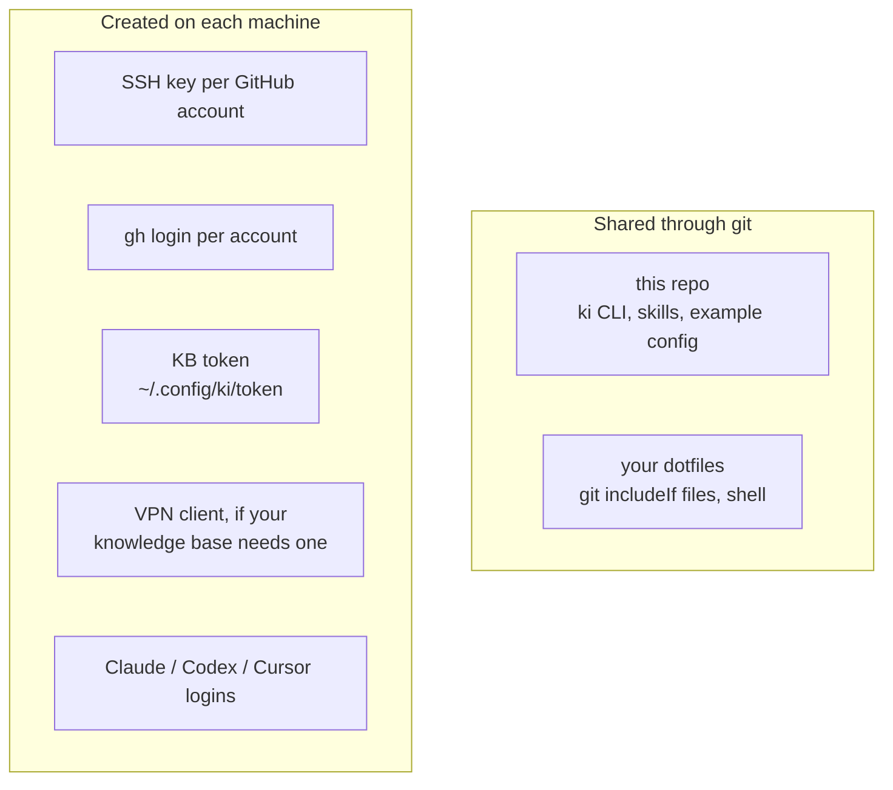

# Laptop setup

Sets up any machine that runs agents. To have an agent do it interactively, give it [INSTALL.md](../INSTALL.md); this page is the manual route. The rule throughout: **config is shared through git, credentials are created per machine and never copied**, so a lost laptop is revoked on its own without touching the others.



## Set up a machine, in order

The short version for a machine you set up from scratch. Each step says what it produces; the sections below explain why.

1. **Tools:** `git`, `gh`, Go 1.27 or later (only to build `ki` from source; Homebrew installs it for you), and Claude Code, Codex or Cursor; the [full list](#1-tools) has the checks and optional tools.
2. **Network:** if your knowledge base is private, enrol the machine in the VPN or network that reaches it. `curl https://<ki-mcp host>/healthz` must answer `ok`. Skip this when you run without a knowledge base or with the [local stack](local-stack.md).
3. **GitHub:** one SSH key per account added to that account, then `gh auth login` for each identity this machine carries. `gh auth status` lists them all.
4. **Folders and emails:** one folder per identity, `~/dev/<folder>/`, each with a git `includeIf` setting the email that `projects.yaml` expects for that identity. `ki` refuses a session where they differ.
5. **Device token:** only with a knowledge base. On the machine `openssl rand -hex 32 | tr -d '\n' > ~/.config/ki/token` (`chmod 600`), `shasum -a 256 < ~/.config/ki/token`, then give the hash, an `id`, the brains the machine may read and an expiry to whoever runs the knowledge base ([device tokens](self-hosting.md#device-tokens)). Never copy another machine's token file.
6. **ki:** [install it](#6-install-ki-and-the-skills), then `ki setup config ~/code/<your configuration repo>` (see [where the config lives](#where-the-config-lives); the harness's own `deploy/config` is an example with generic names and no server), then `ki setup machine <identity>...` with the identities from step 3, for example `ki setup machine me` on a machine with one account. `ki doctor` then expects only those logins, and `ki` refuses a repo of any other identity instead of starting as the wrong person.
7. **Check:** `ki doctor` says `all good`; `ki status` in a mapped repo lists its brains.

## Where the config lives

Everything that is yours rather than the harness's is a configuration directory of five files: `projects.yaml`, `models.env`, `aliases.yaml`, `mcp-config.json` and `config.yaml` (settings that are not projects, today the knowledge-base URL), plus an optional `agent/instructions.md` (see [Your own agent instructions](#your-own-agent-instructions)). `ki` finds it in this order: `KI_CONFIG`, the link `~/.config/ki/config`, else `deploy/config` inside the harness checkout, which holds a worked example with generic names and `https://ki.example.com` as its server. To use a directory of your own, typically a private repo started from [`examples/config/`](../examples/config/):

```bash
ki setup config ~/code/my-config   # validates the five files and writes the link
```

`ki doctor` names the source, `ki status --json` reports it, and `ki update` pulls a linked configuration checkout along with the harness. `ki doctor` warns, without counting a problem, when the harness or that checkout is behind its upstream as last fetched; it makes no network call, so `ki update` is what refreshes it. The knowledge base is optional: name it in `config.yaml` (or `KI_MCP_URL` in the profile) to use one. There is no built-in server, so without a URL ki runs in local mode: sessions and `ki delegate` start with identity, gh account and instructions but without the `ki-kb` MCP server or a device token (the `ki-vault` server stays when `KI_VAULT` is set), `ki doctor` reports `knowledge base: not configured (optional)`, `ki status --json` prints `"knowledge_base": null`, and `ki ask` and `ki kb` say they need a knowledge base. [`examples/config-minimal/`](../examples/config-minimal/) is the smallest configuration `ki setup config` accepts; `models.env`, `aliases.yaml` and `mcp-config.json` are read only by the cluster and are there with minimal content. The same directory is the cluster's overlay, see [deploy/README.md](../deploy/README.md).

### Your own agent instructions

`agent/instructions.md` in the harness is generic: how to use the vault and `ki delegate`, plus `agent/knowledge-base.md` (how to use the knowledge base), which is added only when a knowledge base is configured. What is yours (commit style, review habits, house rules) goes in an optional `agent/instructions.md` inside the configuration directory, started from [`examples/config/agent/instructions.md`](../examples/config/agent/instructions.md). When it exists, every agent gets it after the harness's text, a blank line between:

- Claude Code: `ki` writes both to a private file under `~/.config/ki/run/` and appends that file to the system prompt; old ones are pruned like the MCP configs.
- Codex: the `ki setup codex` block in `~/.codex/AGENTS.md`. Cursor: the rule `ki cursor` writes. Rerun either after editing the file.
- Workers started by `ki delegate` and `ki skill run`: Claude Code through the same file, Codex and Cursor in front of the task. `ki ask` carries its own read-only rules and takes none, and agy gets no instructions at all yet.

Without the file nothing changes and nothing warns. `ki status --json` reports the path as `config_instructions` (`null` when absent) and `ki doctor` lists it. The reasoning is in [the decision](../decisions/2026-11-08-config-instructions.md).

## 1. Tools

Install `git`, the GitHub CLI `gh`, Go 1.27 or later (to build `ki`), a VPN client if your knowledge base needs one, and Claude Code. Codex, Cursor and agy (the Antigravity CLI, which serves Gemini, Claude and GPT-OSS models) are optional, and so is node 22 or later, which only `ki diagram` needs (then run `make diagram` once in the checkout); tmux is needed only for [`ki mecca`](ki-mecca.md). The checks your [standards](../standards/README.md) name run wherever they are installed:

```bash
brew install uv golangci-lint shellcheck shfmt pre-commit gitleaks tmux
```

## 2. One folder per GitHub identity

Keep repos for each account under their own folder, so the folder decides who you are and an agent cannot pick the wrong identity:

```
~/dev/personal/    ~/dev/work/    ~/dev/client/
```

In `~/.gitconfig` (kept in your dotfiles):

```ini
[includeIf "gitdir:~/dev/personal/"]
    path = ~/.config/git/personal
[includeIf "gitdir:~/dev/work/"]
    path = ~/.config/git/work
```

`~/.config/git/work`:

```ini
[user]
    email = alice@work.example.com
[core]
    sshCommand = ssh -i ~/.ssh/id_work -o IdentitiesOnly=yes
```

Every repo under that folder, including agent worktrees, commits with that email and pushes with that key. The email must match the identity's `email` in `projects.yaml`; `ki` refuses to start a session if it does not.

## 3. SSH keys and gh logins

`projects.yaml` lists every identity the harness knows, but a machine usually carries a few of them: a work laptop has the employer's account, a personal one has yours. Record that once:

```bash
ki setup machine me work     # the identities this machine has gh logins for
```

It writes `~/.config/ki/machine.yaml`. `ki doctor` then checks those logins and only notes the others, and `ki` refuses to start a session in a repo of an identity the machine does not carry, with the command that adds it. Without the file every identity is expected, which is right for a single-identity setup and wrong for everything else.

The same file carries this machine's model policy, which you edit by hand (`ki setup machine` keeps it). When the file still names an identity that `projects.yaml` no longer has, the same command replaces that list and keeps `models`, `effort` and `roles` if those blocks parse:

```yaml
identities: [me, work]
models:                      # class of work -> agent (the `ki --agent` name) -> model
  judgement: {claude: opus, codex: gpt-5}
  execution: {claude: sonnet, codex: gpt-5-mini}
  search: {claude: haiku}
  writing: {claude: haiku}
effort:                      # Claude Code and agy
  execution: medium
roles:                       # who may run a delegated job, and in what order or turns
  execution:
    strategy: ordered        # or round-robin
    providers: [codex:gpt-5-mini, claude:sonnet, agy:gemini-3.8-flash-low]
  writing:
    providers: [claude:haiku]
  planner:                   # which agent a bare `ki` starts, first eligible wins
    providers: [claude:opus, codex:gpt-5, agent]
```

Judgement is the session itself, where issues are written and reviews made: `ki` passes that model to the agent it starts (`--model` for Claude Code and Codex), unless `ki --model` or `KI_MODEL` says otherwise for one run. Execution is a delegated worker applying a described change (`ki delegate`, which `/ki-burndown` runs per issue): the model and effort for the worker's agent, unless its provider in `roles` names one. Search is read-only lookup, reserved for subagents that only read. Writing is light prose: summaries, changelogs, commit and PR text, status posts (`ki delegate --role writing`). An agent missing from a class keeps its own default, so a policy for Claude Code alone is fine; model names are whatever the vendor accepts, nothing in ki knows them. `roles` is read by `ki delegate`, which vendors may run a headless job of that class, tried in order or in weighted turns, with a breaker and a daily cap per provider ([ki delegate](ki-delegate.md#roles-letting-the-machine-pick-the-vendor)), and by a bare `ki` for the `planner` role ([below](#the-planner-role-which-agent-a-bare-ki-starts)).

For each account, on each machine:

```bash
ssh-keygen -t ed25519 -f ~/.ssh/id_work -C "alice@work.example.com laptop-1"
# add the .pub to that GitHub account
gh auth login          # once per account; gh keeps them all
```

`ki` never switches gh's active account. It exports `GH_TOKEN` from `gh auth token --user <github_user>` for the repo you are in, so agents always act as that repo's identity.

## 4. Global git ignore

```bash
mkdir -p ~/.config/git && printf '%s\n' .cursor/mcp.json .cursor/rules/ki.mdc >> ~/.config/git/ignore
```

## 5. KB token and network access

Create this machine's token and register its hash in `tokens.json` ([device tokens](self-hosting.md#device-tokens)):

```bash
mkdir -p ~/.config/ki && chmod 700 ~/.config/ki
umask 077; openssl rand -hex 32 | tr -d '\n' > ~/.config/ki/token
shasum -a 256 < ~/.config/ki/token      # the sha256 for the tokens.json entry
```

A second file, `~/.config/ki/token-sensitive`, is only needed while `projects.yaml` lists brains under `sensitive_brains`; today it lists none. A machine that still has the file under its previous name keeps working: `ki` reads it and prints a deprecation notice until you rename it to `token-sensitive`.

Skip this step when you run without a knowledge base. Otherwise make sure the machine can reach the server named by `knowledge_base.url` in your configuration's `config.yaml`: with the [local stack](local-stack.md) that is a loopback port, on a cluster it is whatever network you put in front of ki-mcp (a VPN, say). `export KI_MCP_URL=https://<name>` in your shell profile overrides it for one machine.

## 6. Install ki and the skills

Three ways to get the `ki` binary, then `ki setup skills`. None needs a checkout of this repository, see [a release binary needs no checkout](#a-release-binary-needs-no-checkout). Contributors use a checkout instead, see [contributors](#contributors).

**Homebrew** (macOS and Linux). The formula builds `ki` from the release's source tarball, so Go is installed as a build dependency:

```bash
brew install kislow/tap/kio
ki setup skills
```

`brew upgrade kio` upgrades it, and `ki update` then relinks the skills.

**From a release archive** (built for macOS and Linux, arm64 and amd64, on every `v*` tag):

```bash
gh release download --repo <owner>/<repo> --pattern "kio_*_$(uname -s | tr A-Z a-z)_$(uname -m | sed 's/x86_64/amd64/;s/aarch64/arm64/').tar.gz"
tar xzf kio_*.tar.gz ki && mv ki ~/.local/bin/
ki setup skills
```

**With `go install`**, using the module path in this repository's `go.mod`:

```bash
GOBIN=~/.local/bin go install <module>/cmd/ki@<version>
ki setup skills
```

### Contributors

Work from a checkout, which `~/.config/ki/harness` points at, and your edits to `skills/` show up at once:

```bash
git clone <repo-url> ~/code/kio
cd ~/code/kio
make laptop       # installs ki into ~/.local/bin (BINDIR=... to change), links skills and agents, turns off Claude attribution, runs ki doctor
```

### A release binary needs no checkout

`ki` embeds `agent/*.md` and `skills/` from the repository, so a release binary or a `go install` build works with only a configuration directory (`ki setup config <dir>`, see [where the config lives](#where-the-config-lives)). `ki setup skills` links the `/ki-*` skills into `~/.claude/skills` and `~/.agents/skills`: to the checkout's `skills/` when `~/.config/ki/harness` (or `KI_HOME`) points at one, else to a copy of the embedded files under `~/.config/ki/skills/<version>/`, so an upgrade links a new folder. A skill folder that exists and is not a link is never overwritten. A checkout wins over the embedded files, so contributors see their edits at once. `ki doctor` shows `embedded (version X)` on the checkout line when there is none; the `deploy/config` fallback and `ki diagram` need a checkout. `ki update` without a checkout says to upgrade the binary the way it was installed, pulls a linked configuration and runs `ki setup skills`; with a checkout detached on a release tag, it fetches tags and moves to the newest `vX.Y.Z`.

Fix whatever `ki doctor` reports until it says `all good`. From then on `ki update` is the one command after a release: it fetches tags and pulls the checkout (and a linked configuration checkout, if `ki setup config` points at one), reinstalls `ki`, relinks the skills and runs `ki doctor`. It refuses a checkout with local changes or on another branch.

## Daily use

| Command | What it does |
| --- | --- |
| `ki` | Start an agent in the current repo with its scope, identity and instructions: `KI_AGENT`, else the first eligible provider of `roles.planner`, else Claude Code. Refuses in a repo that is not in `projects.yaml`; `--force` starts a session there without an identity, acting as gh's active account (with the cortex brain when a knowledge base is configured). Outside a git repo, `ki` looks at the git repos directly under the folder (hidden folders and `*-worktrees` skipped, unmapped repos ignored): one identity's repos start a session as that identity with the union of their projects' brains, so `cd ~/repos/infra && ki` works across several repos; a folder (or `~`) with no mapped repos starts without an identity, as gh's active account with cortex only; a folder mixing identities is refused, since a session has one `GH_TOKEN` and one knowledge-base token |
| `ki --identity NAME` | Outside a repo, start as that identity: its gh account, cortex and the non-sensitive brains of its projects (name a sensitive one with `--brain`). Inside a mapped repo it has to be the repo's own identity, or `--force`. The machine must still carry the identity |
| `ki --brain acme` | Add a brain for this session only; a sensitive brain switches to the sensitive token |
| `ki --agent codex` | Start another agent with `KI_TOKEN`, `KI_BRAINS`, `KI_MCP_URL` and `GH_TOKEN` exported. `ki codex`, `ki claude`, `ki agy`, `ki cursor-agent` and `ki agent` (Cursor's binary name) are the same with the agent first; combined with `--agent` they are refused, `ki cursor` stays the subcommand that writes Cursor's MCP config, and a first word that is no flag, command or agent is refused with a suggestion (agent arguments go after `--`) |
| `ki --model sonnet` | Run this session on a given model (`KI_MODEL` in your profile sets the default); passed to Claude Code, Codex and agy as `--model` |
| `ki --mode skip` | Permission mode: `ask` prompts before each action, `auto` lets the agent's own reviewer approve, `edits` accepts file edits and runs only allow-listed commands without asking, `skip` never prompts. `KI_MODE` in your profile sets the default, else `ask`; the session banner shows the active mode. See [Permission modes](#permission-modes) |
| `ki status` | Show what `ki` resolves here, including the default mode (`--json` for skills and scripts, with the machine's roles, their providers' health, `models` and `effort`: see [ki ask](ki-ask.md#ki-status---json)) |
| `ki recap [--identity NAME] [--since YYYY-MM-DD] [--json]` | One identity's GitHub activity, board cards and changed project notes since the previous working day; what `/ki-recap` drafts from. Reads with that identity's own gh login, wherever you run it |
| `ki vault push [-m message]` | Optional ([vault](vault.md)). Commit, pull with rebase and push the vault; what the note-writing skills call |
| `ki vault mcp [--read-only]` | The vault MCP server over stdio; agents start it themselves, you never run it by hand. `--read-only` leaves `vault_write` out, for `ki ask` |
| `ki diagram build\|check\|render\|requirements` | Build a tldraw drawing in the vault from its spec, keeping hand edits, and render it to PDF; needs node and `make diagram` once ([diagrams](diagrams.md)) |
| `ki cursor` | Write Cursor's MCP config and always-on rule for this repo (only if git ignores both) |
| `ki setup claude` | Turn off Claude Code's co-author trailer and PR line in your user settings, once per machine |
| `ki setup codex` | Add the KB server and agent instructions to Codex's global config, once per machine |
| `ki setup config ~/code/my-config` | Use a configuration directory of your own (`projects.yaml`, `models.env`, `aliases.yaml`, `mcp-config.json`, `config.yaml`); without it `ki` reads the harness checkout's `deploy/config`, the example |
| `ki setup machine me work` | Record which identities this machine carries in `~/.config/ki/machine.yaml`; doctor checks only their logins and `ki` refuses other identities' repos. The file's `models`, `effort`, `roles` and `delegate` blocks (the model policy, the [delegation roles](ki-delegate.md#roles-letting-the-machine-pick-the-vendor) and the [edits-mode allow-list](ki-delegate.md#edits-mode-a-worker-without-skipped-permissions)) are kept, including when the old identity list no longer validates |
| `ki update` | Fetch tags and pull the harness checkout and a linked configuration checkout, reinstall `ki`, relink skills, run `ki doctor` |
| `ki doctor` | Check this machine, in sections: Harness, Git and GitHub, Agents, plus Vault and Diagrams once `KI_VAULT` or a workspace is configured ([vault](vault.md)) |
| `ki validate` | Validate `projects.yaml` |
| `ki version` | Print the installed version |
| `ki mecca` | The tmux hub: `ki mecca new <project> --task ...` opens a window running `ki` in that checkout, `ki mecca ls` shows which windows wait for you. See [ki-mecca](ki-mecca.md) |
| `ki delegate (--task "..." \| --issue N) [--project NAME] [--role execution \| --agent codex] [--json]` | Run one task headless in a fresh worktree of this repo (or of `--project`'s checkout, from anywhere), on the agent the machine's role policy picks (or the one named) and print its status line (`PR`, `DONE`, `BLOCKED`, `FAILED`). `--issue` claims that GitHub issue first; `ki delegate ls` lists past jobs. See [ki delegate](ki-delegate.md) |
| `ki skill run <skill> [args...] [--role R \| --agent A] [--checkout PR\|BRANCH] [--allow TOOL]... [--json]` | One skill, headless, on the agent its role picks, allowed only the tools its frontmatter declares; a scratch folder or a throwaway worktree. See [ki skill run](ki-skill.md) |
| `ki ask "<question>" [--role R \| --agent A] [--source kb,vault,gh] [--json]` | One read-only answer, citing a source for every fact, from the agent the machine's `search` role picks; no repo needed and nothing written. See [ki ask](ki-ask.md) |
| `ki mcp ls [--agent claude\|cursor\|codex] [--json]` | Every MCP server each agent on this machine can reach, with source, transport, a redacted target and status (Claude Code's from `claude mcp list`, Cursor's and Codex's from their config files), plus ki's own. Never prints a token. See [ki mcp ls](ki-mcp-ls.md) |
| `ki kb brains\|search\|recent\|activity\|context [--brain B]... [--all] [--json]` | Read-only views of the knowledge base for UIs: the reachable brains with document counts, ranked hits with sources and links, the newest documents, documents ingested per day, the context pack. Same server, token and brain rules as a session. See [ki kb](ki-kb.md) |
| `ki approve <pr> [--review [--comment]] [--merge] [--dry-run] [--json]` | Approve a pull request (URL or `owner/repo#N`) as its repo's identity, right away or after a read-only agent reviewed it clean; `--merge` squash-merges afterwards. Never approves your own pull request and never bypasses branch protection. See [ki approve](ki-approve.md) |

## Claude Code, Codex and Cursor

The knowledge base, skills, standards and identity rules work in all three. They differ only in how each tool is configured.

| | Claude Code | Codex | Cursor |
| --- | --- | --- | --- |
| One-time setup | none | `ki setup codex` | none |
| Per repo | none | none | `ki cursor` once |
| Start a session | `ki` | `ki --agent codex` | open the repo in Cursor |
| KB scope and token | passed by `ki` | env vars from `ki`, read by `~/.codex/config.toml` | baked into the repo's `.cursor/mcp.json` |
| Agent instructions (harness's, then the config directory's) | injected by `ki` | `~/.codex/AGENTS.md` | `.cursor/rules/ki.mdc` (always applied) |
| Skills | `~/.claude/skills` | `~/.agents/skills` | `~/.agents/skills` (and `~/.claude/skills`) |
| `gh` account | `GH_TOKEN` set by `ki` | `GH_TOKEN` set by `ki` | gh's active account: `gh auth switch` when changing identity |
| Permission mode | `ki --mode` | `ki --agent codex --mode` | the IDE's own settings; `ki --agent cursor-agent --mode` for the CLI |
| `/ki-burndown` | `ki delegate` per issue, in parallel | `ki delegate` per issue, one after another | `ki delegate` per issue, one after another |

**Codex:** `ki setup codex` adds a managed block to `~/.codex/config.toml` (the `ki-kb` server, reading its token from `KI_TOKEN` and its scope from `KI_BRAINS`) and to `~/.codex/AGENTS.md` (the agent instructions). Your own settings outside the block are never touched, and re-running it updates the block in place. Without a knowledge base the block holds only the `ki-vault` server, and `config.toml` is left alone when there is not even that. Start Codex through `ki --agent codex` so those variables are set for the repo you are in; started directly, Codex has no KB access. If you keep an `AGENTS.override.md` in `~/.codex`, Codex reads that instead of `AGENTS.md`, and `ki doctor` warns you.

**Vault server** (optional, [vault](vault.md)): with `KI_VAULT` set, every session also gets `ki-vault`, a local MCP server that `ki` starts over stdio (`ki vault mcp`). Its tools, `vault_write`, `vault_read`, `vault_list` and `vault_search`, let any agent save a note where the vault's `AGENTS.md` says it belongs, with the frontmatter from `templates/`, the folder note updated and the vault pushed, so the note is in its brain after the next sync. Claude Code gets it through the session's MCP config, Codex through the `ki setup codex` block (rerun it after moving the vault or reinstalling `ki`), Cursor through `ki cursor`. It refuses the same things `ki vault push` refuses, plus credential-shaped values and a second note with an existing name. `ki doctor` reports whether it is offered.

**Cursor:** no Cursor CLI is needed. Run `ki cursor` once in each repo: it writes `.cursor/mcp.json` with that repo's scope and token, and `.cursor/rules/ki.mdc`, an always-applied rule with the agent instructions. Both stay out of git through your global ignore. A per-repo file is used on purpose: a Cursor window opened from the dock often cannot see shell variables, so a global config reading env vars is unreliable. Rerun `ki cursor` after rotating your KB token or changing the repo's brains.

### Permission modes

`ki --mode` (or `KI_MODE`) translates one setting into each agent's own flags:

| Mode | Claude Code | Codex | Cursor CLI (`cursor-agent`) | agy (Antigravity CLI) |
| --- | --- | --- | --- | --- |
| `ask` (default) | `--permission-mode manual` | `--sandbox workspace-write --ask-for-approval on-request` | nothing: it prompts by default | nothing: it prompts by default |
| `auto` | `--permission-mode auto` (the auto-mode classifier) | `--approve-for-me` (automatic review, workspace-write sandbox) | `--sandbox enabled`: commands run without asking, inside the macOS sandbox, writing only in the workspace. Never with `--force`, which overrides the sandbox. `ki delegate` also writes `.cursor/sandbox.json` into the worktree (hidden from git through `info/exclude`) allowing `api.github.com` so `gh` works; no other host is opened | none: ki refuses (agy's `--mode auto` depends on the account and silently falls back to prompting) |
| `edits` | `--permission-mode acceptEdits` plus `--allowedTools=Bash(<entry>:*)` per `delegate.allow` entry | none: ki refuses | none: ki refuses | `--mode accept-edits`, with `command(<entry>)` rules merged into agy's settings ([edits mode](ki-delegate.md#edits-mode-a-worker-without-skipped-permissions)) |
| `skip` | `--dangerously-skip-permissions` | `--dangerously-bypass-approvals-and-sandbox` | `--force` | `--dangerously-skip-permissions` |

`edits` accepts file edits and runs the shell commands listed under `delegate.allow` in `machine.yaml` without asking; any other command prompts in a session and is refused in a headless worker. A delegated worker (`ki delegate`) defaults to `auto`; for an agent without it (agy), `edits` when the machine file defines `delegate.allow`, else `skip`; it refuses `ask`: nothing interactive can answer. An unknown mode, or a mode the agent has no equivalent for, stops `ki` before anything starts. Any other agent gets nothing for `ask` and is refused `auto` and `skip`. Permission flags you pass after `--` win: if your agent args already set permissions (for example `ki -- --permission-mode plan`), `ki` adds none of its own and the banner says `mode=set by agent args`. `skip` turns off every prompt, including for commands that touch live infrastructure; use it in repos and sessions where that is acceptable.

### Subagents

Agent work inside a `ki` session goes through `ki delegate` (implementation, fixes, issues, pull requests) and `ki skill run ki-review` (reviews), which run in their own worktree on the vendor the machine picks and are recorded in the job ledger. A Claude Code session's own built-in subagents skip all of that, so every `ki` session of Claude Code, interactive or a delegated worker, registers a `PreToolUse` hook on the subagent tool (`Agent`, and `Task` in older versions) in its single `--settings`. The hook starts the hidden `ki session guard`, which allows the types in `sessions.subagents.allow` and denies the rest with a reason naming `ki delegate` and `ki skill run ki-review` (a delegated worker is told to do the work itself). A call that names no type is `general-purpose`; hook input the guard cannot read is denied.

```yaml
sessions:
  subagents:
    allow: [Explore]   # the default when the block is absent; [] allows none, ["*"] turns the guard off
```

`ki status` prints the policy on a `subagents` line. Codex, Cursor and agy have no guard: `agent/instructions.md` is the only lever there.

## The planner role: which agent a bare `ki` starts

Without `--agent`, `ki` starts the first of these that applies:

1. the positional agent (`ki codex`) or `--agent`
2. `KI_AGENT`
3. the first eligible provider of `roles.planner` in `machine.yaml`
4. `claude`

`roles.planner` has the shape of any other role (`strategy`, `providers` of `agent[:model]`) and is read with the rules `ki delegate` uses for a pick: a provider is skipped when its agent is not on PATH, when a job on it left it over quota until a reset that has not passed, when its latest launch failed less than 10 minutes ago, or when its `daily_jobs` is used up. Every skipped provider is named on stderr (`ki: role planner: claude:opus skipped, over quota until 2026-11-08T19:00:00+04:00`) and the banner names the chosen one (`planner=codex:gpt-5`). The pick only reads the ledger: no reservation, no turn or daily-cap count, nothing written, because a session is not a job. Quota and launch failures are known from delegated jobs only, so a session that hits its limit on its own does not demote the agent for the next `ki`; with `round-robin` the turn never advances, so the first provider always leads, and `ordered` is the strategy to write.

When no provider is eligible, `ki` refuses with each reason and the earliest reset, and exits non-zero. `--agent`, a positional agent or `KI_AGENT` still start a session. `ki status --json` carries a `planner` object (`agent`, `model`, `source` as `roles.planner`, `KI_AGENT` or `default`, the `skipped` providers with their reasons, or `error`) and `ki doctor` prints the same on a `planner` line, for a machine that defines the role.

## Models and cost

Nothing in the harness picks a model for you except where it is cheaper to be explicit:

| What runs | Model | Change it |
| --- | --- | --- |
| A `ki` session (Claude Code, Codex or agy) and the skills you run in it (`/ki-issue`, `/ki-review`, `/ki-decision`, ...) | `ki --model M`, else `KI_MODEL`, else the model of the provider `roles.planner` picked, else `models.judgement.<agent>` from `machine.yaml`, else the agent's default | the flag for one run, the machine file for good |
| A worker started by `ki delegate` | the provider's model from the role in `machine.yaml` (`roles.execution` unless `--role` names another class), else `--model M`, else `models.<class>.<agent>` and `effort.<class>` for that class, else the agent's default; never `KI_MODEL`. The job records the model the agent reported (see [ki delegate](ki-delegate.md#the-result)) | the roles block (which vendor, in what order or turns), the flag for one job |
| Any other subagent an agent spawns | the agent instructions say: only for long, self-contained work, on the cheapest model that can do it, read-only explorers for search | `agent/instructions.md` |
| Cursor | whatever its model picker shows (your plan's allowlist) | the picker |
| Extraction on the cluster (ingest) | `KI_LLM_MODEL` in `deploy/config/models.env`, Claude Haiku 5.5 today | a release |

Keep judgement work (writing issues, reviewing) on the strongest model you have; burndown executes issues that are already written, several at once, so it is where a cheaper model pays off.

## No agent attribution

Commits and PRs should read as yours. Each tool is covered separately:

- **Claude Code:** sessions started with `ki` get `--settings` with `attribution.commit` and `attribution.pr` empty. `ki setup claude` writes the same into `~/.claude/settings.json` for sessions you start without `ki`; `ki doctor` checks it.
- **Cursor:** turn off both switches under Settings > Agents > Attribution. Cursor keeps them in its own settings, which `ki` cannot check.
- **Every agent:** the agent instructions forbid co-author trailers, `Generated with` lines and session links, which also covers a tool that ignores its own setting.

## Optional integrations

A notes vault kept in git, with Obsidian and its sync, a cluster pusher and tldraw drawings, is optional and nothing above needs it. Export `KI_VAULT` to turn it on for a machine; see [vault and diagrams](vault.md). Without it, the skills that write notes hand you the text.

## Lost or retired machine

1. Delete its SSH keys from each GitHub account.
2. Remove its entries from `tokens.json` and update the secret ki-mcp reads ([device tokens](self-hosting.md#device-tokens)).
3. Remove it from your VPN, if you use one.
4. Sign it out of Claude, Codex and Cursor from their account pages.

The other machines keep working untouched.
