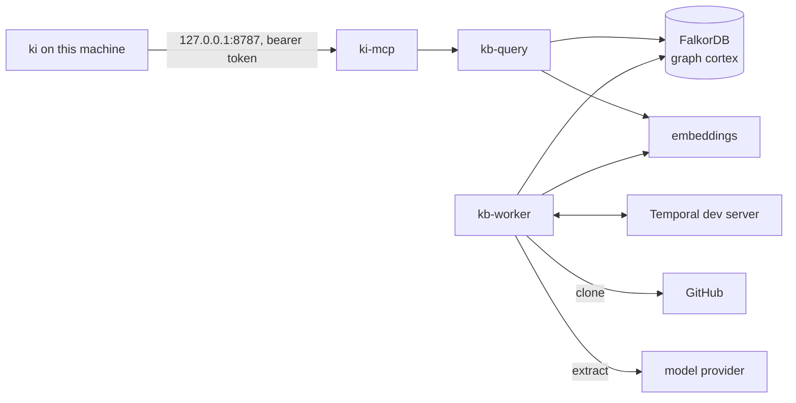

# Local stack

Runs the knowledge base on one machine with Docker Compose: FalkorDB, a Temporal development server, the ingest worker, kb-query, the embedding service and ki-mcp. No cluster, VPN, Traefik, Argo CD or secrets operator is needed. Use it to try the knowledge-base path, or to give one machine its own graph. The production shape is still a Kubernetes cluster, see [self-hosting](self-hosting.md#kubernetes).

The stack lives in [`deploy/compose/`](../deploy/compose/): [`compose.yaml`](../deploy/compose/compose.yaml), the configuration directory in [`config/`](../deploy/compose/config/), and the scripts `setup.sh` and `smoke-test.sh`.

## What runs

| Service | Image | Role | Reachable from the host |
| --- | --- | --- | --- |
| `falkordb` | `falkordb/falkordb:6.0.3`, pinned by digest as in `deploy/kustomization.yaml` | The graph store, one graph `cortex`, with a password | No |
| `temporal` | `temporalio/temporal:1.10.0`, pinned by digest, running `server start-dev` | Workflows and the sync schedule, in memory | No |
| `kb-worker` | built from `kb/Dockerfile` | Ingest: clones the projects, extracts entities and facts, embeds | No |
| `kb-query` | built from `kb/Dockerfile` | Search API that ki-mcp calls | No |
| `embeddings` | `text-embeddings-inference:cpu-1.9.4` serving `BAAI/bge-small-en-v1.5` | Embeddings, the same model as the cluster | No |
| `ki-mcp` | built from `cmd/ki-mcp/Dockerfile` | The MCP server: device tokens, scope, context packs | `127.0.0.1:8787` only |



Only `ki-mcp` publishes a port, and only on loopback. Every other service is reachable from the other containers on the compose network and from nothing else.

## Before you start

- Docker with Compose v2 (Docker Desktop or Docker Engine).
- Network access for the first start: the images, the embedding model from Hugging Face, and at run time GitHub and your model provider.
- An API key for an OpenAI-compatible chat endpoint. Extraction sends the text of every ingested document to that provider, so choose one you are content to use for those documents. The stack names no provider of its own.
- A read-only GitHub token for each repository you ingest. Public repositories need one too: the worker authenticates every clone with the token of the identity the project names.
- The `ki` CLI, if you want sessions on this machine to use the stack (`make laptop` or `make install-cli`).

Starting the stack needs only the model settings. The GitHub token is needed once ingest runs.

## Start it

1. Prepare the local files. Nothing is overwritten if it exists.

   ```bash
   deploy/compose/setup.sh
   ```

   This writes `deploy/compose/.env` (the FalkorDB password and the embedding service key, random, mode 0600), copies `config/models.env.example` to `config/models.env`, and writes `local/tokens.json` and `local/ki-token`: one device token, stored as its SHA-256 in `tokens.json` and in clear only in `ki-token`.

2. Set the providers in `deploy/compose/config/models.env`: `KI_LLM_BASE_URL`, `KI_LLM_MODEL` and `KI_LLM_API_KEY`. Every `REPLACE-ME` must go. `KI_LLM_STRUCTURED_MODE` may need to change for your provider (see [Models](models.md)). The embedding settings point at the local embedding service; change them only together with the key, and know that ingest and queries must keep one model (changing it means re-ingesting).

3. Point `deploy/compose/config/projects.yaml` at a repository you can read: set `repo` and the ingest rules (`README.md` and `docs/` in the example). Check it with the validator:

   ```bash
   go run ./cmd/ki validate deploy/compose/config/projects.yaml
   ```

4. Put a read-only GitHub token for the `me` credential in `deploy/compose/local/git-tokens/me`. The file is mounted read-only into the worker; on Linux it must be readable by uid 10001, the user the worker runs as.

5. Start the stack from `deploy/compose`:

   ```bash
   docker compose up -d --wait
   curl -s -o /dev/null -w '%{http_code}\n' http://127.0.0.1:8787/healthz   # 200
   ```

   `--wait` returns when FalkorDB, Temporal, kb-query and the worker report healthy. A worker without a valid token or model key stays up and logs its sync failures; that is the point at which to check step 2 and 4.

6. Connect `ki` to it. This replaces the device token and the configuration link of an existing `ki` setup, so on a machine that already uses another knowledge base, back up `~/.config/ki/token` and note the current configuration (`ki status --json`) first.

   ```bash
   mkdir -p ~/.config/ki && install -m 0600 deploy/compose/local/ki-token ~/.config/ki/token
   ki setup config deploy/compose/config
   ki doctor
   ```

   `knowledge_base.url` in `config/config.yaml` is `http://localhost:8787`. `ki setup config` links this directory as your configuration. It holds `config/models.env` with your key, so do not push the directory to a remote, and keep it out of project repositories.

To rotate the device token, delete `local/tokens.json` and `local/ki-token`, run `setup.sh` again, reinstall `~/.config/ki/token`, and restart ki-mcp with `docker compose restart ki-mcp`, which reads the token file at start.

## Smoke test

[`smoke-test.sh`](../deploy/compose/smoke-test.sh) checks the whole path once: it starts the stack, ingests the README and `docs/` of this checkout's `origin` (on its main branch, not your working tree), waits for documents to reach `cortex`, and asks ki-mcp for `get_context`.

```bash
deploy/compose/smoke-test.sh
```

It needs the model key and the `me` token from the steps above. It runs as its own compose project, `ki-local-smoke`, with its own volumes, so it cannot touch a stack you run; it tears that project down on exit, volumes included, unless `KEEP_STACK=1`. Set `KI_SMOKE_REPO` to ingest another repository, and `SMOKE_TIMEOUT` (seconds, default 1200) if extraction is slow.

Expected output, with the timestamps and the repository name of your run:

```text
HH:MM:SSZ smoke: starting the stack; ingesting https://github.com/OWNER/REPO (README.md and docs/)
HH:MM:SSZ smoke: ki-mcp answers on http://127.0.0.1:8787
HH:MM:SSZ smoke: sync triggered
cortex holds N documents
HH:MM:SSZ smoke: PASS: documents ingested into cortex
HH:MM:SSZ smoke: PASS: get_context returned a pack of M bytes, written to deploy/compose/local/smoke-pack.md
HH:MM:SSZ smoke: tearing down the stack and its volumes
```

`N` and `M` are positive numbers. The script exits 0 after the PASS lines and 1 with a `FAIL:` line otherwise. A failure before ingest completes usually means a missing key or token, which the script names. For more, `docker compose -p ki-local-smoke logs kb-worker`.

## Security

- **Loopback only.** `ki-mcp` is published as `127.0.0.1:8787`. When that port is taken, set `KI_MCP_PORT` in `.env` and the same port in `knowledge_base.url` of `config/config.yaml`; the smoke test reads `KI_MCP_PORT` too. FalkorDB, Temporal, kb-query, the embedding service and the worker's metrics publish no port.
- **Token required.** Every request to `/mcp` needs a bearer token. `local/tokens.json` holds only digests. Other local users can reach the port, but they still need the token.
- **FalkorDB has a password**, generated into `.env`.
- **The Kubernetes default-deny network policy does not apply.** `deploy/network-policy.yaml` is a Kubernetes object: compose has no equivalent policy, and the containers share one network with outbound internet access, because the worker clones from GitHub and calls your model provider. The isolation here is the set of ports not published, not a policy.
- **Secrets stay local.** `.env`, `config/models.env` and `local/` are gitignored and are never committed; the example files hold placeholders only.
- **Document text stays out of Temporal inputs and results**, as in the cluster. The dev server's history holds project names and counts.
- **FalkorDB's licence.** The FalkorDB server is licensed under the Server Side Public License (SSPL). This repository does not bundle the image: compose pulls `falkordb/falkordb` from Docker Hub, pinned by digest, and the licence applies to that image. Check it before you offer the stack to anyone else.
- **The Temporal dev server has no authentication** and keeps workflow history in memory. It is for development, not for a shared host. Ingest progress is kept in FalkorDB, so a restart of Temporal only drops workflow history; the worker recreates the schedule.

## How it differs from the cluster

| | Cluster ([self-hosting](self-hosting.md#kubernetes)) | Local stack |
| --- | --- | --- |
| Isolation | Kubernetes namespace and default-deny network policy | Compose network, unpublished ports |
| Access | Traefik IngressRoute behind a VPN | Loopback port 8787 |
| Temporal | Helm chart on Postgres | `server start-dev`, in memory |
| Secrets | Secrets operator from the GitOps repo | `.env`, `config/models.env`, `local/` |
| Images | Release tags from a registry (ghcr.io by default) | Built from this checkout |
| Embeddings, FalkorDB | Same model and pinned digest | Same model and pinned digest |
| Operations | Replicas, alerts, backups, the vault pusher | None: one machine, no backups |

## Stop and remove

```bash
cd deploy/compose
docker compose down              # stop, keep the volumes (the graph in FalkorDB, the embedding model cache)
docker compose down --volumes    # stop and delete them too
```

The smoke test removes its own project's volumes on exit. Deleting volumes deletes the graph: the stack has no backup.
