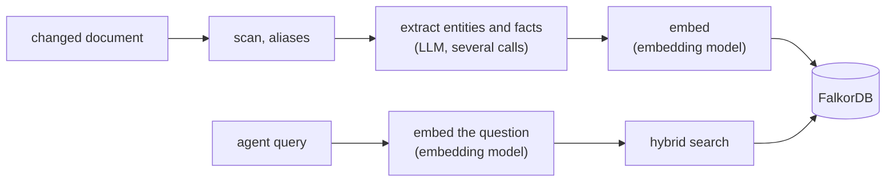

# Models

Three different things use models, and they are deliberately separate:

| Use | Who calls it | Configured in | Current choice |
| --- | --- | --- | --- |
| Agents doing the work | You, through Claude Code, Codex, Cursor or agy | Your own logins on each machine | Your subscriptions |
| Extraction during ingest | `kb-worker`, unattended | `deploy/config/models.env` | Claude Haiku 5.5 (`claude-haiku-5-5`) through Anthropic's OpenAI-compatible endpoint |
| Embeddings for ingest and every query | `kb-worker` and `kb-query` | `deploy/config/models.env`, `deploy/kb/embeddings.yaml` | `BAAI/bge-small-en-v1.5`, 384 dimensions, on text-embeddings-inference in the cluster |

The knowledge base is model-agnostic: whichever agent you use gets the same context packs. Subscription logins cannot be used by unattended server jobs, which is why extraction needs an API key. Embeddings need none: they run in the cluster.

## Where models are called

Only changed documents reach the LLM. A day with no edits costs one `git ls-remote` per project and tick, and nothing else. Every agent query costs one small embedding call.

## Why these choices

- **Claude Haiku 5.5 for extraction** (decided 2026-10-19 after measuring the same twelve notes on four models; the owner wants Claude, and Haiku 5.5 gave a graph on par with DeepSeek with no schema re-asks at about a third of Sonnet 5.5's price):

  | Model | Entities / edges | Calls per note | Seconds per note | Re-asks | Cost per note, estimated |
  | --- | --- | --- | --- | --- | --- |
  | DeepSeek Flash, thinking off | 96 / 154 | 45 | 31 | 0 | $0.02 |
  | Claude Haiku 4.5 | 85 / 126 | 32 | 24 | 89 | $0.15 |
  | Claude Sonnet 5.5 | 108 / 149 | 28 | 34 | 0 | $0.45 |
  | Claude Haiku 5.5 | 91 / 130 | 25 | 37 | 2 | $0.12 |

  DeepSeek stays the cheap fallback: Graphiti supports it directly with `KI_LLM_STRUCTURED_MODE=json_object` (schema in the prompt, empty responses retried) and `KI_LLM_THINKING=false`.
- **How Claude is wired:** `KI_LLM_BASE_URL=https://api.anthropic.com/v1`, and `KI_LLM_STRUCTURED_MODE=prompt` (the endpoint accepts only strict JSON schemas, which Graphiti's models are not, so the schema goes in the prompt and `SchemaEchoClient` validates the answer; the mode also drops `temperature`, which Claude 5.5 models refuse) and `KI_LLM_THINKING=true`. Claude 5 models think by default on that endpoint: the reasoning is never returned, but it is billed as output and counts against `max_tokens`, so `SchemaEchoClient` raises every call to at least `KI_LLM_MAX_TOKENS` (Graphiti itself caps edge extraction at 16,384). `KI_LLM_THINKING=false` sends `thinking: {"type": "disabled"}`, which Haiku 5.5 accepts at its default effort; it would cut output tokens but has not been measured for graph quality. Sonnet is the same settings with `claude-sonnet-5-5`.
- **Embeddings in the cluster:** independent of the extraction provider. `bge-small-en-v1.5` is small (33M parameters), runs on CPU, and is a standard choice for English retrieval. Graphiti only embeds entity names and short fact sentences, never whole documents, so its 512-token input limit does not matter. Served by text-embeddings-inference, it speaks the same OpenAI-compatible API Graphiti already uses, so no code changes; it runs in namespace `harness`, so embedding text never leaves the cluster, and costs nothing per call. It is English-only: if entities, facts or queries become mixed German and English, move to a multilingual model such as `intfloat/multilingual-e5-small`, after checking how its `query: `/`passage: ` prefixes would be applied, since Graphiti sends text unchanged.
- **One provider for every brain:** the harness holds no regulated data and sensitive brains are fed dummy data, so they use the same provider as everything else. The native DeepSeek API is hosted in China: before ingesting a client's own material, check that the client agreement allows it (see [Security](security.md#before-client-material-goes-in)).

## Rough costs (Claude Haiku 5.5; DeepSeek Flash is about six times cheaper)

| Job | Volume | Cost |
| --- | --- | --- |
| Backfill, about 3,000 documents | ~45M tokens in, ~6M out | about $10, once |
| Ongoing ingest, about 20 changed documents a day | ~300k in, ~40k out per day | about $2 a month |
| Nightly project cards (planned) | ~120k in, ~10k out | about $0.02 a night |

These are estimates; the worker logs the real numbers, see [Operations](operations.md#model-usage-and-cost). A bulk load of short documents measured about $0.02 to $0.03 each on DeepSeek, and what decides speed and cost is in [Bulk ingest](operations.md#bulk-ingest-speed-and-cost).

Anthropic has one list price around the clock; DeepSeek's off-peak discount only matters on the fallback. On DeepSeek, set `KI_LLM_PEAK_UTC=Mon-Fri 01:00-04:00,06:00-10:00` and `KI_LLM_BALANCE_URL=https://api.deepseek.com/user/balance`, so bulk loads wait for the cheap hours and stop before the account runs dry (see [Bulk ingest](operations.md#bulk-ingest-speed-and-cost)). Measure on a 50-document sample before the full backfill: Graphiti's prompt sizes depend on how large and connected your documents are.

## Switching providers

- **Extraction model:** change `KI_LLM_*` in the env file and release; the config map ships with the manifests. Existing graphs stay valid. Documents that failed extraction with the old model are retried only after `forget-failures` (see [Operations](operations.md#watch-ingest)).
- **Embedding model or dimensions:** the index is built with one embedding model and queries must use the same one, so a different model means re-embedding even at the same dimension. Today that means wiping the graphs, the `ki:ingest:*` state keys, the `ki:synced:*` markers and the `ki:failed:*` records and letting the next sync rebuild everything, extraction included (see [Operations](operations.md#rebuild-a-brain)). A re-embed-only migration from stored entity names and facts is possible but not built.

## Self-hosting later

Embeddings already run in the cluster on CPU (`deploy/kb/embeddings.yaml`). The resource requests there are a starting point: measure under ingest load and adjust. Extraction needs roughly a 30B-class model to produce reliable structured output: a 24 GB GPU, or about 32 GB of RAM for a mixture-of-experts model on CPU (slow, but ingest is background work). To try it before buying hardware, rent a GPU by the hour (an AWS `g5.xlarge` on spot is about $0.42/hour), serve the model with vLLM, point `KI_LLM_BASE_URL` at it, and run the same 50-document sample.
