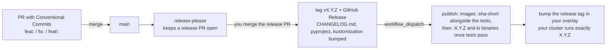

# Operations

Day-two tasks for a knowledge base running on a Kubernetes cluster ([self-hosting](self-hosting.md)). The commands use the cluster's `harness` and `temporal` namespaces; on the [local stack](local-stack.md) run the same `python -m ki_kb.admin ...` commands with `docker compose exec kb-worker` from `deploy/compose/` instead of `kubectl exec`.

## Watch ingest

Temporal UI (the hostname you set in the Temporal values, or `kubectl -n temporal port-forward svc/temporal-web 8080:8080`): the schedule `ki-sync-projects` starts `SyncProjects` every `KI_SYNC_EVERY_MINUTES` (5 by default). With `KI_SYNC_EVERY_MINUTES=0` syncing is manual: the schedule has no interval and stays paused, and a sync runs when you press Trigger on the schedule in the Temporal UI or run `kubectl -n temporal exec deploy/temporal-admintools -- temporal schedule trigger --schedule-id ki-sync-projects` (both work while it is paused). The worker applies the setting to the schedule each time it starts, and never unpauses one paused by hand. Each run's result lists, per project, the commit and how many documents were added, replaced, removed, unchanged, rejected by the scanner, failed extraction, or deferred, with `deferred_reason` saying why: `quiet` when they were committed within the last `KI_INGEST_QUIET_MINUTES` (30 by default), so a note you are still editing is extracted once, after you stop, not on every push; `peak` or `balance` when a bulk project waits for off-peak or for money (see [Bulk ingest](#bulk-ingest-speed-and-cost)); `time` when the attempt's timeout leaves no room for another batch (the worker stops before starting a batch that, judging by the slowest one so far plus 5% of the timeout, would not finish, so Temporal never cuts a batch off; the rest goes on the next run); `backoff` when the project's last runs failed (see [Failed runs and backoff](#failed-runs-and-backoff)). To see why a document was rejected, read the worker log for `document rejected by scanner` (`kubectl -n harness logs deploy/kb-worker`): it carries the project, the path (omitted for `sensitive` projects), and the rule kinds with the line numbers each matched on, never the matched text. The sync result's `rejected_rules` maps each rejected path to its rule kinds, and `rejected_rule_counts` counts documents per rule kind (the only one filled for a sensitive project); `ki_ingest_rejections_total` shows the rule mix over time. Open the document at those lines and either remove the value or, for a false positive, report it so the rule is tightened. Within a run the vault syncs first, repo docs next, and `bulk: true` projects last. To sync one project immediately, start `SyncOneProject` on queue `ki-ingest` with the project name as its only input (`"<project>"`).

A failed sync shows a fixed message in Temporal: the project, the error type, and the file path for non-sensitive projects. The full error, which can contain model output, is only in the worker's log (`kubectl -n harness logs deploy/kb-worker`).

A document whose extraction fails (an unparseable or truncated model answer, for example) fails alone: the sync goes on, the result counts it under `failed` (paths under `failed_paths` for non-sensitive projects), and the worker logs `document failed` with the error type. It is not tried again until the document changes or a new worker version is released. After a fix that is neither, such as a higher `KI_LLM_MAX_TOKENS` or another extraction model, retry every failed document on the next sync:

```bash
kubectl -n harness exec deploy/kb-worker -- python -m ki_kb.admin forget-failures
```

A batch whose attempt died together with the database (a FalkorDB crash or outage) cannot clean up the episodes it had already saved; the next attempt removes them before it starts. Copies left by releases before 0.25.7 are repaired once with:

```bash
kubectl -n harness exec deploy/kb-worker -- python -m ki_kb.admin remove-duplicates --dry-run
kubectl -n harness exec deploy/kb-worker -- python -m ki_kb.admin remove-duplicates
```

A copy that owns no knowledge (the attempt died before extraction finished) is deleted directly. A document with a copy that does own knowledge, or whose recorded episode is gone, has its ingest state forgotten, and the next sync removes every copy and extracts it once more: Graphiti credits a fact to the episode that first produced it, so deleting only the copy could take facts the recorded version relies on. The command forgets state before deleting anything, so it is safe to interrupt; it takes seconds.

FalkorDB Browser (its own hostname, or a port-forward to port 3000 of the `falkordb` service) shows the graphs themselves. Log in with host `localhost`, port `6379` and the FalkorDB password from your secrets manager (`kb-secrets/falkordb-password`); it can run any query, so treat it as an admin console.

## Upgrade FalkorDB 4.x to 6.x

6.x cannot read the append-only file 4.x writes ("effects buffer is version 2, this build reads 3"), and it loads a 4.x range index on a property that also has a full-text index as missing. Nothing has to be ingested again: the graphs and the ingest state (`ki:ingest:*`, `ki:synced:*`) are in the data files and come across as they are. Rehearsed on a copy of a 2,200-document instance: every label and relation count, embedding, sampled entity and state key matched afterwards.

1. Pause the schedule and wait until no `SyncProjects` run is left (cancel a running one), so nothing writes during the switch.
2. Back up the data directory (see [Backups](#backups)) and keep the counts per graph for comparison.
3. Remove anything in the data directory that is not `*.rdb` or `appendonlydir` (a `core.*` crash dump, for example): 6.x hands the directory to its unprivileged user (uid 999) only when it holds nothing else. Releases before 0.27.0 mounted the volume at `/data`, which 6.x turns into a link; there the hand-over reached only the top folder and redis-server exited with "Can't open the temporary manifest file ... Permission denied" (fixed once by `chown -R 999:999 /var/lib/falkordb/data/` in the pod while it was up).
4. On 4.x, rewrite the append-only file into the snapshot format 6.x reads, and wait for `aof_rewrite_in_progress:0` and `aof_last_bgrewrite_status:ok`:

   ```bash
   kubectl -n harness exec falkordb-0 -c falkordb -- sh -c 'redis-cli -a "$FALKORDB_PASSWORD" --no-auth-warning BGREWRITEAOF'
   kubectl -n harness exec falkordb-0 -c falkordb -- sh -c 'redis-cli -a "$FALKORDB_PASSWORD" --no-auth-warning INFO persistence' | grep -E 'aof_rewrite_in_progress|aof_last_bgrewrite_status'
   ```

5. Deploy the release that pins 6.x.
6. Rebuild the indexes once; it checks that index lookups find what full scans find and fails loudly otherwise, and ends with an append-only rewrite (0.28.0 and later), because 6.0.3 could not replay the index drops from its log: on 2026-10-25 the next start stopped with "Diverged applying GRAPH.EFFECT ... Unable to drop index ... no such index". If that happens, the `dump.rdb` FalkorDB writes on shutdown is a complete snapshot: make it the base of a fresh `appendonlydir` (copy it to `appendonly.aof.<n>.base.rdb`, an empty `appendonly.aof.<n>.incr.aof`, a two-line manifest, owner 999) and start again:

   ```bash
   kubectl -n harness exec deploy/kb-worker -- python -m ki_kb.admin rebuild-indexes
   ```

7. Compare the counts per graph with step 2, then unpause the schedule.

Until step 6 lookups by name and group are full scans: correct, only slower.

## Model usage and cost

Every `add_episode` (one document) or `add_episode_bulk` (one batch of `KI_INGEST_BATCH` documents) logs one INFO line, `"episode model usage"`, with `graph`, `model`, `episodes`, `episode_uuids` (or `error` when it failed), `calls`, `input_tokens`, `output_tokens`, `reasoning_tokens`, `cached_tokens`, `truncated`, `prompts` (calls and input tokens by Graphiti prompt name, retries included) and `calls_per_episode` and `input_tokens_per_episode` (the batch's totals divided by its documents). No names, paths or text. Replacing or deleting a document removes its old episode, and Graphiti then rebuilds the summary of every entity that episode touched with `extract_nodes.extract_entity_summaries_from_episodes`, often the largest prompt of a sync. A removal that called the model logs its own line with `removed_episode` (the old episode's uuid) instead of `episode_uuids`; one that made no model call logs nothing. Together the lines are complete: every model call of a sync is in exactly one line, so their `input_tokens` add up to the increase of `ki_llm_tokens_total{kind="input"}` over the same period, and the per-prompt split to `ki_llm_prompt_input_tokens_total`. Cross-check a window by summing the lines and comparing with the counter's increase from Prometheus (`increase(ki_llm_tokens_total{kind="input"}[2h])`, summed over models); a gap means a model call outside `add_episode`, `add_episode_bulk` and `remove_episode`, or a window that cut a batch in half. Sum a day's tokens:

```bash
kubectl -n harness logs deploy/kb-worker --since=24h \
  | jq -Rc 'fromjson? | select(.msg == "episode model usage")' \
  | jq -sc '{lines: length, calls: (map(.calls) | add), input: (map(.input_tokens) | add), output: (map(.output_tokens) | add)}'
```

Cost is `input / 1e6 * input price + output / 1e6 * output price` for the `model` in the line: for `claude-haiku-5-5`, $0.10 in and $0.50 out per million tokens (prompts up to 100K tokens, list price on 2026-10-24; check Anthropic's pricing page). Anthropic's endpoint reports hidden reasoning inside `output_tokens` and leaves `reasoning_tokens` and `cached_tokens` at 0; DeepSeek fills them. A failed episode still logs what it spent. To map an `episode_uuid` back to a document, look it up in the `ki:ingest:<project>` hash.

Each model call also logs `"model call"` at debug level (`LOG_LEVEL=DEBUG`) with `finish_reason`, `max_tokens`, the token counts and `answer_chars`. An answer stopped by `max_tokens` logs a warning, `"model answer cut off by max_tokens"`, with the same fields: `answer_chars` far below what `output_tokens` would produce means reasoning used up the budget.

## Issue or change a device token

```bash
secret="$(openssl rand -hex 32)"; printf '%s' "$secret" | sha256sum
# add or edit the entry in tokens.json (id, sha256, brains, expires),
# paste the whole file into its secrets-manager item; the operator
# updates ki-mcp-tokens, then:
kubectl -n harness rollout restart deployment/ki-mcp
```

Give the secret to the device as `~/.config/ki/token` (or `token-sensitive`). `tokens.json` lives only in the secrets manager, never in git. A token's `brains` decide what that machine can read; see [which machine reads what](projects-and-brains.md#which-machine-reads-what).

## Rotate a git token

Create the new fine-grained token on GitHub, then update its secrets-manager item; the operator updates `kb-git-tokens`. The worker reads tokens at the start of every sync, so no restart is needed.

## Revoke a laptop

See [Laptop setup: lost or retired machine](laptop-setup.md#lost-or-retired-machine).

## Rebuild a brain

Needed after changing the embedding model, or if a graph looks wrong. Run in the worker pod:

```bash
kubectl -n harness exec deploy/kb-worker -- python -m ki_kb.admin forget-graph brain-acme
```

This deletes the graph, the ingest state for every document that fed it, the project's sync markers and its recorded extraction failures, so the next sync re-extracts those documents from git. Documents feeding other brains are untouched. Add `--dry-run` to see what it would delete.

## Change a brain's sensitivity

Adding a brain to `sensitive_brains` or taking it out moves no data: change `projects.yaml` and the brain's `sensitive` flag in the MCP config together (`make check-manifests` fails if they disagree), and update the device tokens that should or should no longer read it.

## Retire a brain

Removing a brain from the MCP config and `KI_ALLOWED_GRAPHS` leaves its documents in FalkorDB. The worker detects that and stops every sync with `StrandedGraph` until they are cleaned up, so nothing lingers unnoticed.

1. Before the change: `python -m ki_kb.admin forget-graph brain-<name> --dry-run`, then without `--dry-run`.
2. Remove the brain from `projects.yaml`, the MCP config and `KI_ALLOWED_GRAPHS`; `make check-manifests`; release.

If step 1 was missed, run `python -m ki_kb.admin forget-stranded --dry-run` and then `forget-stranded` in the worker pod. It only deletes graphs the worker may no longer touch.

## Add a project or brain

See [Projects and brains](projects-and-brains.md).

## Backups

Backups are your cluster's job, not the harness's; the state worth copying nightly, off the cluster, is:

| What | Content |
| --- | --- |
| the two Temporal databases (namespace `temporal`) | `pg_dump` of `temporal` and `temporal_visibility` |
| the FalkorDB data directory | append-only file and RDB snapshots on the `data-falkordb-0` volume |

The graphs are a rebuildable index of git, so the FalkorDB backup mainly saves re-ingesting; Temporal history is what a restore of a half-finished sync needs. A backup job that names the volume directory by PVC uid needs updating if the PVC is ever recreated.

## Alerts

The harness exposes three things to a Prometheus stack that selects ServiceMonitors in every namespace: Temporal's server metrics (the chart's ServiceMonitors, `deploy/temporal/values.yaml`), a `redis_exporter` sidecar on the FalkorDB pod (`deploy/kb/falkordb.yaml`, ServiceMonitor in `deploy/kb/monitoring.yaml`, opened by the `falkordb-metrics-from-prometheus` policy), and, through a blackbox probe you add, the extraction provider's API. The rules below live with your cluster's monitoring, not in this repo; these are the ones the harness was built with:

| Alert | Means | First look |
| --- | --- | --- |
| `HarnessSyncRunFailed` | a `SyncProjects` run failed in the last 15 min | worker log: `kubectl -n harness logs deploy/kb-worker \| grep '"sync failed"'`; the `stderr`/`path` fields say which project and why |
| `HarnessSyncNotSucceeding` | no `SyncProjects` run has completed for 2 h, or Temporal metrics are missing | `temporal workflow list` in the admintools pod; is the schedule paused, is the worker up |
| `FalkorDBDown`, `FalkorDBMetricsMissing` | the exporter cannot reach FalkorDB, or Prometheus cannot reach the exporter | `kubectl -n harness get pods -l app.kubernetes.io/name=falkordb`; Prometheus targets |
| `FalkorDBEmpty` | FalkorDB is up with no keys: the graphs are gone (a restart without the PVC, a bad restore) | `appendonlydir` on the PVC, `GRAPH.LIST`; restore from backup |
| `FalkorDBAofDisabled`, `FalkorDBAofWriteFailing` | durability is off or broken; the next restart loses data | `CONFIG GET appendonly`, `INFO persistence`, disk space on the node |
| `FalkorDBMemoryHigh` | over 85 % of the container limit | graph sizes, `MAX_QUEUED_QUERIES`, raise the limit in `deploy/kb/falkordb.yaml` |
| `ThirdPartyApiUnreachable` | the extraction provider's API does not answer over TLS from the cluster | the provider's status page; egress from the worker pod; ingest stalls until it is back |

## Cost and latency

The harness exports what extraction costs and how fast the knowledge base answers; the dashboard and the alert rules live with your cluster's monitoring. Scraped by the ServiceMonitors in `deploy/kb/monitoring.yaml` (network policies open the ports to Prometheus only):

| Metric | From | Labels | Meaning |
| --- | --- | --- | --- |
| `ki_llm_tokens_total` | kb-worker, `:9464` | `provider`, `model`, `kind` = input, output, reasoning, cached | tokens the provider billed, as its API reported them |
| `ki_llm_calls_total` | kb-worker | `provider`, `model`, `outcome` = ok, cut_off, error | chat completions; `cut_off` hit `max_tokens`, `error` is any failed request (rate limit, budget cap, outage) |
| `ki_llm_prompt_calls_total` | kb-worker | `prompt` | chat completions by Graphiti prompt name (`dedupe_edges.resolve_edge`, `extract_edges.edge`, ...), retries included |
| `ki_llm_prompt_input_tokens_total` | kb-worker | `prompt` | input tokens by prompt name; divide `increase(...)` by `increase(ki_ingest_documents_total{outcome=~"added|replaced"}[1d])` for calls and tokens per document |
| `ki_llm_call_seconds` | kb-worker | `provider`, `model` | wall time of one completion |
| `ki_llm_balance_usd` | kb-worker | `provider` | the provider's account balance in USD, read at sync start and periodically during bulk syncs; only with `KI_LLM_BALANCE_URL` set, and absent until the first reading |
| `ki_ingest_documents_total` | kb-worker | `project`, `outcome` = added, replaced, removed, rejected, deferred, failed | one count per document per sync run |
| `ki_ingest_rejections_total` | kb-worker | `project`, `rule` = the scanner's rule kind (`card-number`, `aws-access-key`, `assigned-secret-unquoted`, ...) | one count per rejected document per rule per sync run |
| `ki_ingest_document_seconds` | kb-worker | `project` | time to extract one document (a bulk batch's time is shared evenly) |
| `ki_query_seconds` | kb-query, `/metrics` | `tool`, `stage` = total, search, episodes | one request, whole and per stage |
| `ki_query_requests_total` | kb-query | `tool`, `status` | requests by HTTP status |
| `ki_mcp_tool_seconds` | ki-mcp, `/metrics` | `tool`, `brain_count` | one MCP tool call, fan-out included |
| `ki_mcp_tool_calls_total` | ki-mcp | `tool`, `outcome` = ok, denied, error | `denied` is a scope or input refusal, `error` a backend failure |

No label ever carries a query, a document path, a token id or a brain name. `KI_METRICS_PORT=0` turns the worker's server off.

Queries for the panel. The price per million tokens is a Grafana variable (`$in_price`, `$out_price`, per provider); the harness does not know prices.

```promql
# tokens per day by provider and kind
sum by (provider, kind) (increase(ki_llm_tokens_total[1d]))

# estimated spend per day (set $in_price and $out_price for the provider in view)
sum by (provider) (increase(ki_llm_tokens_total{kind="input"}[1d])) / 1e6 * $in_price
  + sum by (provider) (increase(ki_llm_tokens_total{kind=~"output|reasoning"}[1d])) / 1e6 * $out_price

# documents per outcome per day
sum by (outcome) (increase(ki_ingest_documents_total[1d]))

# seconds per document, p50 and p95
histogram_quantile(0.5, sum by (le) (rate(ki_ingest_document_seconds_bucket[1h])))
histogram_quantile(0.95, sum by (le) (rate(ki_ingest_document_seconds_bucket[1h])))

# knowledge base latency per tool, p50 and p95, as the agent sees it
histogram_quantile(0.5, sum by (tool, le) (rate(ki_mcp_tool_seconds_bucket[1h])))
histogram_quantile(0.95, sum by (tool, le) (rate(ki_mcp_tool_seconds_bucket[1h])))

# where the time goes inside kb-query
histogram_quantile(0.95, sum by (stage, le) (rate(ki_query_seconds_bucket[1h])))

# a provider cap or outage: errors rising while successes stay flat
increase(ki_llm_calls_total{outcome="error"}[30m]) > 20
  and increase(ki_llm_calls_total{outcome="ok"}[30m]) < 5
```

Alert to add next to `harness.rules` in your cluster repo:

```yaml
- alert: HarnessExtractionFailing
  expr: increase(ki_llm_calls_total{outcome="error"}[30m]) > 20
  for: 10m
  labels: { severity: warning }
  annotations:
    summary: extraction calls are failing
    description: >-
      More than 20 extraction calls failed in 30 minutes. A provider cap or
      outage parks documents as failed; see the worker log for the error type,
      then `ki_kb.admin forget-failures` once the provider answers again.
```

With the balance guard on (`KI_LLM_BALANCE_URL`), alert before bulk ingest stops for money:

```yaml
- alert: HarnessLLMBalanceLow
  expr: min(ki_llm_balance_usd) < 10
  for: 15m
  labels: { severity: warning }
  annotations:
    summary: extraction provider balance is low
    description: >-
      The provider balance is under $10. Below KI_LLM_MIN_BALANCE (5 by
      default) bulk projects are deferred with reason "balance"; small
      changes keep flowing until the provider refuses them.
```

## Bulk ingest: speed and cost

Day to day, ingest is a few changed notes per run and nothing here matters. A bulk load (a large archive folder, a new repo, a rebuild) is thousands of documents, and these settings decide whether it takes a few hours or a day, and what it costs. Measured on 2026-10-25 with 1,785 short GitHub documents into one brain on DeepSeek V4 Flash (prompt mode, thinking off):

| Setting | Where | Default | What it does |
| --- | --- | --- | --- |
| `KI_INGEST_BATCH` | models.env | 16 | Documents per Graphiti bulk call within one graph. The biggest lever: 16 ran at 5.3 documents a minute against 3 at 8, and used fewer input tokens per document (about 290,000 against 380,000), because a batch shares its search and merge context. |
| `KI_EDGE_DEDUPE_CANDIDATES` | models.env | 5 | Facts between the same two entities shown to the model with each new fact (`dedupe_edges.resolve_edge`). Graphiti's own limit is 10, which on a grown graph meant one call per new fact with up to 20 facts in the prompt. |
| `KI_EDGE_INVALIDATION_CANDIDATES` | models.env | 3 | Facts of any entities shown with each new fact to check for contradictions. 0 skips that search, and a fact whose entities share no fact yet then needs no call at all. |
| `KI_INGEST_RATE_LIMIT_ATTEMPTS` | models.env | 5 | Extra attempts for a rate-limited bulk call in the same sync. After these retries, the activity fails so Temporal can try the batch on a later run; it never falls back to expensive single-document calls for a 429. |
| `KI_INGEST_RATE_LIMIT_MAX_WAIT_SECONDS` | models.env | 600 | Total time spent waiting between rate-limit retries. The waits double from 15 seconds (15, 30, 60, 120, 120), each capped at 120 seconds, and the worker heartbeats while it waits. |
| `KI_SYNC_EVERY_MINUTES` | models.env | 5 | How often the schedule starts `SyncProjects`. 0 makes syncing manual: no interval, the schedule kept paused, a sync only when triggered. Applied to the existing schedule each time the worker starts. |
| `KI_SYNC_TIMEOUT_MINUTES` | models.env | 45 | StartToClose of one sync attempt for an ordinary project. |
| `KI_SYNC_BULK_TIMEOUT_MINUTES` | models.env | 240 | The same for a `bulk: true` project, also when it is synced on demand with `SyncOneProject`, so a long load is not cut off every attempt. Must not exceed the ceiling; a bad value stops the worker at start-up. |
| `KI_SYNC_TIMEOUT_CEILING_MINUTES` | models.env | 360 | Hard upper bound on both. The heartbeat (5 minutes, fixed) is what detects a stuck attempt, so the long limit only lets an attempt that still heartbeats keep running. |
| `KI_LLM_PEAK_UTC` | models.env | empty | UTC windows in which the provider bills more, such as `Mon-Fri 01:00-04:00,06:00-10:00` (DeepSeek, double price). Bulk work is deferred inside them with `deferred_reason: peak` and runs on the first tick after they end. Days are one day or a range (`Mon-Fri`, `Fri-Mon` wraps), a clause without days reuses the previous clause's, and a window like `22:00-02:00` runs past midnight. Empty means no windows; a malformed value stops the worker at start-up. |
| `KI_INGEST_BULK_THRESHOLD` | models.env | 25 | A project with more documents than this waiting for extraction is bulk; fewer go through at any hour, so an edited note never waits. 25 is under two batches of 16, about five minutes at 5.3 documents a minute, and under a dollar at $0.03 a document: not worth holding back. `bulk: true` on a project in `projects.yaml` makes it bulk at any size. |
| `KI_LLM_BALANCE_URL` | models.env | empty | The provider's balance endpoint (DeepSeek: `https://api.deepseek.com/user/balance`), called at run start and during bulk syncs with the LLM key and a 5-second timeout; each reading is exported as `ki_llm_balance_usd`. Empty turns the guard off. |
| `KI_LLM_MIN_BALANCE` | models.env | 5 | USD. Below it bulk work is deferred with `deferred_reason: balance`, and so it is when the balance cannot be read (an error, a timeout, no USD figure), which is logged as `LLM balance unreadable` with the error type only. Small changes keep flowing either way. In bulk syncs the worker rechecks between batches, at most once per `KI_LLM_BALANCE_CHECK_INTERVAL_MINUTES`, default 10. If a recheck is below the floor or unreadable, it finishes and records the current batch, then defers the remaining documents for the next run. Each read uses a 5-second timeout and exports `ki_llm_balance_usd`. |
| `KI_LLM_BALANCE_CHECK_INTERVAL_MINUTES` | models.env | 10 | Minimum minutes between balance reads during a bulk sync. Must be at least 1; a low or unreadable reading defers batches that have not started. |
| `SEMAPHORE_LIMIT` | worker env (overlay patch) | 10 | Graphiti's parallel model calls per operation. 20 changed nothing: a bulk batch runs its stages one after another and each waits for its slowest call, so extra slots stay idle. |
| `KI_FALKORDB_MAX_CONNECTIONS` | models.env | 300 | Connections in the one pool every graph lane shares. A full pool waits for a free connection; it does not raise `MaxConnectionsError` and fail the batch. 300 is three lanes times Graphiti's nested query fan-out: `SEMAPHORE_LIMIT` is 10, and a bulk resolve runs a gather of lookups inside a gather of episodes, so one lane can hold 100 queries. Raise it when `SEMAPHORE_LIMIT` goes up. The wait is capped at five minutes (`POOL_WAIT_SECONDS`); past that the checkout raises `ConnectionError` and the run ends as an outage, so a stuck FalkorDB or a pool deadlock costs five minutes, not the two-hour activity timeout. |
| FalkorDB `MAX_QUEUED_QUERIES` | `deploy/kb/falkordb.yaml` | 1000 | Queries FalkorDB queues before refusing. Bulk merges arrive in bursts; at 100 the queue overflowed while FalkorDB sat idle. Can be raised live with `GRAPH.CONFIG SET MAX_QUEUED_QUERIES <n>`. |
| `KI_INGEST_QUIET_MINUTES` | models.env | 30 | Documents committed more recently wait; irrelevant for an old archive. |

What the numbers looked like at the tuned settings: about 750 model calls and 4.6 M input tokens per batch of 16, three quarters of the input served from the provider's prompt cache, a batch every three minutes, FalkorDB under a quarter of a core, no provider rate limits at about 4 calls a second (750 per three-minute batch). On DeepSeek off-peak that is about $0.02 to $0.03 per short document.

Signs something is wrong, from the worker log or the metrics (see "Cost and latency"):

- `bulk add failed, splitting the batch` in the log: a batch failed during extraction for a document-specific reason and was split in halves, recursively, until the bad document stands alone and is recorded as failed; a bad document in a 16-document batch costs 16 + 30 document extractions, not 16 + 16 + 16. Service outages fail the sync without a Temporal retry, while rate limits log `bulk add rate limited, retrying` with the attempt and delay; tune the retry limits only if the provider regularly needs longer to recover.
- `ki_llm_calls_total{outcome="error"}` rising while `ok` is flat: the provider refuses (a spending cap, an expired key); the `HarnessExtractionFailing` alert fires.
- Documents per minute falling as the graph grows: Graphiti's merge queries scan more edges each batch; check FalkorDB's `GRAPH.SLOWLOG <graph>`.

Before a bulk load:

1. Off-peak happens by itself once `KI_LLM_PEAK_UTC` names the provider's windows (DeepSeek: Mon-Fri 01:00-04:00 and 06:00-10:00 UTC, double price): a folder mapped on a weekday morning waits until 10:00 UTC. Mark an archive repo `bulk: true` so it waits even while its first changes are small, and syncs after the vault and the other repos.
2. Check the provider balance against an estimate of $0.03 per short document, more for long ones (a 20 KB postmortem cost about $0.20). With `KI_LLM_BALANCE_URL` set, the run defers bulk work below `KI_LLM_MIN_BALANCE` instead of failing on a spending cap halfway, and `ki_llm_balance_usd` can alert first (below).
3. Map one small folder first and watch a batch go through, then map the rest.
4. Change batch size only when both numbers move the right way: documents per minute up and input tokens per document flat or down (both are in the per-batch log line, `"episode model usage"`). A faster batch that costs more per document is not a gain.
5. Do not change configuration during the run: every change restarts the worker, and the interrupted sync resumes only after Temporal's heartbeat timeout, about ten minutes lost each time. Tune between loads.
6. To try a harness change against a running load without a release, use `make try` ([Releases](#releases)) rather than a release per attempt.

## Vault pusher

Optional: the harness runs without it ([vault and diagrams](vault.md)). `vault-pusher` keeps a copy of the vault in step with Obsidian Sync and pushes it to your vault repo (decision of 2026-10-23). Three settings name your installation, all set by the configuration overlay ([deploy/README.md](../deploy/README.md)): `VAULT_REMOTE` (the repo the deploy key may push to), `OBSIDIAN_VAULT` (the remote vault's name in Obsidian Sync; `OBSIDIAN_DEVICE`, `cluster` by default, is the name this pod registers under), and the committer identity in `gitconfig`, which must be the email of the identity that owns the vault repo in `projects.yaml`. It then needs two things once.

The deploy key, before or after the first deploy (the pod waits for it):

```bash
ssh-keygen -t ed25519 -N '' -C 'vault-pusher' -f ./vault-pusher
gh api repos/<you>/<vault>/keys -f title=vault-pusher -f key="$(cat ./vault-pusher.pub)" -F read_only=false
# store the content of ./vault-pusher in your secrets manager, map it as key
# id_ed25519 of the vault-deploy-key secret, then delete both files
```

The Obsidian login, after the pod runs (email, password and 2FA are prompted; the `sync` container logs this exact command with your vault and device names):

```bash
kubectl -n harness exec -it deploy/vault-pusher -c sync -- ob login
kubectl -n harness exec -it deploy/vault-pusher -c sync -- ob sync-setup --vault <OBSIDIAN_VAULT> --path /data/vault --device-name cluster
```

Then let it carry every file type the vault tracks (config stays off; your main machine commits `.obsidian/`):

```bash
kubectl -n harness exec deploy/vault-pusher -c sync -- ob sync-config --path /data/vault --file-types image,audio,video,pdf,unsupported
```

The `sync` container notices within a minute, pulls the whole vault, and the `pusher` attaches git and starts pushing. Tracked files this device never receives (root dotfiles such as `.gitignore`, `.obsidian/`, anything the first sync did not bring) stay out of its sparse checkout, so they are never committed as deleted. A run that would delete more than 25 files is refused and logged: check Obsidian Sync, then push by hand. Watch both:

```bash
kubectl -n harness logs deploy/vault-pusher -c sync -f
kubectl -n harness logs deploy/vault-pusher -c pusher -f
```

If the pusher reports a rebase conflict, resolve it in the pod (`kubectl exec -it ... -c pusher -- sh`, then `git -C /data/vault status`) and it continues on its next run. Losing the volume only means logging in again.

## Releases

One version covers the whole harness: the `ki` CLI and the `ki-mcp`, `kb` and `vault` images are released and deployed together, because they share `projects.yaml`, the brain rules and the deployment check.



1. Give every PR a Conventional Commit title (`feat:`, `fix:`, `docs:`, `chore:`, `ci:`, `feat!:` for a breaking change); CI rejects any other title. PRs are squash-merged, so that title becomes the single commit on main that release-please reads. While the version is below 1.0.0, a breaking change bumps the minor version. The first release is 0.1.0 (`initial-version` in `release-please-config.json`).
2. Only changes that ship can release. `docs:`, `ci:`, `chore:`, `test:`, `refactor:`, `style:` and `build:` titles never open a release; `feat:`, `fix:`, `perf:` and `revert:` do. On top of that, a PR that only touches `docs/`, `decisions/`, `.github/`, `README.md` or `CLAUDE.md` is ignored whatever its title (`exclude-paths` in `release-please-config.json`).
3. Every merge to main that does ship something updates one open release PR (`chore: release X.Y.Z`) with the next version and the changelog. Merge it when you want to release.
4. Merging it tags `vX.Y.Z`, creates the GitHub Release, and dispatches `publish`, which runs the CI checks on the tag, attaches the `ki` binaries, and pushes the images to the registry the workflow is configured for, as `X.Y.Z` and `sha-<short>`. By default that is `ghcr.io/<owner>/kio-kb` and `ghcr.io/<owner>/kio-mcp` (the owner lowercased), pushed with the workflow's `GITHUB_TOKEN`; nothing to configure. The vault image (`kio-vault`) is built and pushed only when the repository variable `PUBLISH_VAULT` is `true`: its Dockerfile installs a package that cannot be redistributed, so a public repository leaves it unset and [Vault](vault.md) has you build it yourself. The registry repositories are named `<prefix>-kb`, `<prefix>-mcp` and `<prefix>-vault`, where the prefix is the repository variable `IMAGE_PREFIX` (like `RUNNER`, set under Settings, Secrets and variables, Actions) and `kio` when it is unset. Optional: push to your own ECR instead, by setting the repository variables `AWS_ECR_ROLE_ARN` (an IAM role that GitHub's OIDC token may assume, allowed to push to the repositories) and `AWS_REGION`; the workflow then reaches ECR through that role and no longer pushes to ghcr.io. The images build while the checks run and are pushed as `sha-<short>` only; the `release-tags` job adds `X.Y.Z` to those same images (no rebuild, same digest) once the checks and every build have passed, so no image carries a release tag unless the checks passed on the tag. The `ki` binaries wait for the checks as before. Builds reuse layers from a registry cache, `<image>:buildcache`, which main builds keep warm.
5. Homebrew: after the release assets exist, the `tap` job downloads the tag's source tarball, computes its sha256, renders `Formula/kio.rb` with `scripts/homebrew-formula.sh` (from `packaging/homebrew/kio.rb.tmpl`) and pushes it to the tap as `feat(kio): vX.Y.Z`, authored by the token's account. Users then get the release with `brew install kislow/tap/kio`. The job runs only when the repository variable `HOMEBREW_TAP` names the tap repository (for example `kislow/homebrew-tap`; a fork leaves it unset and never touches a tap). It needs the secret `HOMEBREW_TAP_TOKEN`: a fine-grained personal access token with Contents read and write on that tap repository only. A rerun that finds the formula already at the version commits nothing.
6. Deploy: bump the `resources` line of your configuration overlay to `<repo-url>//deploy?ref=vX.Y.Z`, and the Temporal chart's values to the same tag if you take them from this repository, then apply or let your GitOps tool sync. The release PR already pinned the three images to `X.Y.Z` in `deploy/kustomization.yaml`, and `check-manifests` refuses anything that is not a release tag.

Every merge to main also pushes `sha-<sha>` images (the full commit sha; no moving `:main` tag) to the registry, so a fix can be tried on a cluster without a release. The check refuses them in committed manifests; `scripts/try-image.sh` runs one in place of the release:

```sh
export KI_IMAGE_REGISTRY=<your registry>     # only when it is not ghcr.io/kislow
export KI_IMAGE_PREFIX=<your IMAGE_PREFIX>   # only when it is not kio
scripts/try-image.sh kb <sha>        # or: make try COMPONENT=kb REF=<sha>
scripts/try-image.sh --restore       # or: make try-restore
```

It uses the current kube context and plain `kubectl`. It pauses the Argo CD application (`KI_ARGO_APP`, default `harness`, in namespace `argocd`) with the `argocd.argoproj.io/skip-reconcile` annotation rather than by changing its sync policy, which an app-of-apps with self-heal would put back within seconds. Then it sets the component's deployments to `<registry>/<image name>:<tag>`, only on the containers that run that image, and waits for the rollout (`KI_ROLLOUT_TIMEOUT`, default `5m`). Components: `kb` (`kb-worker` and `kb-query`), `mcp` (`ki-mcp`), `vault` (`vault-pusher`). The second argument is a commit sha (it becomes `sha-<sha>`), `sha-<...>`, or a release `X.Y.Z`. `--dry-run` prints the changes without making them. `--restore` removes the pause and asks Argo CD to refresh: with self-heal on, it puts the released images back. If self-heal is off, the script says so, and you sync the application yourself. While the application is paused, Argo CD applies nothing to the harness, not even a merged release, so restore when the trial is over. Without Argo CD, `kubectl set image` on the same deployments does the same job.

### Verify a release

On a public repository, `publish` and the main builds attach a signed build provenance attestation (GitHub artifact attestations) to each image and to the release binaries. Check one with the GitHub CLI, which needs no key:

```sh
gh attestation verify oci://ghcr.io/kislow/kio-kb:X.Y.Z --repo kislow/kio
gh attestation verify kio_X.Y.Z_linux_amd64.tar.gz --repo kislow/kio
```

The first line verifies the image behind the tag, the second a downloaded release archive. A pass proves the artifact was built by this repository's workflow from the tagged commit. Attestations need a public repository, so a private fork's builds have none.

If a publish failed, rerun it from the Actions tab (`publish`, run on tag `vX.Y.Z`, version `X.Y.Z`). Release tags are never moved or reused; fix forward with the next release.

Repository settings this relies on:

- Settings > Actions > General > Workflow permissions: "Allow GitHub Actions to create and approve pull requests", so release-please can open its PR.
- Settings > General > Pull Requests: allow squash merging only, with "Default commit message" set to "Pull request title". Merge commits repeat the PR title in their body, which lists every change twice in the changelog. Checks do not run on that PR by themselves (GitHub does not start workflows for changes made with the workflow token); it only changes versions and the changelog, and `publish` runs the full checks on the tag.

## Failed runs and backoff

An outage (the model, embedder or FalkorDB unreachable, rate limited past the retries, or refusing credentials) ends the project's run at once and is not retried by Temporal: the batch in flight was paid for and is discarded, so a retry would pay for it again. Finished batches are already saved, and the next scheduled run resumes from them. Other errors, such as a failed clone, are still retried up to three attempts.

After two failed runs in a row a project is deferred with `deferred_reason: backoff`: its runs do nothing, not even a clone, until the delay passes. The delay starts at 30 minutes and doubles with each further failed run, up to 24 hours. A run that completes, including one that defers documents or finds nothing to do, clears it. The state is the string `ki:backoff:<project>` in FalkorDB next to `ki:failed:<project>`; to retry a project at once after fixing the cause, delete that key (`redis-cli DEL ki:backoff:<project>`) or start `SyncOneProject`, which honours it too.
