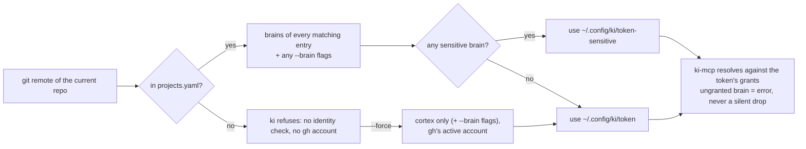

# Projects and brains

`projects.yaml` is the single place that says which projects exist, which brains they feed, and which GitHub identity touches them. It lives in your configuration directory (`deploy/config/` in the harness checkout, or the directory `ki setup config` links; see [laptop setup](laptop-setup.md#where-the-config-lives)). Ingest reads it in the cluster; `ki` reads it on your laptops. Project repos contain nothing harness-related.

Validate after every edit (runs the Go and the Python validator, which are tested against the same fixtures in `testdata/projects/`):

```bash
make validate-projects   # or: ki validate
```

## The file

```yaml
sensitive_brains: []             # e.g. [client, client-*]: never in a default scope; need the sensitive token

identities:
  me:
    github_user: alice           # the account gh is logged in as
    email: alice@example.com     # the commit email ki expects
    credential: me               # read-only git token name in the cluster
    ingest: true                 # required: may this identity's repos be ingested?
  client-a:
    github_user: alice-clienta
    email: alice@client-a.com
    credential: client-a
    vault: false                 # never copy this identity's reviews or decisions into the vault
    ingest: true
  employer:
    github_user: alice-work
    email: alice@employer.example
    credential: employer
    vault: false
    ingest: false                # its repos may be scopes for sessions, but never feed a brain

projects:
  - name: acme
    repo: https://github.com/client-a/acme
    identity: client-a
    brains: [acme, voice]    # session scope; cortex is always added
    board: Acme              # GitHub Project that /ki-issue files into
    vault_folders: [acme-co] # more vault folders /ki-recap reads for this project
    # bulk: true             # a large repo: ingest only off-peak, after everything else
    ingest:
      - { path: docs/, brain: acme }
      - { path: docs/patterns/, brain: cortex }   # longest matching path wins

# Optional named views over the projects, brains, boards, and vault folders
# already described above. Cortex is implied in every workspace.
workspaces:
  - name: work
    title: Work
    brains: [acme]
    projects: [acme]
    board: Acme
    vault: [projects/acme/]
```

| Field | Meaning |
| --- | --- |
| `brains` | What agent sessions in this repo can read. Add `voice` where you want `/ki-review` to match your reviewing tone |
| `ingest` | Which paths feed which brain. No rules means the repo is only a session scope and nothing is ingested |
| `identity` | Which GitHub account owns the repo; drives the git token in the cluster and the identity guard on laptops |
| `board` | Optional GitHub Project title for `/ki-issue`; the skills work without one |
| `vault_folders` | Optional list of vault folders under `projects/`, valid names, no duplicates. `/ki-recap` reads the folder named after the project plus these, and only those no other identity's project also claims. No folder is derived from the project name |
| `bulk` | Optional, `false` by default. `true` makes a project off-peak only whatever its size: its ingest waits out `KI_LLM_PEAK_UTC` and a low provider balance, and it syncs after the vault and the other repos (see [Bulk ingest](operations.md#bulk-ingest-speed-and-cost)) |
| `ingest` (identity) | Required on every identity. `false` for an employer or client whose repos must never be ingested: their projects may list `brains` but no ingest rules, enforced by both validators |
| `vault` (identity) | `false` keeps the skills from copying that identity's reviews and decisions into the vault, and `ki recap` refuses that identity |
| `workspaces` | Optional named views. Each workspace lists brains found in its projects, optional project names and board, and vault folders under `projects/` or `diagrams/projects/` that no other workspace equals, contains or sits inside. Brains cannot mix sensitive and non-sensitive entries; `voice` and `security` are refused |

Validation refuses: unknown keys (a typo fails instead of being ignored), unknown identities, an identity without `ingest`, ingest rules under an `ingest: false` identity, brain names outside `[a-z0-9-]`, ingest paths that leave the repo, ingest into a brain not listed in `brains`, one repo under two identities, an empty `branch`, and a project that mixes sensitive and non-sensitive ingest brains. To split one repo across both, list it twice under different names; `ki` merges their scopes.

## How a session gets its scope



A repo that is not in `projects.yaml` never gets "every brain the token grants": `ki` refuses to start there, and with `--force` the session reads cortex only.

Outside a git repo, `ki` resolves the git repos directly under the folder instead: one identity gives that identity and the union of its repos' brains (sensitive ones included, as for a single repo), no mapped repo gives a cortex-only session with no identity, and several identities are refused unless `--identity NAME` picks one, which then gets the identity's non-sensitive brains.

`decisions_for` and `search` may then narrow that resolved set with an optional `brains` argument. A name outside the resolved set is an error, and the argument never adds a brain. See [MCP tools](architecture.md#mcp-tools).

## Adding a project

1. Add an entry to `projects.yaml` (and an identity if it is a new account), then `make validate-projects`.
2. If it uses a new identity, add its read-only git token to the cluster (see [Secrets](self-hosting.md#secrets)), and `ki setup machine` on the laptops that carry it.
3. Merge. The next 5-minute sync picks it up; watch it in the Temporal UI.

## Adding a brain

Brains are cheap: one more graph in the same FalkorDB.

1. Use it in `projects.yaml` (`brains` and `ingest`).
2. Add it to `deploy/config/mcp-config.json` with its graph and the kb-query backend.
3. Add its graph (`brain-<name>`) to `KI_ALLOWED_GRAPHS` for both `kb-worker` and `kb-query` in `deploy/kb/`. `deploy/check.py` derives what both should allow from the MCP config and fails if they disagree.
4. Grant it on the device tokens that should read it (`tokens.json`, see [Operations](operations.md#issue-or-change-a-device-token)).
5. `make test` and merge.

A sub-project of a sensitive brain is not a new brain in this sense: see below. To make another brain opt-in the same way, add it (or a family such as `client-*`) to `sensitive_brains` and mark it `sensitive` in the MCP config.

## Sensitive brains and sub-projects

A sensitive brain is never part of a default scope: a session reads it only when its repo or `--brain` names it, with a separate device token that grants it. This suits regulated client work, where material must stay apart per client or engagement. `client` is the shared sensitive brain in the examples. When the work splits into sub-projects whose material must not mix (different scope, a different stack, separate evidence), each gets its own `client-<sub>` brain.

| Material | Goes to |
| --- | --- |
| Public standards, your checklists, general patterns | `cortex` |
| Shared client design: architecture, controls | `client` |
| One sub-project's scope, stack, gaps, evidence | `client-<sub>` |

`client-*` in `sensitive_brains`, in the MCP config and in the allowed graphs covers every `client-<sub>` brain, so adding a sub-project is one entry in `projects.yaml`:

```yaml
  - name: payments-acme
    repo: https://github.com/<org>/<acme-repo>
    identity: <org-identity>
    brains: [client, client-acme]   # the shared client brain plus this sub-project, never another
    ingest:
      - { path: docs/, brain: client-acme }
```

The name alone makes it sensitive, so a new sub-project is opt-in from the start. A family is never expanded into a default scope: a session reads `client-acme` only when its repo or `--brain` names it, and only with a token that grants it.

## Which machine reads what

Each machine has its own token, and the token's `brains` are the most that machine can ever read. To keep a machine to a few projects, grant only their brains:

```json
{ "id": "laptop-1-sensitive", "brains": ["cortex", "client", "client-*"] }
{ "id": "laptop-2-sensitive", "brains": ["cortex", "client", "client-acme"] }
```

`laptop-1` can work on every client sub-project; `laptop-2` only on `client-acme`, and a session there in another sub-project's repo gets an error, not data. Identities are limited the same way on the laptop side: `~/.config/ki/machine.yaml` (written by `ki setup machine <identity>...`) lists the identities a machine carries, so `ki doctor` expects only their logins and `ki` refuses the other identities' repos. Git access follows the same idea: a machine only has SSH keys and `gh` logins for the accounts it needs. `projects.yaml` itself is in this repo, so every machine with a checkout can see project names, though not their content.

## The vault

Your Obsidian vault is a private repo listed in `projects.yaml` like any other, with ingest rules per folder:

```yaml
  - name: vault
    repo: https://github.com/alice/vault
    identity: me
    brains: [cortex, voice, acme, client, security]
    ingest:
      - { path: engineering/, brain: cortex }
      - { path: reviews/, brain: voice }
      - { path: projects/acme/, brain: acme }
      - { path: projects/client/, brain: client }
      - { path: security/, brain: security }
```

Nobody edits the vault on GitHub. The vault is a git clone on your main machine (`~/notes` in the examples) that Obsidian opens; Obsidian Sync carries the notes to every other device, and git carries them to the cluster. Two things push: `ki vault push` on that machine, and the cluster's `vault-pusher`, which receives the same notes through Obsidian Sync (its device name is a setting, `cluster` by default) and pushes them once nothing has changed for 5 minutes ([decision of 2026-10-23](../decisions/2026-10-23-vault-pusher-in-cluster.md), [Operations](operations.md#vault-pusher)). The worker only clones. Decision records for projects live in the vault under `projects/<name>/decisions/`, never in the project repo. Material of an identity marked `vault: false` never goes into the vault.

`client` sits in the same entry while `sensitive_brains` is empty. The day a brain is listed there, its vault folder needs a second entry for the same repo, because one entry may not mix sensitive and non-sensitive ingest brains; `ki` merges both scopes:

```yaml
  - name: vault-client                  # same repo, second entry: sensitive ingest kept apart
    repo: https://github.com/alice/vault
    identity: me
    brains: [client]
    ingest:
      - { path: projects/client/, brain: client }
```
