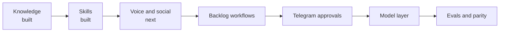

# Roadmap

The harness is built in layers. The knowledge layer comes first because every other layer gets better once agents stop starting cold.

| Stage | Status | Contents |
| --- | --- | --- |
| Knowledge | Built and deployed | Graphiti on FalkorDB, Temporal ingest (quiet period, blobless clones, bulk batches of 16, failed-document isolation, FalkorDB 6.0.3), MCP server, brain scope per device token, central `projects.yaml`, `ki` CLI |
| Skills | Built | `/ki-issue`, `/ki-resolve`, `/ki-burndown`, `/ki-review`, `/ki-debug`, `/ki-decision`, `/ki-recap`, `/ki-diagram`, `/ki-rebase`, `/ki-address` |
| Standards | Built | `standards/common.md`, `go.md`, `python.md`, `bash.md` and templates; this repo follows them, with coverage gates in CI |
| Deploy | Built | Argo CD from your GitOps repo at a release tag, through the configuration repo's overlay; alert rules and nightly backups in your cluster |
| Vault | Built | Private repo, `ki vault push` on your main machine and `vault-pusher` in the cluster (Obsidian Sync to git), `ki vault mcp` for agents, folder-to-brain rules in its `AGENTS.md`; one brain per project or employer, plus security |
| Diagrams | Built | `ki diagram`: tldraw drawings in the vault from specs, hand edits kept, PDFs ([diagrams](diagrams.md)) |
| Sessions | Built | `ki mecca`: one tmux session with a window per agent session, started through `ki`, listed with project, identity and status ([ki-mecca](ki-mecca.md)) |
| Public packages | Built | `pkg/projects`, `pkg/scope` and `pkg/config` are importable by other repos, pinned to a release tag ([go packages](go-packages.md)) |
| Delegation | Built | `ki delegate`: one task headless on Claude Code, Codex, Cursor or agy in its own worktree, one status line back, the vendor picked by the machine's role policy (ordered or round-robin, breaker, daily cap); `--issue` claims the issue so two machines do not start it; `/ki-burndown` runs one per issue from any agent; `ki mecca new <job>` reopens a blocked one; `--when-available` queues a job until a provider is back (`ki queue install` runs the queue every minute) and `ki delegate resume` continues a job that ran out of quota on another provider ([ki delegate](ki-delegate.md)) |
| Voice | Next | `brain-voice` gets the vault's `reviews/` and `writing/` today; still open: more of your own writing and a style guide (#57), per-channel rules (#59), `draft_in_my_voice` (#58) |
| Social | Planned | LinkedIn posts and X adaptation in your voice (#61); finding X and Reddit threads later; X after approval, LinkedIn and Reddit posted by you |
| Backlog | Planned | `/ki-triage`: prioritisation rules in the vault; weekly grooming and sprint proposals on GitHub Projects, applied in one approved batch |
| Reports | Planned | `/ki-report`: sprint and period reports from GitHub (#81) |
| Telegram | Planned | Approvals and agent questions as Temporal signals from a Telegram bot (#64); the same bot drafts Telegram replies (#63) |
| Replies | Planned | Slack (#60), email (#62), Telegram and WhatsApp (#63) replies in your tone, personal channels only, always sent by you or after approval |
| Model layer | Planned | Provider routing across models |
| Evals | Planned | 20 to 30 golden questions per brain, run weekly against each model in use |
| Self-hosting | Later | Rent a GPU to compare against Claude Haiku 5.5, then decide between a GPU server and a home box |
