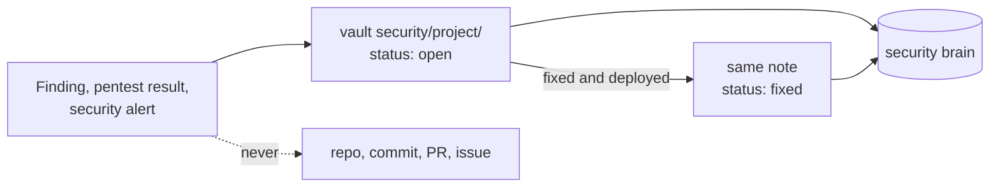

# Security and brain separation

Every brain lives in one FalkorDB in namespace `harness`. What keeps a client's brain away from a machine or session that should not see it is scope, enforced on the server and failing closed: a mistake must refuse, not leak. These are all the controls, layer by layer.

The harness holds no regulated data, so it is not in scope of a compliance regime such as a payment-card standard. `sensitive_brains` is empty by default and one device token is simpler. The sensitive-brain machinery below stays in place for the day a client's material goes in, which suits regulated client work: list the brain, give it a separate token.

```mermaid
flowchart TB
    subgraph edge["Edge"]
        e1["Reachable only over the VPN (the TLS proxy's allow list)"]
        e2["Bearer token per device, SHA-256 stored, must expire"]
    end
    subgraph scope["Scope"]
        s1["Token grants a fixed set of brains"]
        s2["Ungranted brain requested = error, not a silent drop"]
        s3["Sensitive brains only when named, separate sensitive token"]
        s4["Sensitive access audit-logged: token, brain, tool; never the query"]
        s5["Unmapped repo: ki refuses, or cortex only with --force"]
        s6["Machine file: ki acts only as the identities this laptop carries"]
        s7["decisions_for and search brains narrow only; a name outside the resolved scope is an error"]
    end
    subgraph data["Data"]
        d1["Workers and kb-query refuse graphs outside KI_ALLOWED_GRAPHS"]
        d2["Scanner rejects card numbers and secrets before any model sees them"]
        d3["Document text never enters Temporal history, errors included"]
        d4["Symlinks in a cloned repo are never followed"]
        d5["Identities marked ingest: false can never feed a brain"]
    end
    subgraph net["Network"]
        n1["Default-deny ingress and egress in harness, one rule per path"]
        n2["Only kb pods reach FalkorDB on 6379, only Traefik its browser on 3000; only ki-mcp reaches kb-query"]
        n3["A ki-mcp consumer reaches ki-mcp on 8787 and nothing else in harness; CI fails on any wider rule"]
    end
    edge --> scope --> data --> net
```

## Control reference

| Control | Where | Fails how |
| --- | --- | --- |
| VPN-only hosts | the TLS proxy in front of Traefik for the ki-mcp, Temporal UI and FalkorDB Browser hostnames, plus a blackbox probe alert | 403 from outside the VPN |
| Device tokens with expiry | `pkg/config` | 401 |
| Scope resolution | `pkg/scope` | Error naming the brain; no backend is called |
| Optional `brains` on `decisions_for` and `search` | `internal/server`, after `scope.Resolve` | Error naming the brain; no backend is called; the list cannot add a brain |
| Brain families (`client-*`) | `pkg/scope`, `kb/src/ki_kb/brains.py` | Members are sensitive by name and never in a default scope; a grant for one client does not cover another |
| Brain wiring | `deploy/check.py` in CI | CI fails if a brain's sensitivity, backend and allowed graphs disagree |
| Allowed graphs | `kb/src/ki_kb/settings.py` | `GraphNotAllowedError`, 403 from kb-query |
| Pre-ingest scanner | `kb/src/ki_kb/scanner.py` | Matching section skipped; the rest of the file is ingested. Reported by count only for sensitive projects |
| No symlinks out of a clone | `collect_docs` in `kb/src/ki_kb/activities.py` | Symlinked files are skipped, so `docs/x.md -> /proc/self/environ` reads nothing |
| Fixed-message errors | `_safe_error` in `kb/src/ki_kb/activities.py` | Temporal sees project, error type and (non-sensitive only) path; the rest stays in the pod log |
| Stranded graphs | `load_projects` in `kb/src/ki_kb/activities.py`, `ki_kb.admin forget-stranded` | Every sync stops until a graph that is no longer served is cleaned up |
| Identities that may not be ingested | `ingest: false` in both validators | Config rejected |
| Unmapped repos | `ki` | Refuses; `--force` gives cortex only |
| Default-deny network | `deploy/network-policy.yaml`, `deploy/check.py` | CI fails without it; pods reach only what a rule opens |
| A ki-mcp consumer reaches ki-mcp only | `ki-mcp-from-consumers` in `deploy/network-policy.yaml`, `check_consumers` in `deploy/check.py` | CI fails if any policy, directly or through a broad selector, an `ipBlock` over private ranges or a rule without peers or ports, lets a consumer reach FalkorDB, kb-query, the worker or any harness pod other than ki-mcp on 8787, or gives a consumer egress beyond that, DNS in `kube-system` and the internet on 22 and 443 |
| Released images only | `deploy/check.py` | CI fails on `:main`, `:latest` or a SHA tag; image names start with `kio`, plus any prefixes listed in `KI_IMAGE_PREFIXES` (comma-separated, `[a-z0-9-]+`) |
| Secrets from a secrets manager | its operator, mapped in your GitOps repo | Nothing secret in git |
| Identity guard | `ki` | Refuses to start a session that would commit as the wrong person |
| Machine file | `~/.config/ki/machine.yaml`, written by `ki setup machine <identity>...` | `ki` refuses a repo of an identity this machine does not carry (unless `--force`); `ki doctor` expects only the carried logins |
| Edits-mode allow-list | `delegate.allow` in `machine.yaml`, validated in `internal/ki/machine.go`; agy's rules merged by `internal/ki/agy.go` | A wildcard, an empty entry, a duplicate or anything wider than `binary subcommand` is refused; agy's settings only ever gain `command(<entry>)` rules, and a settings file that is not JSON is left alone |
| Harness alerts | Temporal ServiceMonitors, `redis_exporter` sidecar on FalkorDB (port 9121 opened to Prometheus only), rules in your monitoring stack ([operations](operations.md#alerts)) | Sync run failed or none succeeding, FalkorDB down, empty or without AOF, the extraction provider unreachable |

The trade-off of one FalkorDB: anything holding its password can read every graph. Only the worker and kb-query mount it, and only they can reach FalkorDB on the network. FalkorDB Browser is the one other way in: it runs inside the FalkorDB pod, is reachable only over the VPN, and asks for that password on login.

A ki-mcp consumer, such as a dashboard or an agent runner, runs in namespace `harness` with the pod label `app.kubernetes.io/component: ki-mcp-client` and reads the brains through ki-mcp with its own device token, so scope applies to it like to any device. The network gives it ki-mcp on 8787 and nothing else in the harness: `ki-mcp-from-consumers` is the one ingress rule that admits it, and `deploy/check.py` checks every policy from both ends (ingress on a harness pod, egress on a consumer) so a later rule cannot open FalkorDB or kb-query to it. A consumer's own egress (ki-mcp, DNS, git over SSH, HTTPS) ships with its manifests; anything wider fails the same check when it is rendered with the harness.

## What the scanner matches

The pre-ingest scanner (`kb/src/ki_kb/scanner.py`) is a guardrail, not a DLP product. Each section is scanned and only a matching section is rejected, and it is reported by its section key. Each rule says what it flags and what it deliberately leaves alone, because every false positive costs a section that never reaches the brain.

| Rule | Flags | Deliberately does not match |
| --- | --- | --- |
| `card-number` | A Luhn-valid run written like a card: 13 to 19 contiguous digits, or grouped 4-4-4-4, 4-4-4-4-3 or 4-6-5 with one separator (space or hyphen) | Other groupings (phone numbers, version stamps); a run preceded by `+`, `.`, `=` or `CASE ` (international numbers, `eventId=` parameters, dotted versions, support case numbers); a run of one repeated digit |
| `national-id` | The Emirates ID shape `784-NNNN-NNNNNNN-N` | Other national ID formats |
| `private-key`, `aws-access-key`, `github-token`, `slack-token`, `anthropic-key`, `openai-key` | The published formats of each | Anything that only looks similar |
| `jwt` | Three dot-separated base64url segments starting `eyJ`, including a signed `?jwt=` URL | A bare `eyJ` string |
| `assigned-secret` | `password`, `passwd`, `secret`, `api_key` or `token` assigned a quoted value of 8 or more characters | A quoted value containing `<`, `>`, `[`, `]`, `$` or `{`, which is a placeholder such as `'[your-token]'` or `"${TOKEN}"` |
| `assigned-secret-unquoted` | The same keys, as part of a longer name (`FALKORDB_PASSWORD=...`), assigned an unquoted value of 8 or more key characters with at least one digit | Keys ending in `Id`, `Name`, `Arn`, `Ref` or `Path` in any case or separator (`secretsManagerName`, `secret_id`), because they name a secret rather than hold one; values starting `arn:`; placeholders (`<x>`, `$VAR`, `{{ x }}`); prose and values without a digit |

A key such as `secretsManagerName` is skipped by its last word, so a real credential held in a key that happens to end that way is not caught; the other rules still apply to its value.

## Security material has its own brain

Findings, pentest results, security incidents and how each was fixed live in the `security` brain, fed by the vault's `security/` folder ([decision of 2026-10-22](../decisions/2026-10-22-security-brain.md)). A finding is written as soon as it is confirmed, with `status: open`, and the same note moves to `status: fixed` once the fix is deployed, so the brain answers both "have we seen this before" and "how did we fix it". General engineering practice stays in cortex.

Sessions read it only where a project lists `security` in its brains, or with `ki --brain security`. It shares FalkorDB with every other brain, so anything holding the FalkorDB password, FalkorDB Browser included, can read open findings, and the extraction model sees their text during ingest. That is the accepted cost of one instance; a separate instance stays the option for a client whose findings come with their own requirements.

## What never goes into this system

This is one person's brain, used on every project that person works on, employer and client work included; an employer's brain holds work knowledge like any other project brain. The limits are about kinds of data, not about whose project it is:

- Cardholder data, credentials or secrets, in any brain.
- Content from a sensitive brain in cortex, or in a vault folder that feeds a non-sensitive brain.
- Details of open vulnerabilities, pentest reports and exploit steps anywhere but the `security` brain and the vault's `security/` folder.

## Before client material goes in

1. Check the client agreement allows its material on this infrastructure and with the extraction provider (Anthropic today, see docs/models.md); documents are sent to it during ingest.
2. Give each client its own `client-<client>` brain and grant it only to the devices that work for that client.
3. Issue sensitive tokens with short expiries.
4. Switch `harness` pod security from `baseline` to `restricted` once the FalkorDB image is confirmed to run as non-root.
