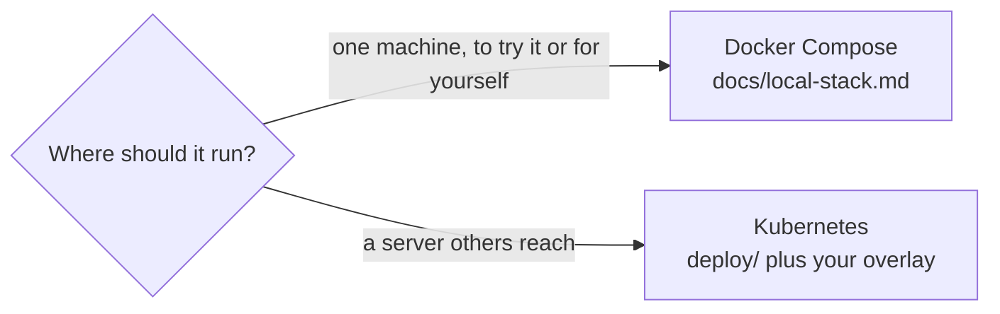

# Self-hosting

The knowledge base is optional: `ki` runs without it, with identity and instructions only. To run one yourself there are two paths.



## The Compose stack

The main path. [Local stack](local-stack.md) runs FalkorDB, a Temporal development server, the ingest worker, kb-query, the embedding service and ki-mcp on one machine, with ki-mcp on a loopback port. Setup is `deploy/compose/setup.sh`, a model file and a read-only GitHub token; the guide covers the security model and the smoke test. Start there unless you need more than one machine to reach the knowledge base.

## Kubernetes

[`deploy/`](../deploy/README.md) is a kustomization for the `harness` namespace, and Helm values plus a Postgres for Temporal in the `temporal` namespace. Nothing in it is tied to a cloud or a GitOps tool: apply it with `kubectl apply -k`, or let Argo CD, Flux or any other tool sync it at a release tag.

What the cluster must provide:

- A CNI that enforces `NetworkPolicy`. The namespace is closed by default, in and out, and one rule opens each path; on a cluster that ignores policies the default-deny is not in force.
- An ingress controller of your choice for ki-mcp (and optionally for the Temporal UI and FalkorDB Browser), described [below](#ingress).
- A way to create the Kubernetes secrets listed [below](#secrets) from your own secrets manager.
- Outbound HTTPS from the `harness` namespace to the git host that holds your projects, to the model provider's API and, once, to wherever the embedding model is downloaded from; and a registry the nodes can pull your images from.
- Optional: a Prometheus stack that selects `ServiceMonitor`s in every namespace, for the metrics and alerts in [Operations](operations.md#alerts).

### Your own overlay

Do not edit `deploy/`. A configuration of your own is a directory started from [`examples/config/`](../examples/config/): the five configuration files plus a `kustomization.yaml` that references a released version of this repository and patches in what is yours (graphs, hostnames, images). It can live in any repository or folder; [deploy/README.md](../deploy/README.md#your-own-configuration-as-an-overlay) lists every setting it carries. The same directory is what `ki setup config` links on a laptop.

### Images

The base pulls `ghcr.io/kislow/kio-kb` and `ghcr.io/kislow/kio-mcp` at the release tag, so a cluster that can reach ghcr.io needs nothing more. To run them from a registry of your own, mirror the release images to it (or let your fork's `publish` workflow push there: by default to `ghcr.io/<your-owner>`, or optionally to your own ECR, see [Operations](operations.md#releases)), then set `images:` in your overlay: `name` is the base's full image name, `newName` is your registry's, and the release tag stays. The vault image has no public copy, see [Vault](vault.md). Your cluster's nodes need to pull from the registry, with a pull secret on the `harness` service accounts if it is private. `make check-manifests` is this repository's check of the base and the example overlay; it accepts `ghcr.io/<owner>/kio-*` and `<account>.dkr.ecr.<region>.amazonaws.com/kio-*` at a semver tag and nothing else. It does not read your overlay, so render yours with `kubectl kustomize` before applying it.

### Secrets

Nothing secret is committed. Each secret below is created by whatever you use to keep secrets (an operator that syncs from a secrets manager, sealed secrets, SOPS), with these names and keys, because the manifests refer to them.

| Secret | Namespace | Key | Value |
| --- | --- | --- | --- |
| `kb-secrets` | `harness` | `falkordb-password` | a random password |
| | | `llm-api-key` | API key of the extraction provider named in `models.env` |
| | | `embedding-api-key` | a random string; the embedding pod will not start without it |
| `kb-git-tokens` | `harness` | one per `credential` in `projects.yaml` | a read-only token for that git host: contents, plus pull requests if you collect reviews, with an expiry |
| `ki-mcp-tokens` | `harness` | `tokens.json` | the [device token](#device-tokens) list |
| `temporal-db-secret` | `temporal` | `password` | a random password |
| `vault-deploy-key` | `harness` | `id_ed25519` | only with the optional [vault pusher](vault.md): an SSH key allowed to push to the vault repository |

#### Device tokens

One token per device. A token's `brains` decide what that machine can read, so a machine that works on two projects gets only those two projects' brains. Only the SHA-256 of each token is stored; the token itself goes to the device, in `~/.config/ki/token`.

```bash
secret="$(openssl rand -hex 32)"
printf '%s' "$secret" | shasum -a 256      # the sha256 for tokens.json
```

`tokens.json` follows [`cmd/ki-mcp/tokens.example.json`](../cmd/ki-mcp/tokens.example.json):

```json
[
  { "id": "alice-laptop", "sha256": "<hash>", "brains": ["cortex", "acme"], "expires": "2027-04-01T00:00:00Z" }
]
```

Store the whole file as one item in your secrets manager. ki-mcp reads it at start: after changing it, restart the deployment (`kubectl -n harness rollout restart deployment/ki-mcp`). [Operations](operations.md#issue-or-change-a-device-token) has the same steps for later changes.

### Ingress

ki-mcp listens on 8787 and speaks MCP over HTTP with server-sent events. The base routes it with a Traefik `IngressRoute` (`deploy/mcp/ingressroute.yaml`, entrypoint `web`) on a placeholder hostname, and one network policy, `ki-mcp-from-traefik`, lets pods labelled `app.kubernetes.io/name: traefik` in the `traefik` namespace reach it. To use another ingress:

1. Remove the `IngressRoute` in your overlay and add your controller's own route (an `Ingress`, a Gateway API `HTTPRoute`) to `ki-mcp` port 8787, for the paths `/mcp` and `/healthz`.
2. Replace the policy's `from` selectors with those of your controller's pods.
3. Turn response buffering off for that route, or the event stream stalls.
4. Terminate TLS in front of it, and set the same hostname as `knowledge_base.url` in your `config.yaml`.

Keep the hostname reachable only from networks you trust. Every request also needs a device token, but a token is not a reason to publish the endpoint. The same goes for the Temporal UI and FalkorDB Browser, which have no login of their own beyond FalkorDB's password: leave them unrouted and use `kubectl port-forward` unless you can restrict them.

### Apply and verify

Apply in this order, each step ready before the next:

1. The secrets above.
2. `deploy/temporal/postgres.yaml` in namespace `temporal`.
3. The Temporal Helm chart (written against 1.7.0) with `deploy/temporal/values.yaml`, plus your own UI hostname if you route one. Postgres comes first because the chart's schema job runs before the rest of the release.
4. Your overlay, which brings in `deploy/` at the release tag.

```bash
kubectl -n temporal get pods         # temporal-*, postgres-0 Running
kubectl -n harness get pods          # falkordb-0, kb-worker, kb-query, embeddings, ki-mcp Running
curl https://<ki-mcp host>/healthz   # answers ok
```

Then on a laptop `ki doctor` should be green. In the Temporal UI the schedule `ki-sync-projects` starts a `SyncProjects` run every five minutes (`KI_SYNC_EVERY_MINUTES`); the first run backfills every project with ingest rules.

### Upgrades and backups

To upgrade, move the release tag in your overlay and in the Temporal step, and apply again. [Operations](operations.md) covers watching ingest, rotating tokens, rebuilding a brain, the metrics and alerts, and the [backups](operations.md#backups) worth taking: the FalkorDB data directory and the two Temporal databases. The graphs are a rebuildable index of git, so a backup mainly saves re-extraction time and cost.

## Where next

- [Projects and brains](projects-and-brains.md): what to put in `projects.yaml`.
- [Laptop setup](laptop-setup.md): point a machine at your knowledge base.
- [Security and brain separation](security.md): the controls that keep brains apart, and which of them you must not weaken.
