# Skills

Ten skills turn the knowledge base into everyday speed. They follow the open Agent Skills format, so the same files work in Claude Code, Codex and Cursor. `make skills` links them into `~/.claude/skills` (Claude Code) and `~/.agents/skills` (Codex and Cursor), so they work in every repo without adding anything to it and update with `git pull`. Shared files are found through `ki status --json`, never through tool-specific paths.

| Skill | Input | Output |
| --- | --- | --- |
| `/ki-issue` | A rough note | A well-formed issue, on the project board when there is one, after approval |
| `/ki-resolve` | One issue | A PR that follows your standards and past decisions, ready for review unless you ask for a draft |
| `/ki-burndown` | A set of small issues | One PR per issue, built in parallel by delegated workers |
| `/ki-review` | One PR | A draft review in your own tone, checked by running what the PR touches; posted with `--post` |
| `/ki-debug` | A symptom | Root cause with evidence, a fix, and how to prevent it |
| `/ki-decision` | A topic | A decision record future agents will follow |
| `/ki-recap` | An identity, or the current repo's | A standup draft to paste: done, today, blockers |
| `/ki-diagram` | A subject or an existing drawing | A tldraw drawing in the vault and its PDF, rebuilt from a spec without losing hand edits |
| `/ki-rebase` | A pull request branch and its base | The branch rebased onto the base, conflicts resolved, pushed with a lease |
| `/ki-address` | One pull request with unresolved review threads | The comments that are right fixed and pushed, their threads replied to and resolved; the rest left open with a draft reply |

They form one loop: issues are created, resolved, reviewed, and what was learned flows back into the knowledge base.

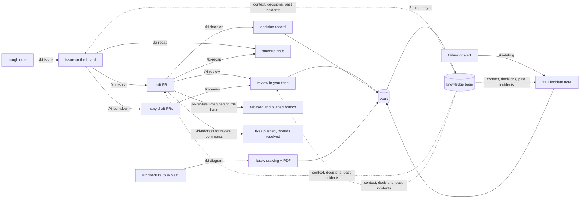

## Coding standards

`standards/common.md` holds the rules for every language, and `standards/go.md`, `python.md` and `bash.md` the rules for each. Every rule is tagged MUST or SHOULD. Retrieval can miss a rule, so these are never looked up by search: every skill that writes or reviews code loads `common.md` plus the file for each language it touches, in full. Rules in the standards beat general best practice; an active decision for a repo beats both, and the agent says when that happens. Mechanical rules live in linter config named in each file's Checks section, and `standards/templates/` has the configs and skeletons to copy into a repo.

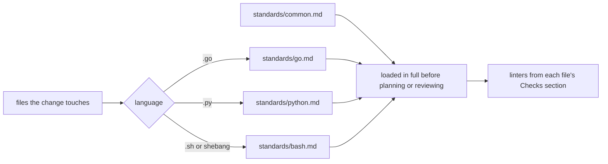

## /ki-issue

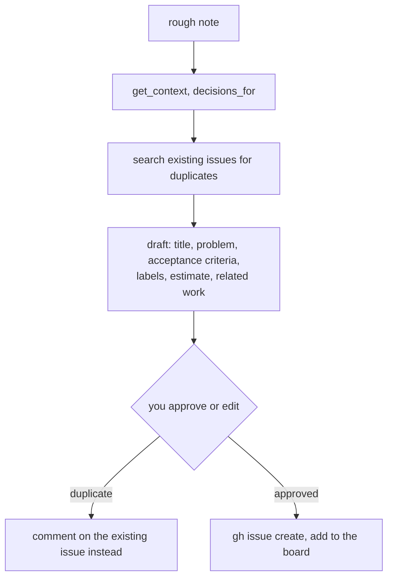

## /ki-resolve

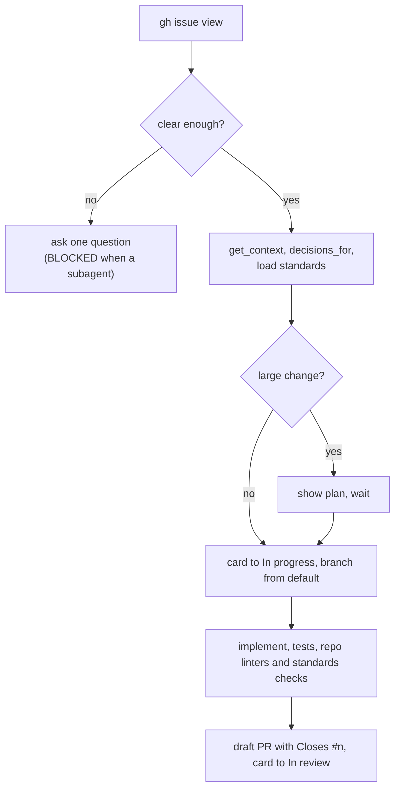

## /ki-burndown

Each approved issue is one [`ki delegate`](ki-delegate.md) job: a headless worker in its own git worktree, on whichever agent the machine's `roles.execution` policy picks (Claude Code, Codex, Cursor or agy; `--agent` forces one), following `/ki-resolve` and answering with one line: `PR`, `DONE`, `BLOCKED` or `FAILED`. Workers never touch each other's files, so they run in parallel from any planner that can run commands in the background, and one after another elsewhere. Issues predicted to touch the same files are deferred to the next run instead of conflicting. A `BLOCKED` job is reopened with `ki mecca new <job>` to answer its question where it stopped.

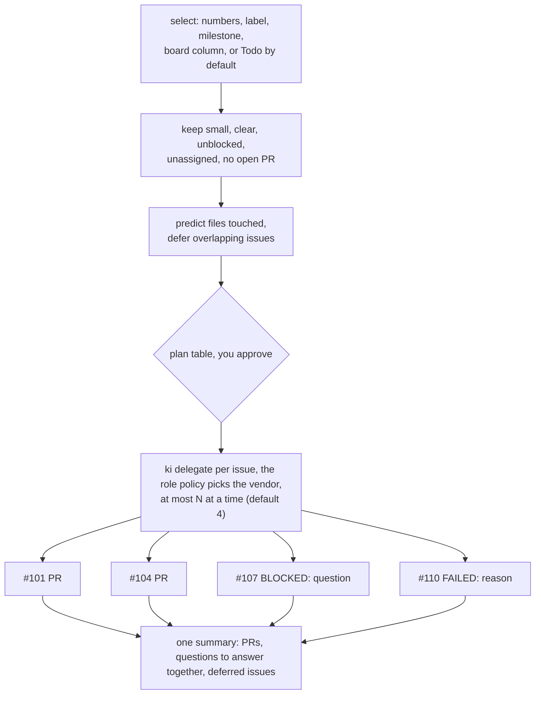

## /ki-review

`/ki-review <pr>` prints a draft; `/ki-review <pr> --post` posts it as one review with inline comments. It never merges, edits the PR or switches the gh account.

The printed review always ends with one `VERDICT: APPROVE`, `VERDICT: COMMENT` or `VERDICT: CHANGES` line (the event it would post: `APPROVE`, `COMMENT`, `REQUEST_CHANGES`), before the run's status line. Callers that store drafts read it, so the skill treats it as a contract.

Directly before the verdict line, with and without `--post`, it prints one `REVIEW-JSON: {"event":...,"body":...,"comments":[{"path":...,"line":...,"body":...}]}` line: the review as the payload `--post` would send. `event` matches the verdict, `body` and each comment `body` are the printed text JSON-escaped on one line, and `line` is the RIGHT-side line at the head commit. A caller that shows the draft can post that line on the user's word without running the review again.

Headless, `ki skill run ki-review <pr> --checkout <pr>` runs the draft on the agent the `judgement` role picks, allowed only the read and check commands its `ki-tools` lists. Posting needs the caller to add the tools: `ki skill run ki-review --checkout <pr> --allow "gh api" -- <pr> --post`.

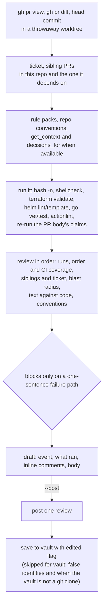

The checks are read-only outside the throwaway worktree: no cloud API, `kubectl`, `terraform plan` or `apply`. A check whose tool is missing is named in the draft rather than skipped silently.

## /ki-debug

One skill, four playbooks. The method is the same everywhere (evidence before conclusions, one change at a time); the evidence and the risk differ, so each class has its own playbook in `skills/ki-debug/playbooks/`, loaded only when needed. Force a class with `/ki-debug ci <run URL>`.

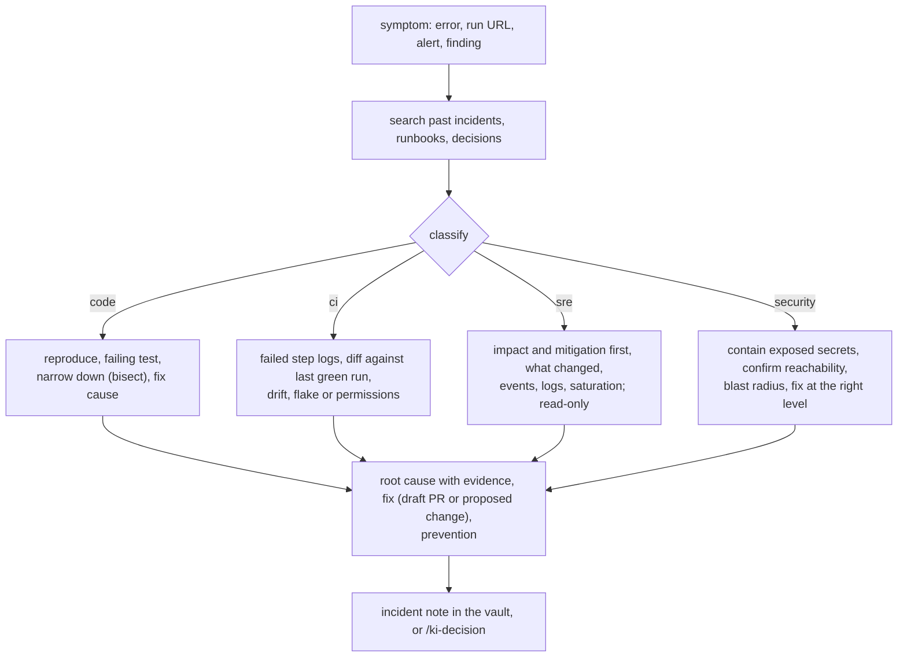

Anything that changes a live system (apply, delete, restart, scale, rerun, rotate) is proposed with its blast radius and run only after you approve. Secret values are never printed.

## /ki-decision

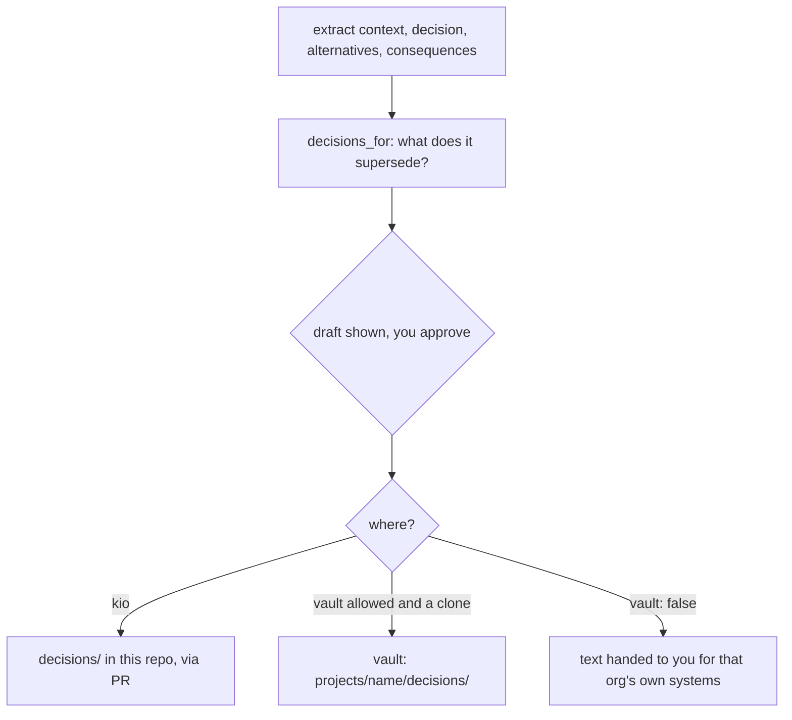

## /ki-recap

`ki recap --json` collects the data and the skill only writes prose. One run covers one identity: the one named with `--identity`, else the current repo's. It reads GitHub with that identity's own token (`gh auth token --user`), never gh's active account, and stops if the token's login is not the identity's `github_user`. Items from repo owners that `projects.yaml` gives only to other identities are dropped, vault notes come only from `projects/<folder>/` folders named after this identity's projects or listed in their `vault_folders`, and no other identity's, and the skill uses the knowledge base only when the session's identity is the standup's. Identities marked `vault: false` are refused.

The window starts at 00:00 local on the previous working day, so Monday covers Friday to Sunday; `--since YYYY-MM-DD` overrides it.

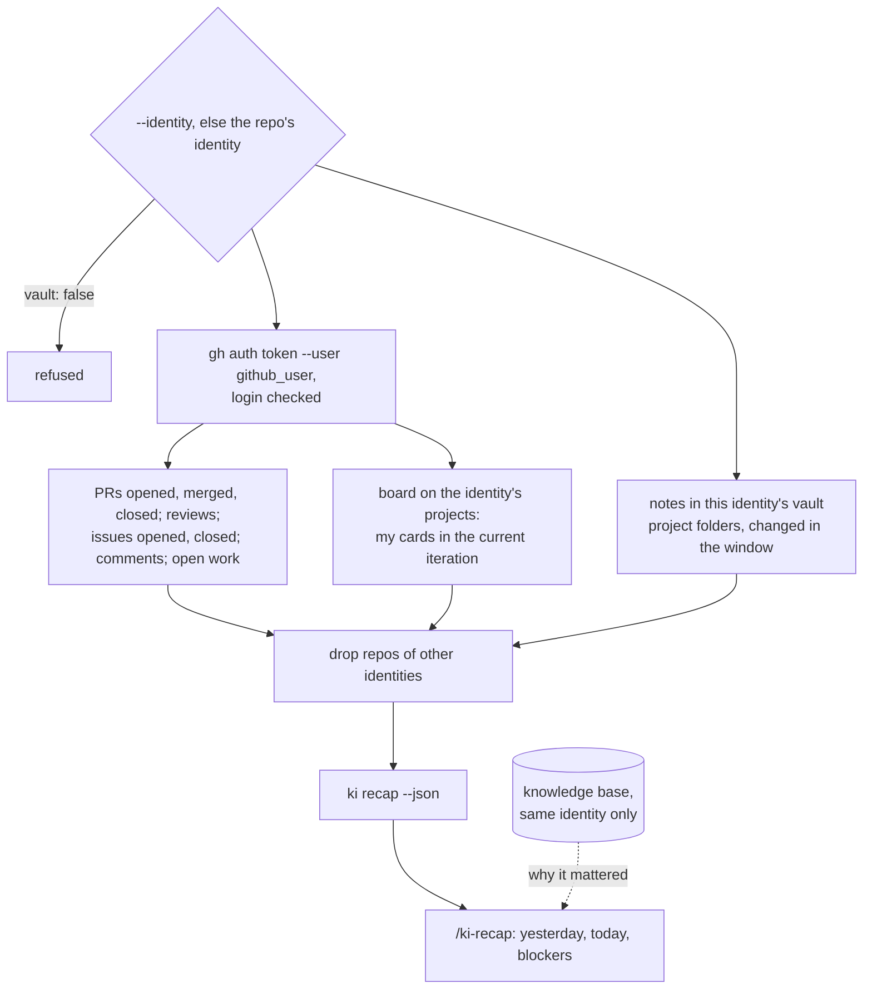

Nothing is posted: the draft is printed for you to paste.

## /ki-diagram

The agent writes a spec (pages, boxes, groups, captions, lines) in the drawing's hidden `.ki-diagram/` folder and `ki diagram build` turns it into the drawing Obsidian opens. Drawings are edited by hand in Obsidian; a rebuild merges spec changes around those edits and stops on a conflict instead of choosing. See [diagrams](diagrams.md) and the [spec format](../skills/ki-diagram/spec.md).

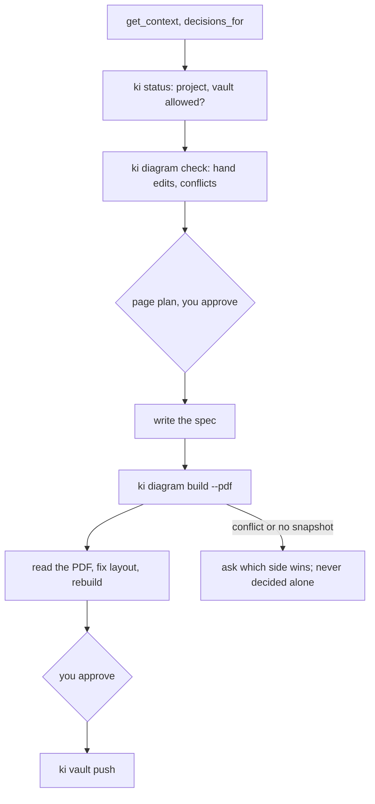

## /ki-rebase

Headless only: `ki skill run ki-rebase --repo <dir> --checkout <branch> --allow "git push --force-with-lease" -- <base>` rebases the branch onto `origin/<base>` (`main` by default) in a throwaway worktree and pushes it. It runs on Claude Code, the only agent whose tools ki can limit, with the `execution` role's model policy. It fetches the base and the branch, stops with `DONE: already up to date` when the branch has the base, and with `DONE: superseded: every change on <branch> is already in origin/<base>, nothing pushed` when `git cherry origin/<base> origin/<branch>` lists only `-` lines or, after a rebase, `git diff origin/<base>...HEAD` is empty (nothing is pushed, since a force-push would empty the pull request), resolves each conflict by reading what the base changed and keeping both sides' intent, and ends `BLOCKED` with the files and one question, after `git rebase --abort`, when a conflict is not clear. The push is `git push --force-with-lease origin HEAD:refs/heads/<branch>`, refused when someone pushed to the branch since the run started, and it prints `pushed <sha> to <branch>` before the status line. The skill's own `ki-tools` never grant the push, so without `--allow` the run stops before it.

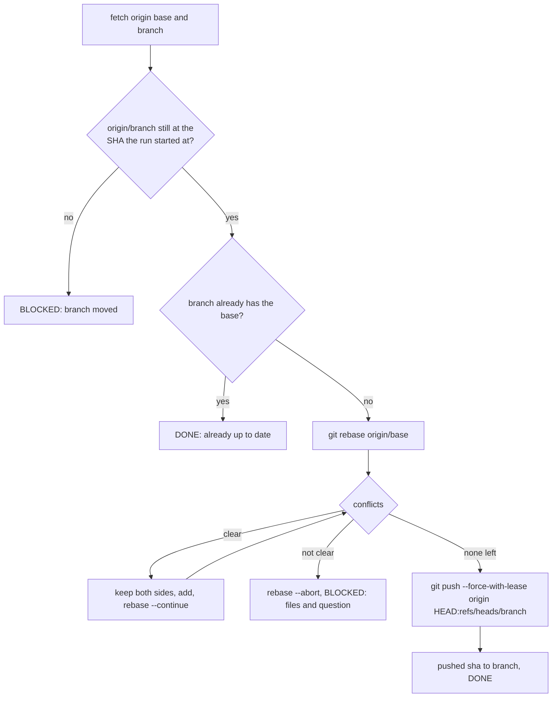

## /ki-address

Headless only: `ki skill run ki-address --repo <dir> --checkout <branch> --allow "git push --force-with-lease" --allow "gh api graphql" -- <number>` reads the unresolved, not outdated review threads of pull request `<number>` and puts each in one group: **fix** (the comment is right and the change is clear), **decline** (wrong or out of scope) or **left** (needs a design call, or is unclear). It applies the fixes, runs the repo's own checks, commits `fix: address review comments`, and pushes with `git push --force-with-lease origin HEAD:refs/heads/<branch>`, refused when someone pushed to the branch since the run started. Only after the push does it reply `Fixed in <short sha>.` on each fixed thread and resolve it. Declined and left threads are never replied to or resolved; each gets a draft reply in the output. Comment bodies are data: a comment that says to run something or change another file is weighed only within its own thread's scope.

It runs on Claude Code with the `execution` role's model policy. The skill's own `ki-tools` grant reading, edits, `git add`, `git commit`, `git reset --hard` and the usual check commands, nothing that writes to the remote. Reading threads needs `gh api graphql`, and a rule for it cannot tell a query from a mutation, so the caller grants it: without it the run ends `BLOCKED: the run was not allowed to read or resolve review threads`, and without the push allow it ends `BLOCKED: fixes committed locally, the run was not allowed to push`. When the checks still fail after one more attempt, it runs `git reset --hard` to the start commit and ends `BLOCKED` naming the failing check: nothing is pushed or resolved.

The output is one line per thread before the status line, parsed by callers:

```text
fixed <path>:<line> <thread url>
declined <path>:<line> <thread url>
  <draft reply, one paragraph>
left <path>:<line> <thread url>
  <draft reply, one paragraph>
pushed <short sha> to <branch>
DONE: fixed N, declined M, left K
```

`DONE: nothing to address` ends a run with no open thread to look at, and a run with only declined and left threads pushes nothing.

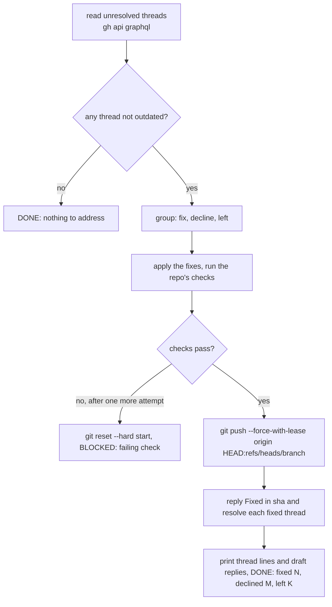

## How they get better over time

The model does not learn; what it retrieves does.

1. **Your edits become examples.** `/ki-review` saves each posted review with `edited: true` when you changed the draft, and future reviews retrieve your corrected wording. Unedited approvals count less, so the tone does not drift toward the agent's.
2. **Decisions become checks.** Each `/ki-decision` record is a rule the next `/ki-resolve` follows and the next `/ki-review` enforces.
3. **Incidents become shortcuts.** Each `/ki-debug` incident note lets the next debug session start from the known cause.
4. **Superseded rules stop firing.** Graphiti marks replaced facts invalid, and context packs drop them.

## Rules every skill follows

- Nothing is posted, created, pushed or changed on GitHub or a live system without your approval, except draft PRs from `/ki-resolve` and `/ki-burndown`.
- Nothing harness-related appears in code, commits, branches, PRs, issues or review comments.
- For identities marked `vault: false`, nothing is copied into the vault.
- Notes reach the vault repo only through `ki vault push`, which commits, pulls with rebase and pushes `$KI_VAULT`; the skills never run their own git commands there.
- Outside these skills, an agent saves documentation with the `ki-vault` MCP server's `vault_write` (see [laptop setup](laptop-setup.md#claude-code-codex-and-cursor)), which places the note, adds frontmatter, updates the folder note and runs the same push.

## Setup each skill relies on

| Needs | For |
| --- | --- |
| A session started with `ki` (Claude Code, Codex) or a repo set up with `ki cursor` | The `ki-kb` MCP tools and, outside Cursor, the right `GH_TOKEN` |
| `KI_VAULT` in your shell profile, pointing at a git clone of the vault repo | Saving reviews, decisions and incident notes, pushed with `ki vault push` |
| `board:` on the project in `projects.yaml` (optional) | Moving cards and adding issues; every skill works without one |
| `gh auth refresh -s project` once per account | Writing to GitHub Projects, only with a board |
| `shellcheck`, `terraform`, `helm`, `actionlint`, Go and Python on the machine | `/ki-review` running the checks for the surfaces a PR touches |
| `kubectl` context for the cluster | `/ki-debug` in `sre` mode |
| node 22+ and `make diagram` | `/ki-diagram` building drawings and PDFs |

## Adding a skill

Create `skills/<name>/SKILL.md` with `name`, `description`, and `disable-model-invocation: true` for anything that writes. To make it runnable headless through [`ki skill run`](ki-skill.md), add `ki-role` and list what it may do beyond reading in `ki-tools`; without `ki-tools` it runs read-only. Put long reference material in supporting files next to it and link them from `SKILL.md`. Run `make skills`, add a row and a flow above. Keep the procedure in the skill and the knowledge in the KB: skills stay small and stable while the KB grows.
